**Built in migration `V34__retail_cash_book.sql` (issue #147).** Flyway runs with `outOfOrder` off, so
the number is the next free one above every open branch (V24 to V28 were held by other open pull
requests when it was written); the owner session renumbers it at merge time if another lands first.
This section is its specification. # 6. Database Design

**Status:** Draft · **Owner:** Hillary

## 6.1 Overview

One PostgreSQL 16 database per environment, one shared schema (`public`), every tenant's
rows in the same tables, isolated by row-level security (ADR-003). Money is integer minor
units and every financial event posts to a double-entry general ledger (ADR-004).

This chapter is the logical data model the migrations implement. It is written in
PostgreSQL types. The physical schema is owned by Flyway SQL migrations in
`backend/src/main/resources/db/migration` (ADR-010), applied as `bms_owner` by the one-shot
migrate container (ADR-006); section 6.9 lists which tables exist so far. A schema drift test
will compare the migrated database with this chapter's table list.

Requirement IDs in the Notes columns point to chapter 3.

## 6.2 Conventions

### 6.2.1 Naming

- Tables are plural snake case. Core tables have no prefix. Tables owned by a vertical
  module are prefixed with the module key: `lending_members`, `lending_loans`.
- Money columns end in `_minor` (`bigint`, minor units) and sit next to a `currency
  char(3)` column on the same row. The only exception is `journal_lines.debit` and
  `journal_lines.credit` (ADR-004).
- Rate columns end in `_bp` (`integer`, basis points).
- Foreign key columns end in `_id`. User references end in `_by` (`created_by`) or
  `_user_id`.
- Enumerations are `text` with a `CHECK (col IN (...))` constraint, not native enum
  types, so adding a value is a plain migration. The allowed values are listed in this
  chapter in square brackets.

### 6.2.2 Standard columns

Every tenant-owned table carries these unless stated otherwise. Tables below list only
their own columns and say "(std)".

| Column | Type | Notes |
|---|---|---|
| `id` | `uuid` | Primary key, generated by the application (UUID v4 or v7). |
| `tenant_id` | `uuid NOT NULL` | FK `tenants(id)`. RLS key. Leads every index. |
| `created_at` | `timestamptz NOT NULL DEFAULT now()` | UTC. |
| `updated_at` | `timestamptz` | Set on every update. Absent on append-only tables. |
| `version` | `integer NOT NULL DEFAULT 1` | Optimistic concurrency on mutable master data (chapter 7 section 7.9). Absent on append-only tables. |

And these constraints:

- `UNIQUE (tenant_id, id)`, so children can reference `(tenant_id, x_id)`.
- Every reference to another tenant-owned table is a composite foreign key
  `FOREIGN KEY (tenant_id, x_id) REFERENCES x (tenant_id, id)`. A row can therefore never
  point at another tenant's row, independently of RLS (ADR-003).
- Branch-owned tables carry `branch_id uuid NOT NULL` with
  `FOREIGN KEY (tenant_id, branch_id) REFERENCES branches (tenant_id, id)`.

### 6.2.3 Dates and times

Business dates (due dates, value dates, entry dates) are `date`, interpreted in the
tenant's timezone (`tenants.timezone`, default `Africa/Kampala`). Event instants are
`timestamptz`, stored in UTC.

### 6.2.4 Append-only tables

`audit_log`, `platform_audit_log`, `journal_entries`, `journal_lines`,
`lending_loan_status_history`, `lending_loan_transactions`,
`lending_repayment_allocations`, `lending_collateral_events`,
`lending_collection_actions` (except `promise_status`), `lending_savings_transactions`,
`lending_savings_daily_balances`, `lending_savings_interest_postings`,
`lending_investment_transactions`, `import_issue_resolutions`.

For these the application role is granted `SELECT, INSERT` only, and a trigger
`reject_mutation()` raises on `UPDATE` or `DELETE` for every role, `bms_owner` included,
except in a migration running as `bms_owner` that opts in with
`SET LOCAL bms.allow_mutation = 'on'`. The helper `bms_make_append_only(table)` attaches it. `lending_collection_actions.promise_status` is the one
updatable column, granted by column.

## 6.3 Row-level security and database roles

### 6.3.1 Roles

| Role | Login | Used by | Rights |
|---|---|---|---|
| `bms_owner` | yes | Migrations, backup (`pg_dump`), restore, onboarding scripts | `NOSUPERUSER BYPASSRLS`. Owns the database, the schema, every table and function. `BYPASSRLS` is required because every table is `FORCE ROW LEVEL SECURITY`: without it `pg_dump` and the `SECURITY DEFINER` resolvers would be filtered by the policy too. Never used by the running API or worker. |
| `bms_app` | yes | API and worker | `NOSUPERUSER NOBYPASSRLS`. DML per table as granted by migrations. Subject to RLS. |
| `bms_platform` | yes | Platform console endpoints on the platform host | Read and write on platform tables (6.4); no access to tenant-owned tables except through the audited support session path (FR-TEN-07). Not created yet: until it is, the platform console runs as `bms_app` and changes tenancy tables only through the platform `SECURITY DEFINER` functions of section 6.3.2 (ADR-016). |

`bms_owner` and `bms_app` are created by `deploy/postgres/initdb/01-roles.sh` when the database
volume is first initialised, on servers, in `make dev` and in the integration tests alike. The
API refuses to start if its database user owns any application table, is a superuser or has
`rolbypassrls` (NFR-SEC-03; `DatabaseRoleGuard`).

### 6.3.2 Policy pattern

Applied by the shared migration helper `bms_apply_tenant_rls(table, key default 'tenant_id')`
to every tenant-owned table, and to nothing else; privileges come from
`bms_grant_app(table, 'SELECT, INSERT, ...')`:

```sql
ALTER TABLE <table> ENABLE ROW LEVEL SECURITY;
ALTER TABLE <table> FORCE ROW LEVEL SECURITY;
CREATE POLICY tenant_isolation ON <table>
  USING (tenant_id = current_setting('app.tenant_id')::uuid)
  WITH CHECK (tenant_id = current_setting('app.tenant_id')::uuid);
```

The `tenants` table has the same policy on `id` instead of `tenant_id`.

Each transaction binds its tenant first:

```sql
SELECT set_config('app.tenant_id', $1, true);   -- true: transaction-local
```

In the application this happens in exactly one place: the transaction manager
(`TenantBindingTransactionManager`) runs it on the transaction's connection when every
Spring-managed transaction begins, with the tenant the request's host resolved to. Nothing
else sets it, so no code path can open a transaction for a different tenant, and a statement
outside a transaction has no tenant at all. Inserts take `tenant_id` from
`current_setting('app.tenant_id')::uuid` rather than from a Java value.

With no tenant bound, a query fails: a session that never set the parameter raises
`unrecognized configuration parameter "app.tenant_id"`, and a pooled session where a previous
transaction set it raises `invalid input syntax for type uuid: ""` (the transaction-local value
has reverted to empty). Both are errors, never rows (NFR-ISO-03). A table with no rows returns
none either way, because the policy is only evaluated against rows.

The policy compares `tenant_id` with `current_setting(...)` directly. Wrapping the setting in a
sub-select, so it is evaluated once per statement instead of once per row read, was measured and
rejected (ADR-028): with the indexes of section 6.12 it saved about a quarter on a few reports, but
it hides the tenant from the planner's statistics, and a valuation report became 13 times slower on
a large tenant. Under the policy only *leakproof* predicates (equality and range on uuid, dates,
timestamps and text) can be index conditions: `lower(col) = ...`, `ILIKE` and trigram `%` run as
filters after the tenant's rows are found (section 6.12).

Two `SECURITY DEFINER` functions, owned by `bms_owner`, with
`SET search_path = public, pg_temp`, are the only sanctioned way around the policy:

```sql
-- Returns the id of an ACTIVE tenant with this slug, or NULL. Nothing else.
CREATE FUNCTION app_resolve_tenant(p_slug text) RETURNS uuid ...;
-- Returns the ids of active tenants, for scheduled jobs.
CREATE FUNCTION app_list_active_tenants() RETURNS SETOF uuid ...;
```

Migration V2 adds two more of the same kind: `app_resolve_tenant_status(slug)` returns the id and
status of an active or suspended tenant, for request-time resolution (a suspended tenant is
served read only, FR-TEN-06), and `app_list_active_tenants_with_module(module)` returns the
active tenants with a module switched on, for a vertical's jobs (FR-TEN-03).

Migration V72 (issue #383, FR-IAM-17) adds `app_staff_sign_in_pages(email)`: for one email it returns the public slug and
name of each active tenant where that address is an active staff user (at most 20 rows, no user id, role or status). It
serves the platform home page's "Find your sign-in page", which emails the result to that same address and shows the asker
nothing; the only caller is `core.onboarding`. The same migration adds the partial index
`users_staff_email_any_tenant` on `users (lower(email))` for staff, because the lookup crosses tenants and the per-tenant
`users_staff_email` index cannot serve it.

The platform functions `platform_create_tenant`, `platform_set_tenant_modules`,
`platform_set_subscription_status` and `platform_list_tenants` (also `SECURITY DEFINER`, owned by
`bms_owner`) are the only way the application changes `tenants`, `tenant_modules` and
`subscriptions`, which stay SELECT-only for `bms_app` (ADR-016).

A third resolver, for gateway callbacks (chapter 12), returns only `(tenant_id, intent_id)` for a
provider reference:

```sql
CREATE FUNCTION app_resolve_payment_intent(p_provider text, p_reference text)
  RETURNS TABLE (tenant_id uuid, intent_id uuid) ...;
```

### 6.3.3 Branch scope

Branch scope is authorisation, applied by the data access layer from the principal's
role assignments (ADR-003). Every list query on a branch-owned table takes the
principal's branch set and adds `branch_id = ANY($branches)` unless the principal's scope
is "all branches". A test per list endpoint proves a branch-scoped user cannot see
another branch's rows (chapter 15).

## 6.4 Platform and reference tables (no `tenant_id`)

### `currencies` (reference, no RLS, `bms_app` SELECT only)

| Column | Type | Notes |
|---|---|---|
| `code` | `char(3)` PK | ISO 4217. Seeded: `UGX` (exponent 0), `KES` (2), `TZS` (2), `USD` (2). |
| `exponent` | `smallint NOT NULL` | Minor unit digits. |
| `name` | `text NOT NULL` | |

### `plans` (reference, no RLS, `bms_app` SELECT only)

| Column | Type | Notes |
|---|---|---|
| `id` | `uuid` PK | |
| `code` | `text UNIQUE NOT NULL` | For example `starter`, `growth`, `institution`. |
| `name` | `text NOT NULL` | |
| `max_branches` | `integer` | NULL = unlimited. FR-TEN-04. |
| `max_staff_users` | `integer` | NULL = unlimited. |
| `max_active_members` | `integer` | NULL = unlimited. |
| `allowed_modules` | `text[] NOT NULL` | For example `{lending}`. |
| `is_active` | `boolean NOT NULL DEFAULT true` | False: offered to no new business and no move onto it. |
| `description` | `varchar(500)` | What the plan includes, typed by the operator. `V75`. |
| `sort_order` | `integer NOT NULL DEFAULT 0` | The order in the operator's list. `V75`. |
| `updated_at`, `updated_by_platform_user_id` | | `V75`. |

Checks since `V75`: `plans_code_shape` (`^[a-z0-9_-]{1,40}$`) and `plans_limits_not_negative` (a limit is NULL or 0 and above; the operator screens send 1 and above). Written
only through `platform_save_plan` (an upsert by code that refuses to take out a module a tenant on the plan has on; ADR-016).
Prices are commercial and are not stored in this repository's seed data: the operator types them (ADR-056).

### `plan_prices` (reference, no RLS, `bms_app` SELECT only, append-only; `V75`, ADR-056)

| Column | Type | Notes |
|---|---|---|
| `id` | `uuid` PK | |
| `plan_id` | `uuid NOT NULL` | FK `plans`. |
| `currency` | `char(3) NOT NULL` | FK `currencies`. |
| `monthly_minor` | `bigint NOT NULL` | 0 to 50,000,000. |
| `annual_months` | `integer NOT NULL` | 1 to 12: the months charged for a year. |
| `effective_from` | `date NOT NULL` | The price in force on a day is the newest row starting on or before it. |
| `reason` | `varchar(300)` | |
| `created_by_platform_user_id` | `uuid NOT NULL` | FK `platform_users`. |
| `created_at` | `timestamptz NOT NULL` | |

Index `(plan_id, currency, effective_from DESC, created_at DESC)`. Written only through `platform_add_plan_price`; the service
refuses a start before today, so a price never changes the past.

### `permissions`, `roles`, `role_permissions` (reference, no RLS, `bms_app` SELECT only)

| Table | Columns |
|---|---|
| `permissions` | `key text PK` (format `<module>.<resource>.<action>`, for example `lending.loans.approve`), `module text NOT NULL`, `description text NOT NULL`, `is_money_moving boolean NOT NULL` |
| `roles` | `key text PK` [`tenant_admin`, `branch_manager`, `loan_officer`, `cashier`, `accountant`, `auditor`, `member`], `name text NOT NULL`, `kind text NOT NULL` [`staff`, `member`], `mfa_required boolean NOT NULL DEFAULT false` (false for every seeded role since `V67`, issue #348, ADR-046: V2 set it true for `tenant_admin`; two-step sign-in is optional and a tenant requires it through its settings, FR-IAM-06, FR-IAM-16; a role flagged here would be required for every tenant that has it) |
| `role_permissions` | `role_key text FK roles`, `permission_key text FK permissions`, PK both |

Seeded from the matrix in chapter 8 by migration V2, with the two platform permissions
(`platform.tenants.read`, `platform.tenants.manage`) that no role holds. Custom tenant roles are
`Later`.

### `platform_users` (`bms_platform` only; `bms_app` until then, ADR-016)

`id uuid PK`, `email varchar(320) NOT NULL` (unique on `lower(email)`), `full_name text NOT NULL`,
`password_hash text` (argon2id; NULL until the operator uses the setup token),
`totp_secret_enc bytea` and `totp_pending_secret_enc bytea` (encrypted with the application data
key; MFA is mandatory and enrolled at first sign-in), `totp_last_step bigint`,
`mfa_enabled boolean NOT NULL DEFAULT false`, `is_active boolean NOT NULL DEFAULT true`,
`failed_login_count integer NOT NULL DEFAULT 0`, `locked_until timestamptz`,
`step_up_failed_count integer NOT NULL DEFAULT 0`, `step_up_locked_until timestamptz` (`V58`),
`setup_token_hash char(64) UNIQUE`, `setup_token_expires_at timestamptz`, `created_at`,
`updated_at`, `last_login_at`.

### `platform_sessions` and `platform_user_recovery_codes` (platform)

`platform_sessions` has the columns of `auth_sessions` with `platform_user_id` in place of
`tenant_id` and `user_id`. `platform_user_recovery_codes`: `id uuid PK`,
`platform_user_id uuid NOT NULL` FK, `code_hash char(64) NOT NULL`, `used_at timestamptz`,
`created_at`.

Until the `bms_platform` role exists, `bms_app` holds the grants on the platform tables
(`platform_audit_log`: SELECT and INSERT only) and no tenant endpoint reads them (ADR-016).

### `platform_audit_log` (`bms_platform` INSERT and SELECT only, append-only; `bms_app` until then, ADR-016)

`id uuid PK`, `occurred_at timestamptz`, `platform_user_id uuid`, `action text`,
`tenant_id uuid NULL` (not a FK, survives tenant deletion), `data jsonb`, `request_id text`,
`ip inet`.

### `onboarding_applications` (platform; no privilege for `bms_app`, definer functions only, ADR-016, ADR-024)

An application is not a tenant (spec section 4). `id uuid PK`, `reference varchar(12) UNIQUE`
(`A-` and 8 characters, read out on the phone), `status text` [`submitted`, `needs_info`,
`verified`, `activated`, `rejected`, `expired`], `business_name varchar(200)`,
`business_name_normalised text` (generated by `onboarding_normalise_name`: lower case, no
punctuation, without Ltd, Limited, Co, Company, SMC, Enterprise(s), The), `contact_name`,
`contact_email varchar(320)` (ASCII only), `contact_email_key text` (generated by
`onboarding_email_key`: lower case, a +tag dropped, Gmail dots dropped and googlemail.com read as
gmail.com), `contact_phone_e164 varchar(20)`, `country char(2)`,
`modules text[]`, `term` [`monthly`, `annual`], `way_in` [`trial`, `paid`], `agent_code` (recorded,
unused until agents), `message varchar(1000)`, `link_token_hash char(64) UNIQUE` and
`link_token_expires_at` (the applicant link: SHA-256 of 256 random bits, 7 days; replaced by every
email to the applicant), `email_verified_at` (in the operator queue once set), `operator_note`,
`applicant_reply`, `reject_reason`, `decided_by` and `decided_at` (FK `platform_users`),
`activated_by`, `activated_at`, `activated_tenant` (FK `tenants`), `activation_way`,
`activation_term`, `activation_note varchar(500)` (the free text note of the payment received,
build step 1), `closed_at`, `created_at`, `updated_at`. A unique index on `contact_email_key`
over the open statuses (`submitted`, `needs_info`, `verified`) keeps one open application per
mailbox; indexes on status and date, phone and normalised name serve the queue and the duplicate
warning. Row-level security is enabled and forced with no policy (`bms_owner` has BYPASSRLS), and nothing
is granted to `bms_app`: the definer functions owned by `bms_owner` are its only way in (create,
relink, created since, read by link, reply, list, counts, duplicates, decide, lock, activated,
expire, purge). Rejected and
expired rows are deleted 90 days after `closed_at` (FR-ONB-09).

### `notification_outbox` (platform; no privilege for `bms_app`, definer functions only, ADR-024)

One row per message to send (spec section 11, FR-NTF-09): `id uuid PK`, `channel` [`email`,
`telegram`, `sms`, `push`] (`sms` from `V30` for the savings receipts, sent by the SMS channel from `V50`, ADR-036; `push` from `V90`, ADR-050), `recipient varchar(320)` (an address, `operator` for the
Telegram operator chat, whose id stays in the environment, an E.164 phone for SMS, or `user:<user id>` for a push notification, which the channel
sends to every device of that person in `push_subscriptions`), `template_key varchar(100)`, `params jsonb` (template values;
cleared to `{}` once sent, because they can hold a one-time link), `status` [`pending`, `sent`,
`failed`], `attempts integer`, `idempotency_key varchar(200) UNIQUE`, `throttle_key varchar(400)`
(groups rows for a volume bound, for example `onboarding.verify:<mailbox>`), `expires_at` (when the
link the row carries stops working: never sent, sent again or kept with its parameters after it),
`last_error
varchar(300)` (an error class or a sender's own safe message, never a text, an address or a
token), `next_attempt_at` (also the claim lease), `created_at`, `updated_at`, `sent_at`,
`failed_at`. Indexes on pending rows, failed rows, `(throttle_key, created_at)` and
`(template_key, created_at)`, and from `V50` `(updated_at)` for the claim's fairness count. Row-level security forced with no policy, no grant to `bms_app`.
`V50` (issue #212, ADR-036) adds `tenant_id uuid` (null for a platform row; foreign key to `tenants`), `category` [`transactional`,
`reminder`, `arrears`] (default `transactional`) and `subject_type` [`member`, `account`] with `subject_id uuid`. The table has
a `tenant_id` but is a platform table: no policy, no grant, reached only through the functions below, which is why the isolation
suite lists it by name.
Functions: `notification_outbox_enqueue` (ON CONFLICT on the key does nothing; `V50` adds an overload that takes the category,
subject and a hold time, reads the tenant from `app.tenant_id` and never from a parameter, refuses an SMS without a bound tenant
or an expiry, writes no SMS row for a tenant the operator has not switched on, and caps a transactional SMS at one hour),
`notification_outbox_count_since` (rows by throttle key or template in a time window, for the
sign-up bounds), `notification_outbox_claim` (first marks due rows with their attempts used up or
their link expired as `failed`, then takes one due row of the enabled channels with `FOR UPDATE
SKIP LOCKED`, counting the attempt and setting the lease in the same statement),
`notification_outbox_record` (sent, or pending again after 1 then 5 minutes, or `failed` at the
third attempt), `notification_outbox_record_result` (`V50`: `sent`, a clean `failed` with the same retry rule, `deferred`
which gives the attempt back and holds the row until a time, `unknown` which marks it `failed` with `unknown_outcome` and
keeps its parameters, `refused` which marks it `failed` with a reason code and clears them; an optional last argument lets a
deferral move the expiry later, to at most 2 days after the row was queued, never earlier than it was), `notification_outbox_failures`
(with the tenant and the category from `V50`; `V53` hides the rows a reversal cancelled), `notification_outbox_cancel_unclaimed` (`V53`: marks the bound tenant's pending SMS rows of one event reference that no sender holds under a live lease, whatever their attempt count, failed `cancelled_reversed` with the parameters cleared; `V53` also adds `notification_outbox.leased_until`, set by the claim and released by `notification_outbox_record_result`, and `lending_investments.notify_member`, default true, false for an investment recorded without telling its investor, backfilled false for any funded by a non-staff source or more than 3 days ago), and `notification_outbox_is_pending` (`V53`: whether a row is still pending, for the channel's last look before the provider call; the lease is on the database's clock), `notification_outbox_counts`,
`notification_outbox_retry` (only a failed row younger than 7 days, with its link not expired and
its parameters kept; for an SMS whose delivery log row is `unknown` it also moves that row back to `failed`, the operator's
deliberate resend) and
`notification_outbox_purge` (sent rows deleted after 30 days, and from `V50` failed SMS rows 30 days after they failed, because their
`recipient` holds a phone number; any unsent row older than 7 days
or past its `expires_at` loses its parameters, a pending one becoming `failed`, `expired`). The claim (`V50` changes it) takes
transactional rows first, then orders by a tenant's turn (its rank among its own due rows plus the rows it was given in the
last minute), then by due time, and locks the best twenty candidates in that order with `SKIP LOCKED`.

### SMS tables (issue #212, `V50`, ADR-036)

- `platform_sms_controls` (platform; no privilege for `bms_app`): `tenant_id PK`, `enabled boolean` (default false),
  `daily_cap integer` (0 to 100000), `updated_by`, `updated_at`. Read by `sms_tenant_control_current()` (the bound tenant's
  own row) and `sms_tenant_control_get(tenant)`; written only by `sms_tenant_control_set`, which refuses a transaction bound
  to a tenant. A tenant with no row is off with a cap of 200.
- `app_tenant_is_active(tenant)`: whether a tenant is `active`; read by `TenantJobs.callForTenant`, which refuses to bind a
  suspended or closed tenant for the SMS steps.
- `sms_channel_state` (platform; one row): `mode`, `sending`, `changed_at`; written by `sms_channel_mode_changed(mode, now)`,
  which marks every pending SMS row `failed`, `backlog_dropped`, when the mode moves from a non-sending one to
  `allowlist` or `live`.
- `sms_deliveries` (tenant, row-level security; `SELECT, INSERT, UPDATE` for `bms_app`): `id`, `tenant_id`, `created_at`,
  `updated_at`, `outbox_id` (unique per tenant; no foreign key, the outbox is purged earlier), `template_key`, `category`,
  `subject_type`, `subject_id`, `recipient_masked` (`+256*****1234`), `recipient_hash` (HMAC-SHA256 under a key derived from
  the application data key), `provider` [`africastalking`, `sink`, `fake`], `provider_message_id`, `segments` (counted by us),
  `provider_segments`, `cost_minor`, `currency`, `cost_raw`, `status` [`queued`, `sent`, `delivered`, `undelivered`,
  `failed`, `rejected`, `blocked_optout`, `sunk`, `unknown`], `failure_reason`, `attempts`. The message text and the number
  are in no column. Indexes on `(tenant_id, provider_message_id)`, `(tenant_id, created_at)` and `(created_at)`. Kept 13
  months by `sms_deliveries_purge`; counted by `sms_platform_count_since` (the platform ceiling) and
  `sms_tenant_count_since` (the operator's view).
- `sms_opt_outs` (tenant, row-level security): `id`, `tenant_id`, `created_at`, `member_id` (no foreign key; null for a row
  about a number alone), `recipient_hash` (null means the member on any number; a row needs a member or a hash),
  `recipient_masked` (`+256*****1234`, for display; the number is never stored), `scope` [`reminders`, `all`], `source`
  [`staff`, `member`, `number`, `import`], `created_by`, `removed_at`, `removed_by`; active while `removed_at` is null. At most one
  active row per member and one per number (partial unique indexes; `V52`), so two people at once or a double click do not stack
  rows; written by the staff routes of #218 and honoured by the channel.
- `platform_sms_sender_ids` (platform, built in `V52`, #218; forced row-level security with no policy and no grant to the
  application role, like `platform_sms_controls`): `id`, `tenant_id`, `sender_id` (3 to 11 ASCII letters and digits, at least one
  letter), `approved_by`, `approved_at`, `withdrawn_by`, `withdrawn_at`. A unique index on `lower(sender_id)` among the
  active rows gives an id to one tenant at a time. Reached only through `sms_sender_ids_for_tenant`, `sms_sender_id_approve` and
  `sms_sender_id_withdraw` (the operator's; each refuses a transaction bound to a tenant) and `sms_sender_ids_current` and
  `sms_sender_id_approved` (the bound tenant's own).
- `sms_template_overrides` (tenant, row-level security; built in `V52`, #218): `id`, `tenant_id`, `event_key`, `body` (at most 480
  characters, validated by the placeholder language at save and again at send), `version` (the `If-Match` of a change; 0 while
  there is none), `created_at`, `updated_at`, `updated_by`; unique on `(tenant_id, event_key)`. A removal deletes the row; the
  audit log keeps what it said.
- `sms_tenant_switched_on(now)` (definer, `V52`): marks the bound tenant's pending SMS outbox rows `failed` with
  `backlog_dropped` when the tenant switches SMS on; `notification_outbox_enqueue` also writes no SMS row while the tenant's own
  switch (`module_groups.sms.enabled`) is off. It marks only rows still pending; the channel also refuses, as `backlog_dropped`,
  any row queued before the group's `acknowledged_at`, so a row already claimed at the switch-on cannot be sent either.

### `unmatched_gateway_callbacks` (`bms_platform` and `bms_app` INSERT; `bms_platform` SELECT)

`id uuid PK`, `received_at timestamptz`, `provider text`, `provider_reference text`,
`headers jsonb`, `body jsonb`, `signature_valid boolean`, `handled_at timestamptz`,
`note text`. Callbacks whose reference resolves to no intent (chapter 12).

## 6.5 Core tenant-owned tables

### `tenants` (RLS on `id`; `bms_app` SELECT only; written by the platform functions, ADR-016)

| Column | Type | Notes |
|---|---|---|
| `id` | `uuid` PK | |
| `slug` | `varchar(63) UNIQUE NOT NULL` | `CHECK (slug ~ '^[a-z0-9]([a-z0-9-]{1,61}[a-z0-9])$')`; reserved labels refused by the service (FR-TEN-02). |
| `name` | `text NOT NULL` | |
| `status` | `text NOT NULL` | [`active`, `suspended`]. FR-TEN-06. |
| `currency` | `char(3) NOT NULL` | FK `currencies`. Default `UGX`. |
| `timezone` | `text NOT NULL` | Default `Africa/Kampala`. |
| `plan_id` | `uuid NOT NULL` | FK `plans`. |
| `created_at`, `updated_at` | | |

### `subscriptions` (RLS; `bms_app` SELECT only)

(std, no `version`) `plan_id uuid NOT NULL`, `status text NOT NULL` [`trial`, `active`,
`past_due`, `suspended`, `cancelled`], `current_period_start date`,
`current_period_end date`, `trial_ends_on date`, `next_status_change_on date`,
`updated_by_platform_user_id uuid`. One current row per tenant
(`UNIQUE (tenant_id)`); history is in `platform_audit_log`. `trial_ends_on` is the last day of
the free month: since `V75` the trigger `start_trial_clock` on `auth_sessions` sets it once, one
month from the first session of a staff user, in the tenant's time zone (FR-SUB-02).
`suspended_from` (`V75`) is the status a resume brings back, kept while the subscription is suspended or cancelled, and set to `active` by a payment recorded meanwhile; `is_pilot` (`V75`, ADR-024 decision 6) marks a pilot or complimentary business with no free month end and no scheduled status change (marking clears both), which the clock and the scheduled transitions skip. `current_period_start` and `current_period_end` are the first and the last day paid for, moved by
`platform_record_subscription_payment`; the operator can also set the two dates by hand with
`platform_set_subscription_dates` and the plan with `platform_set_tenant_plan`, which refuses a plan the business is over on open shops and stores, staff or active lending members (ADR-056). `platform_plan_tenants_over` counts the businesses on a plan that a lowered limit would leave over it, for the warning before a plan is saved.

### `subscription_payments` (RLS; `bms_app` SELECT only; append-only; `V75`, ADR-024 decision 4, ADR-056)

(std, no `version`, no `updated_at`) `subscription_id uuid NOT NULL` (composite FK
`subscriptions`), `plan_id uuid NOT NULL`, `status text NOT NULL DEFAULT 'confirmed'`
[`claimed`, `confirmed`, `rejected`; only `confirmed` is written in this release],
`amount_minor bigint NOT NULL` (1 to 50,000,000), `currency char(3) NOT NULL` (the tenant's),
`method text NOT NULL` [`mtn_momo`, `airtel_money`, `bank_transfer`, `other`],
`reference varchar(100)`, `paid_on date NOT NULL`, `months integer NOT NULL` (1 to 24),
`period_start date NOT NULL`, `period_end date NOT NULL` (the first and last day covered),
`note varchar(500)`, `recorded_by_platform_user_id uuid NOT NULL` (FK `platform_users`). Index
`(tenant_id, created_at DESC)`. Written only through
`platform_record_subscription_payment`, which reads the tenant from `app.tenant_id` inside the
transaction the platform console binds to it (`TenantContext.callAs`), in one transaction with
the subscription move and the `Idempotency-Key` row. FR-SPM-01.

Reads for the operator across tenants (`V75`, definer functions owned by `bms_owner`):
`platform_tenant_overview()` (every tenant with its plan, subscription dates, modules, the
first tenant admin as the owner and the latest staff sign-in), `platform_tenant_admins(tenant)`
and `platform_tenant_outbox(tenant, limit)` (the outbox rows of one tenant, never their
parameters).

### `tenant_modules` (RLS; `bms_app` SELECT only)

`tenant_id uuid`, `module_key text` [`lending`, `retail`], `enabled_at timestamptz`,
`enabled_by_platform_user_id uuid`. PK `(tenant_id, module_key)`. FR-TEN-03.

### `tenant_settings` (RLS)

(std) `settings jsonb NOT NULL`, `UNIQUE (tenant_id)`. The JSON holds only the keys a tenant
admin has set, validated against a typed schema in the service; every read applies the defaults
below to the rest. A tenant without a row reads all defaults. A stored key not in the table below
(such as the retired `retail_allow_negative_stock`, #64) is ignored on read and does not fail a
write. Keys and defaults:

| Key | Type | Default | Requirement |
|---|---|---|---|
| `display_name` | string | tenant name | FR-TEN-08 |
| `logo_document_id` | uuid or null | null | FR-TEN-08 |
| `theme_primary` | `#RRGGBB` string or null | null (platform look) | FR-TEN-08 |
| `setup_dismissed` | boolean | false | FR-TEN-08 |
| `receipt_footer` | string | empty | FR-DOC-01 |
| `module_groups.sms` (the settings group `sms`, built in #218, written only by `PUT /settings/sms`: `enabled`, `acknowledged_by`, `acknowledged_at`, `acknowledged_text_version`, `sender_id`, `window_start`, `window_end`, `daily_cap`, `monthly_cap`, `include_balance`) | boolean, user, time, text, string or absent, `HH:MM`, `HH:MM`, integer or absent, integer or absent, boolean | false; absent; absent; absent; no sender (the shared sender); `08:00`; `20:00`; absent (the operator's cap applies); absent; false. Switching on needs the acknowledgement. The sender must be one the operator approved for the tenant (`platform_sms_sender_ids`). The window is at least 60 minutes and inside 06:00 to 21:00. A cap is at most its ceiling (the operator's daily cap for the tenant, and 31 times that for a month) and **0 means stop, never the default** | ADR-036, FR-NTF-02, FR-NTF-04, FR-NTF-17, FR-NTF-20 |
| `sms_sender_name`, `sms_window_start`, `sms_window_end`, `sms_include_balance` (flat keys before #218) | no longer read or written: `PATCH /settings` refuses them (400); migration `V52` copied the window (clamped to 06:00 to 21:00 on the way in) and balance values of a tenant that had set them into its group once (the sender name was never approved and is not copied) | | ADR-036 |
| `sms_daily_cap` | not a tenant setting: the operator's cap and the on/off switch are in the platform table `platform_sms_controls`, set by the platform operator only; the tenant's own `daily_cap` in the group above can only lower it | 200 until set; off | ADR-036, FR-NTF-20 |
| `payments.collections_enabled` | boolean | false; settable only while the tenant's own payment account is verified (`payment_gateway_accounts`, V56), else 409 `merchant_account_not_verified` | ADR-035 |
| `module_groups.ai` (the settings group `ai`: `enabled`, `daily_token_cap`, `daily_cost_cap_micro`, `acknowledged_by`, `acknowledged_at`, `acknowledged_text_version`) | boolean, integer, integer, user, time, text | false, `BMS_AI_TENANT_DAILY_TOKENS` (20,000), `BMS_AI_TENANT_DAILY_COST_MICRO` (500,000), null; a cap is at most the platform ceiling; switching on needs the acknowledgement and a tenant named in `BMS_AI_ENABLED_TENANTS` (403 `advisor_not_available`), enforced in the group's validation (built in #220) | ADR-037 |
| `approval_thresholds_minor` | map of action type to integer | every action 0 | FR-APR-04 |
| `approval_validity_days` | integer | 14 | FR-ORG-08 |
| `allow_loans_before_kyc_verified` | boolean | false | FR-MEM-05 |
| `max_active_loans_per_member` | integer or null | null | FR-ORG-07 |
| `appraisal_weights` | object | section 3.18.1 defaults | FR-ORG-04 |
| `disabled_collateral_types` | string array | empty | FR-COL-05 |
| `require_mfa_all_staff` | boolean | false; two-step sign-in is required of every staff user (issue #348, ADR-046) | FR-IAM-06, FR-IAM-16 |
| `require_mfa_roles` | string array of staff role keys (`member` is refused) | empty; the holders of these roles are required to use two-step sign-in | FR-IAM-16 |
| `mfa_grace_days` | integer 0 to 90 or null | null (read as 0, at once); the grace period last chosen | FR-IAM-16 |
| `mfa_enforce_from` | ISO instant or absent | absent (at once); written by the server only, to now plus the grace days when the policy is turned on or widened or a grace period is sent, and cleared when the policy is turned off or the grace is 0; until then a covered user without a factor signs in and is shown the date | FR-IAM-16 |
| `reports_enabled` | boolean | false; the tenant switch of the report runs (ADR-038, issue #214): off, nothing is queued, run or listed | FR-RPT-04 |

`logo_document_id` is set only by the logo upload route, never by a settings patch: it names a
`documents` row of this tenant whose subject type is `core.tenant` and subject id is the tenant id
(no new table). `theme_primary` must match `^#[0-9A-Fa-f]{6}$` and keep contrast 4.5 against white
or near-black text (stored upper case). Neither is personal data; both are audited with before and
after values. Older logos stay in `documents` (rows are never deleted).

### `branches` (RLS)

(std) `code varchar(10) NOT NULL` (`CHECK (code ~ '^[A-Z0-9]{2,10}$')`),
`name text NOT NULL`, `location text`, `is_head_office boolean NOT NULL DEFAULT false`,
`status text NOT NULL` [`active`, `inactive`; `inactive` is what the owner calls closed, ADR-041],
`stocks_goods boolean NOT NULL DEFAULT true` (false: the branch keeps no goods and retail refuses sales, restocks, transfers and
stock adjustments there), `closed_at timestamptz`, `closed_reason text` (set by closing, cleared by reopening; migration V61,
issue #329),
`sells_goods boolean NOT NULL DEFAULT true` (false: a Store, a branch that holds stock but does not sell; retail refuses a sale, a payment taken and a
refund paid there with `branch_does_not_sell`), `CHECK (sells_goods OR stocks_goods)` named `branches_store_stocks` (a Store must keep goods; migration
V65, issue #366, ADR-048).
`UNIQUE (tenant_id, code)`; partial unique index
`ON branches (tenant_id) WHERE is_head_office` (exactly one head office). FR-BR-01.

### `users` (RLS)

(std) `kind text NOT NULL` [`staff`, `member`], `full_name text NOT NULL`,
`email varchar(320)`, `phone_e164 varchar(16)`, `status text NOT NULL` [`invited`,
`active`, `deactivated`], `failed_login_count integer NOT NULL DEFAULT 0`,
`locked_until timestamptz`, `step_up_failed_count integer NOT NULL DEFAULT 0`,
`step_up_locked_until timestamptz` (`V58`), `mfa_enabled boolean NOT NULL DEFAULT false`,
`last_login_at timestamptz`, `preferences jsonb NOT NULL DEFAULT '{}'` (`V31`, ADR-025; CHECK it is
an object). `preferences.tours` maps a guided tour id to `{status: completed | dismissed, version, at}`
(FR-IAM-14); it holds only what the user chose for themselves, never anything a permission reads.
Partial unique `(tenant_id, lower(email)) WHERE email IS NOT NULL AND kind = 'staff'`;
partial unique `(tenant_id, phone_e164) WHERE kind = 'member'`.
`CHECK (email IS NOT NULL OR phone_e164 IS NOT NULL)`.
`is_owner boolean NOT NULL DEFAULT false` (`V79`, ADR-062, FR-IAM-18): the Owner of the business. `contact_changed_at
timestamptz` (`V79`): when the email or phone last changed; `second_factor_changed_at timestamptz` (`V79`): when two-step
sign-in was last set up or reset; the Owner's own transfer waits 24 hours after either (or after
`user_credentials.password_changed_at`). Partial unique
`users_one_owner (tenant_id) WHERE is_owner` (one Owner per business); `CHECK users_owner_is_staff (NOT is_owner OR (kind =
'staff' AND status <> 'deactivated'))`; the trigger `users_owner_is_admin` refuses a user made the Owner without an active
`tenant_admin` assignment (and any user inserted as the Owner), and the trigger `user_role_assignments_owner_keeps_admin` on
`user_role_assignments` refuses revoking, moving or deleting the Owner's `tenant_admin` assignment. V79 backfills one Owner per business with
an active administrator (the one whose email is the activated sign-up application's `contact_email`, else the earliest created),
with a system `core.user.owner_assigned` audit row and a `platform.tenant.owner_assigned` platform row each; a business with no
active administrator stays without one (a WARNING in the migration log). V79 also replaces `platform_tenant_overview` (the owner is
the Owner) and `platform_tenant_admins` (adds `is_owner`, the Owner first).

### `user_credentials` (RLS)

`user_id uuid PK` (FK `(tenant_id, user_id)`), `tenant_id uuid NOT NULL`,
`password_hash text` (argon2id; staff), `pin_hash text` (argon2id; members),
`totp_secret_enc bytea` (encrypted with the application data key),
`totp_pending_secret_enc bytea` (issued by enrolment, not yet confirmed), `totp_last_step bigint`
(a TOTP code is accepted once), `password_changed_at timestamptz`,
`pin_failed_count integer NOT NULL DEFAULT 0`, `pin_locked_until timestamptz`, `updated_at`.
Never returned by any endpoint.

### `user_recovery_codes` (RLS)

`id uuid PK`, `tenant_id`, `created_at`, `user_id uuid NOT NULL` (FK `(tenant_id, user_id)`),
`code_hash char(64) NOT NULL` (SHA-256), `used_at timestamptz`. Ten per enrolment, single use;
replaced as a set. FR-IAM-11.

### `user_invitations` (RLS)

(std, no `version`) `user_id uuid NOT NULL`, `token_hash char(64) NOT NULL UNIQUE`
(SHA-256 of the one-time token), `expires_at timestamptz NOT NULL` (72 hours),
`accepted_at timestamptz`, `revoked_at timestamptz` (a newer invitation replaced it),
`invited_by uuid NOT NULL` (a staff user, or the platform operator who created the tenant; no
foreign key).

### `user_password_resets` (RLS)

(std, no `version`; issue #320, FR-IAM-15, ADR-042; migration `V62`)
`user_id uuid NOT NULL` (FK `(tenant_id, user_id)`), `token_hash char(64) NOT NULL UNIQUE` (SHA-256 of the one-time token),
`expires_at timestamptz NOT NULL` (one hour), `origin text NOT NULL` [`self`, `admin`, `operator`], `requested_by uuid` (the tenant admin
who issued an `admin` link or the platform operator who issued an `operator` link; null for `self`; no foreign key; a CHECK ties the two), `used_at timestamptz` (the link set a password),
`revoked_at timestamptz` (a newer link, or a deactivation, replaced it; a CHECK keeps used and revoked apart). Index
`(tenant_id, user_id, created_at DESC)`. Grants `SELECT, INSERT, UPDATE`; `created_at` is written by the application's clock. Rows are deleted 30
days after they were made by `user_password_resets_purge(timestamptz)` (a definer function the nightly job `core.identity.password-reset-purge` calls; there is no
DELETE grant, and the function itself never deletes a row younger than 30 days, whatever cutoff it is given). `origin` `operator` rows are the platform operator's. The token itself is never stored.

### `sign_in_address_failures` (platform, no RLS)

(ADR-059, the review of PR #433; migration `V78`) The failed-sign-in count and lock of every address typed at sign-in that
matches no account, so it locks exactly as an account's `failed_login_count` and `locked_until` do, across restarts.
`address_hash text PRIMARY KEY` (64 hex digits, the SHA-256 of `<kind>:<tenant id>:<address>`, the email in lower case or the phone
in E.164; no address and no tenant id is stored), `failed_login_count integer NOT NULL`, `locked_until timestamptz`,
`last_failed_at timestamptz NOT NULL` (indexed). No tenant owns a row, so no row policy, as for the other platform
tables. Grants `SELECT, INSERT, UPDATE`; one `INSERT ... ON CONFLICT DO UPDATE` counts a failure with the same rules as
an account's row. A row with no failure for 7 days and no lock in force is deleted by
`sign_in_address_failures_purge(timestamptz)` (a definer function the nightly job `core.identity.sign-in-failure-purge`
calls; it never deletes a younger or a locked row, whatever cutoff it is given).

### `push_subscriptions` (RLS)

(std without `updated_at` and `version`; ADR-050; migration `V68`) One row per
user per device that receives Web Push. `user_id uuid NOT NULL` (FK `(tenant_id, user_id)`), `endpoint text NOT NULL` (the push service's
address for that browser; `https://` only, at most 2048 characters), `endpoint_hash char(64) NOT NULL` (SHA-256 of the endpoint in hex),
`p256dh varchar(100) NOT NULL` (the subscription's public key, 65 bytes as unpadded base64url, 86 to 88 characters), `auth varchar(30) NOT NULL`
(its secret, 16 bytes, 20 to 24 characters), `user_agent varchar(300)` (the browser's own description, shown to the person only as a label such
as "Chrome on Android"), `created_at timestamptz`, `last_used_at timestamptz` (set when a push was accepted). `UNIQUE (tenant_id, endpoint_hash)`:
the endpoint is the device, so it is one row in the tenant, and a second person who subscribes from the same device takes the row over
(`INSERT ... ON CONFLICT (tenant_id, endpoint_hash) DO UPDATE SET user_id, p256dh, auth`). `UNIQUE (tenant_id, id)`. Index
`(tenant_id, user_id)`. Grants `SELECT, INSERT, UPDATE, DELETE`: a device is removed when the person removes it, when the push service answers
404 or 410, or when it is beyond the ten a person may keep. The endpoint and the keys are secrets of the device: the API never returns them,
they are never logged or audited, and they are not copied into the outbox. The same migration widens the CHECK on `notification_outbox.channel` to
`email`, `telegram`, `sms` and `push`.

### `feedback_items` (RLS)

(std without `updated_at` and `version`; ADR-065; migration `V80`, issue #447) One row per idea, problem or question a member of staff
sent from inside the app. `sender_user_id uuid NOT NULL` (FK `(tenant_id, sender_user_id)` to `users`), `kind text NOT NULL` (`idea`,
`problem`, `question`), `message text NOT NULL` (1 to 2000 characters once trimmed), `page_path varchar(300)` (the path of the page the
sender came from, starting with `/`; the service drops any query and fragment), `app_version varchar(100) NOT NULL` (the running version
and git SHA, from the server's own build), `user_agent varchar(400)`, `screenshot_document_id uuid` (FK `(tenant_id,
screenshot_document_id)` to `documents`; a core document of subject type `core.feedback`), `status text NOT NULL DEFAULT 'new'` (`new`,
`seen`, `done`), `reply_note text` (1 to 2000 characters, the operator's reply the sender sees), `status_changed_at timestamptz`,
`status_changed_by uuid` (FK to `platform_users`; the date and the operator change only when the status does, not for a
reply alone), `linked_issue_number integer` (`CHECK (linked_issue_number > 0)`, the issue the operator opened for the item, null
when none), `created_at timestamptz`. `UNIQUE (tenant_id, id)`. Indexes `(tenant_id,
sender_user_id, created_at DESC)` (the sender's list and the hourly limit) and `(status, created_at DESC)` (the operator's list). Grants
`SELECT, INSERT` only: the status and the reply change only through `platform_feedback_set_status`. Four SECURITY DEFINER functions,
each refusing a transaction bound to a tenant (ADR-016): `platform_feedback_list(status, id, since, limit, offset)` (newest first across
every business, only what was sent after `since` when it is given, at most 200 a page, with the business's slug and name, the sender's
name and the linked issue), `platform_feedback_tenant(id)` (the business of
one item, so the operator's screenshot read can bind it) and `platform_feedback_set_status(id, status, reply, platform_user_id, now)`
(forward only; answers `not_found`, `backwards` or the tenant id; a null reply keeps the one there, an empty one or one of only spaces, tabs and line breaks clears it) and
`platform_feedback_set_linked_issue(id, issue)` (sets the linked issue or clears it with a null; answers `not_found` or the tenant id).
The status and the reply change only through `platform_feedback_set_status`, the linked issue only through
`platform_feedback_set_linked_issue`.

### `auth_sessions` (RLS)

(std, no `version`) `user_id uuid NOT NULL`, `family_id uuid NOT NULL`,
`refresh_token_hash char(64) NOT NULL UNIQUE`, `expires_at timestamptz NOT NULL`,
`idle_expires_at timestamptz NOT NULL`, `rotated_at timestamptz`,
`revoked_at timestamptz`, `revoked_reason text` [`sign_out`, `rotation_reuse`,
`user_deactivated`, `admin`, `mfa_reset`, `password_reset` (added by the migration of #320)], `ip inet`, `user_agent text`.
One row per refresh token: a rotation marks the row `rotated_at` and inserts the next row of the
same family; the access token's `sid` is the row id.
Index `(tenant_id, user_id) WHERE revoked_at IS NULL`. FR-IAM-07, FR-IAM-08.

### `otp_challenges` (RLS)

(std, no `version`) `phone_e164 varchar(16) NOT NULL`, `purpose text NOT NULL`
[`member_activation`, `pin_reset`], `code_hash char(64) NOT NULL`,
`expires_at timestamptz NOT NULL`, `attempts smallint NOT NULL DEFAULT 0`,
`consumed_at timestamptz`. FR-IAM-09.

### `user_role_assignments` (RLS)

(std) `user_id uuid NOT NULL`, `role_key text NOT NULL` (FK `roles`),
`branch_id uuid` (NULL = all branches of the tenant), `granted_by uuid NOT NULL`,
`revoked_at timestamptz`, `revoked_by uuid`.
Partial unique `(tenant_id, user_id, role_key, coalesce(branch_id, '00000000-0000-0000-0000-000000000000'::uuid)) WHERE revoked_at IS NULL`.
Check `user_role_assignments_admin_every_branch` (V73, ADR-055): an active `tenant_admin` row has no branch, so an administrator always covers every branch; V73 widened any limited administrator row before validating it. The roles `retail_storekeeper` and `retail_purchasing` are seeded by V73; V74 adds the permission `retail.sale.all_sellers` (administrators), the only change of slice 2: the own-sales filter reads `retail_sales.created_by`.

### `audit_log` (RLS, append-only)

| Column | Type | Notes |
|---|---|---|
| `id`, `tenant_id`, `created_at` | | `created_at` is the event time. |
| `actor_user_id` | `uuid` | NULL for system jobs. |
| `actor_kind` | `text NOT NULL` | [`staff`, `member`, `system`, `platform`] |
| `branch_id` | `uuid` | |
| `action` | `varchar(100) NOT NULL` | `<module>.<entity>.<verb>`, for example `lending.loan.approved`. |
| `entity_type` | `varchar(100) NOT NULL` | |
| `entity_id` | `uuid` | |
| `request_id` | `varchar(64)` | Correlates with logs. |
| `ip` | `inet` | |
| `data` | `jsonb NOT NULL DEFAULT '{}'` | `{"before": {...}, "after": {...}}` with NIN and phone masked (FR-AUD-05). |

Indexes: `(tenant_id, created_at DESC)`, `(tenant_id, entity_type, entity_id)`,
`(tenant_id, actor_user_id, created_at DESC)`.

### `approval_requests` (RLS)

| Column | Type | Notes |
|---|---|---|
| (std) | | |
| `branch_id` | `uuid NOT NULL` | |
| `action_type` | `text NOT NULL` | `CHECK (action_type ~ '^[a-z][a-z0-9_]{2,62}$')`. The values are the action types of chapter 8 section 8.4, each registered by the module that owns it; the registry, not the database, refuses an unknown type (ADR-015). |
| `subject_type` | `text NOT NULL` | For example `lending.loan`. |
| `subject_id` | `uuid NOT NULL` | |
| `amount_minor` | `bigint` | For threshold rules and the queue display. |
| `currency` | `char(3)` | |
| `payload` | `jsonb NOT NULL` | Snapshot executed on approval (FR-APR-08). |
| `subject_version` | `integer` | Subject's `version` when requested; mismatch on approve marks `stale`. |
| `status` | `text NOT NULL` | [`pending`, `approved`, `rejected`, `cancelled`, `expired`, `stale`] |
| `requested_by` | `uuid NOT NULL` | |
| `requested_at` | `timestamptz NOT NULL` | |
| `expires_at` | `timestamptz NOT NULL` | `requested_at + 7 days`. |
| `decided_by` | `uuid` | |
| `decided_at` | `timestamptz` | |
| `decision_note` | `text` | Required when `rejected`. |
| `execution_error` | `text` | Last failed execution attempt (FR-APR-06). |

`CONSTRAINT approval_checker_is_not_maker CHECK (decided_by IS NULL OR decided_by <> requested_by)`
(FR-APR-02); a rejection needs a note; `amount_minor` and `currency` are both set or both NULL.
A cancellation sets `decided_at` but not `decided_by`. Partial unique
`(tenant_id, action_type, subject_id) WHERE status = 'pending'`: one pending request per
action and subject.

### `tenant_sequences` (RLS)

`tenant_id uuid`, `sequence_key text` (for example `member_no`, `loan_no`,
`journal_no`, `receipt:<branch_code>`, `voucher:<branch_code>`, `savings_no`,
`investment_no`, `investment_certificate`), `next_value bigint NOT NULL DEFAULT 1`. PK `(tenant_id, sequence_key)`.
Numbers are taken with `UPDATE ... SET next_value = next_value + 1 RETURNING next_value - 1`
in the business transaction, so they are gap-free (FR-DOC-04).

### `idempotency_keys` (RLS)

| Column | Type | Notes |
|---|---|---|
| `tenant_id` | `uuid NOT NULL` | |
| `principal_id` | `uuid NOT NULL` | User id, or the gateway adapter's fixed id for callbacks. |
| `key` | `varchar(100) NOT NULL` | Client-supplied `Idempotency-Key`. |
| `method`, `path` | `text NOT NULL` | |
| `request_hash` | `char(64) NOT NULL` | SHA-256 of the canonical JSON body. |
| `status` | `text NOT NULL` | [`in_progress`, `completed`] |
| `response_status` | `smallint` | |
| `response_body` | `jsonb` | |
| `created_at` | `timestamptz NOT NULL` | |
| `expires_at` | `timestamptz NOT NULL` | `created_at + 7 days`; purged nightly. |

PK `(tenant_id, principal_id, key)`. Behaviour in chapter 7 section 7.8.

### `outbox_events` (RLS)

(std, no `version`) `event_type text NOT NULL` (for example `notification.send`,
`document.render`, `report.build`), `payload jsonb NOT NULL`,
`available_at timestamptz NOT NULL DEFAULT now()`, `status text NOT NULL` [`pending`,
`processing`, `done`, `failed`], `attempts smallint NOT NULL DEFAULT 0`,
`last_error text`, `processed_at timestamptz`.
Index `(status, available_at) WHERE status = 'pending'`.
The worker's dispatcher reads pending rows across tenants through
`app_list_active_tenants()` and processes each in a transaction bound to that tenant.

### `notification_templates` (RLS)

(std) `event_key text NOT NULL` (FR-NTF-02 list), `channel text NOT NULL` [`sms`, `email`],
`locale text NOT NULL DEFAULT 'en'`, `subject text` (email), `body text NOT NULL`,
`is_active boolean NOT NULL DEFAULT true`, `updated_by uuid`.
`UNIQUE (tenant_id, event_key, channel, locale)`.

### `notifications` (RLS)

(std, no `version`) `branch_id uuid`, `channel text NOT NULL`, `recipient text NOT NULL`
(E.164 or email), `subject_type text`, `subject_id uuid`, `event_key text NOT NULL`,
`dedupe_key text NOT NULL` (for example `reminder:due_in_3:<schedule_item_id>`),
`body text NOT NULL`, `status text NOT NULL` [`queued`, `sending`, `sent`, `delivered`,
`undelivered`, `failed`, `suppressed`], `segments smallint`, `provider text`,
`provider_message_id text`, `attempts smallint NOT NULL DEFAULT 0`,
`scheduled_for timestamptz NOT NULL`, `sent_at timestamptz`,
`delivered_at timestamptz`, `last_error text`.
`UNIQUE (tenant_id, dedupe_key)` (FR-NTF-06). Index `(provider, provider_message_id)`.

### `documents` (RLS)

(std, no `version`) `branch_id uuid`, `doc_type text NOT NULL` [`receipt`, `voucher`,
`loan_agreement`, `schedule`, `loan_statement`, `member_statement`, `savings_statement`,
`investment_certificate`, `report`, `upload`], `doc_number text`,
`subject_type text`, `subject_id uuid`, `object_key text NOT NULL UNIQUE`
(`tenants/<tenant_id>/<doc_type>/<yyyy>/<mm>/<id>.<ext>`), `content_type text NOT NULL`,
`size_bytes bigint NOT NULL`, `sha256 char(64) NOT NULL`, `created_by uuid`.
`CHECK (object_key LIKE 'tenants/' || tenant_id::text || '/%')` ties the key to the row's own
tenant. Index `(tenant_id, subject_type, subject_id)`. A document is written once: `bms_app` holds
SELECT and INSERT only. `sha256` is of the stored bytes, after images are re-encoded.

### `report_runs` (RLS)

Built (issue #214, extras slice D1, migration V49; ADR-038). (std, no `version`) `report_key text NOT NULL` (a key such as
`lending.par`), `params jsonb NOT NULL` (the normalised parameters, every default filled in, printed on the output),
`params_hash text NOT NULL` (SHA-256 of the report, format, as-of date and parameters), `scope jsonb NOT NULL` (the branches and
officer the requester could see when the run was queued, frozen: the job has no signed-in user), `format text NOT NULL`
[`json`, `csv`, `pdf`, `xlsx`, `pack`; slice D1 runs `json` and `csv`], `status text NOT NULL` [`queued`, `running`, `ready`,
`failed`, `cancelled`], `requested_by uuid NOT NULL`, `as_of date NOT NULL` (the business date the figures stand at),
`snapshot_at timestamptz` (the database's start time of the query transaction, set when the query phase has committed),
`started_at`, `finished_at`, `cancel_requested_at` (a running run asked to stop), `owner text` (the process that claimed
the run, `host/instance`) and `heartbeat_at timestamptz` (when that process last said the run was alive), `document_id uuid` (the stored file; composite
foreign key to `documents`), `row_count integer`, `size_bytes bigint`, `row_cap integer NOT NULL` and `size_cap_bytes bigint
NOT NULL` (the limits the run was queued under; the run applies the smaller of these and the limits in force when it
executes), `error text` (a stable code, never a message: `report_too_large`, `snapshot_unavailable`, `report_stale_as_of`, `timeout`, `interrupted`,
`reports_disabled`, `requester_deactivated`, `report_unavailable`, `run_failed`), `expires_at timestamptz` (30 days after
ready) and `files_deleted_at timestamptz` (the object was deleted; the `documents` row stays). Checks: a `ready` run names its
document and expiry and no other run does; a `failed` run names its error and no other run does. Unique indexes: one `running`
run per tenant (`report_runs_one_running`) and one open run per tenant, requester and `params_hash`
(`report_runs_dedupe`, over `queued` and `running`), so two identical requests give one run even when they arrive together.
Slice D2 (issue #217) adds no column and no migration: the `format` check already allows `pdf` and `xlsx`, and a PDF or workbook is stored
as a `documents` row of type `report` whose `doc_number` is the number printed on the PDF.
`bms_app` holds SELECT, INSERT and UPDATE; a row is never deleted. Slice D2 adds `pdf_document_id` and `xlsx_document_id` for
the pack. Three read-only `SECURITY DEFINER` functions let the runner see across tenants without reading any run's content:
`app_count_running_report_runs()`, `app_tenants_with_queued_report_runs()` and
`app_tenants_with_stale_report_runs(cutoff)`, which names the tenants with a running run whose heartbeat (or start, if it never
beat) is older than the cutoff. The migration sets `lock_timeout` to five seconds before it takes its brief locks on `tenants` and
`documents`.

Migration V94 (issue #334, ADR-074) replaces the three definer functions so that they also count and name suspended tenants:
a business whose subscription has ended still gets the workbook it asks for. Signatures, owners and grants are unchanged.

### `data_export_settings` (RLS)

Built (issue #334 step 1, migration V94; ADR-074). (std, no `version`) `weekly_email boolean NOT NULL DEFAULT true` (the Owner is
emailed the workbook every week), `updated_by uuid NOT NULL` (composite foreign key to `users`). Unique `(tenant_id)`: one row
per business, written on the first change; no row means on. `bms_app` holds SELECT, INSERT and UPDATE; every change is audited
(`core.data_export.settings_changed`, before and after).

### `data_export_weekly` (RLS)

Built (issue #334 step 1, migration V94; ADR-074). (std, no `version`) `week_of date NOT NULL` (the Monday that starts the week,
checked), `run_id uuid` (the week's `core.data_export` run, composite foreign key to `report_runs`), `recipient_user_id uuid` (the
Owner it was made for, composite foreign key to `users`), `status text NOT NULL` [`queued`, `emailed`, `skipped`, `failed`],
`attached boolean` (the workbook was attached rather than linked), `reason text` (a stable code: `no_owner_email`, `cancelled`
or the run's error code), `finished_at timestamptz`. Unique `(tenant_id, week_of)`: one row per business and week, so the job
queues one workbook and one email however often it runs. Checks: a `skipped` week has no run and every other one has; only a
`queued` week has no `finished_at`. Partial index on the `queued` weeks. `bms_app` holds SELECT and INSERT, and UPDATE of
`status`, `attached`, `reason` and `finished_at` only.

### `payment_methods` (RLS)

(std) `method_key text NOT NULL` [`cash`, `bank`, `mtn_momo`, `airtel_money`, `gateway`,
`savings_transfer`], `branch_id uuid` (NULL = tenant default),
`gl_account_id uuid NOT NULL`, `is_active boolean NOT NULL DEFAULT true`.
Unique `(tenant_id, method_key, coalesce(branch_id, zero uuid))`. FR-GL-08. Built in
`V43__payment_methods.sql` (#160). A branch row wins over the tenant row; a method with no row
posts to its seeded account (`cash` to `cash_on_hand`, `bank` to `bank`, `mtn_momo` to
`mobile_money_mtn`, `airtel_money` to `mobile_money_airtel`, ADR-026), and a row with
`is_active = false` switches the method off. `core.ledger`'s `PaymentMethods` is the one lookup;
lending's loans, savings and investments post through it, at the branch of the loan, account or
investment (request checks included). A correction credits the account its original entry debited.
Retail postings and the cash book do not use it yet (#236), so while the retail module is on `cash`
and `bank` can be mapped only to `cash_on_hand` and `bank` (`account_used_by_retail`, ADR-026), and
`platform_set_tenant_modules` (replaced in V43) refuses to switch retail on while an active cash or
bank mapping points elsewhere. `bms_app` holds SELECT, INSERT, UPDATE and DELETE on the table (a
mapping is removed to return the method to its default).

### `payment_intents` (RLS)

| Column | Type | Notes |
|---|---|---|
| (std) | | |
| `branch_id` | `uuid NOT NULL` | |
| `purpose` | `text NOT NULL` | Module-defined, for example `lending.loan_repayment`, `lending.savings_deposit`, `lending.investment_funding`. |
| `subject_type`, `subject_id` | `text`, `uuid NOT NULL` | The account being paid. |
| `payer_phone_e164` | `varchar(16) NOT NULL` | |
| `amount_minor`, `currency` | | `CHECK (amount_minor > 0)` |
| `provider` | `text NOT NULL` | Adapter key (`pesapal`, ADR-035). |
| `provider_reference` | `text` | Unique per provider once known. |
| `status` | `text NOT NULL` | [`created`, `pending`, `succeeded`, `failed`, `expired`] |
| `failure_reason` | `text` | |
| `initiated_by_user_id` | `uuid NOT NULL` | Member or staff user. |
| `expires_at` | `timestamptz NOT NULL` | |
| `succeeded_at` | `timestamptz` | |
| `booked_subject_txn_id` | `uuid` | The repayment or deposit created (FR-PAY-03). |

`UNIQUE (provider, provider_reference)`.

As built in slice #213 (migration `V54__payment_gateway_core.sql`; the status set is the ADR-035 amendment of 2026-10-17: `created`, `pending`, `paid`, `booked`, `booked_unallocated`, `needs_attention`, `failed`, `cancelled`, `expired`, `reversed_pending_review`, `reversed`, moves guarded by a trigger, unique `(tenant_id, initiated_by, idempotency_key)`, `paid_currency`, `verified_at`, `next_check_at`, `check_requested_at`, `check_failures`, `order_verified_at`, and no delete grant); `payment_callbacks` holds identifiers and a closed outcome and no body, header or address; the platform tables `payment_unmatched_callbacks` and `payment_callback_counters` are reached only through definer functions (`app_resolve_payment_intent(provider, scope, tracking_id, reference)`, `app_tenants_with_due_payment_checks`, `app_record_unmatched_payment_callback`, `app_count_payment_callback`, `payments_housekeeping`). Columns added by ADR-035: `merchant_reference text NOT NULL UNIQUE`
(`BMS-<env>-<32 hex>`), `redirect_url text`, `scope text NOT NULL DEFAULT 'tenant'` [`tenant`, `platform`],
`paid_amount_minor bigint`, `confirmation_code text`, `reported_method text`, `last_checked_at timestamptz`,
`final_status text` [`booked`, `booked_unallocated`, `needs_attention`, `failed`, `expired`], `refusal_code text`,
`creation_lease_until timestamptz`, `technical_failures integer`. `payment_callbacks` stores identifiers only and its `outcome` also takes `unknown_reference` and
`throttled`. The definer function `app_resolve_payment_intent(provider, provider_reference, merchant_reference)` returns the
tenant and intent id or nothing (ADR-016).

### `payment_gateway_accounts` (RLS, built in slice #233, migration `V56`)

One row per tenant and provider: the lender's own payment provider account (ADR-035 amendment of 2026-10-18). Money owed to a tenant is
collected only into this account, never into the platform's.

| Column | Type | Notes |
|---|---|---|
| (std) | | `UNIQUE (tenant_id, provider)` |
| `provider` | `text NOT NULL` | `pesapal` |
| `consumer_key_enc`, `consumer_secret_enc` | `bytea NOT NULL` | AES-256-GCM boxes sealed with the application data key (`BMS_DATA_KEY`, chapter 8 section 8.7); never selected by any API, never logged, never in an audit row |
| `merchant_id` | `uuid NOT NULL DEFAULT gen_random_uuid()` | Which merchant account this is: new when the consumer key changes (not when only the secret does); recorded on each intent (`payment_intents.merchant_id`, nullable, null for intents before V56) so an order is never checked with another merchant's credentials |
| `consumer_key_hmac` | `char(64) NOT NULL UNIQUE` | HMAC-SHA256 (hex) of the consumer key under a key derived from the data key: no two tenants can be connected to one merchant account; recomputed on re-seal |
| `key_hint` | `varchar(4) NOT NULL` | The last four characters of the consumer key, for display |
| `data_key_id` | `varchar(64) NOT NULL` | Which data key sealed the boxes; the rotation job (`core.payments.reseal-accounts`) re-seals rows whose id is not the current one |
| `status` | `text NOT NULL` | [`saved`, `verified`, `failed`]; the API shows `saved` as `not_connected` with `credentials_saved` true |
| `ipn_id` | `text` | The provider's registration of this account's notification address; set by Test connection |
| `ipn_token_hash` | `char(64) UNIQUE` | The SHA-256 of the random path token of that address; the token itself is never stored |
| `ipn_registered_at`, `last_checked_at` | `timestamptz` | |
| `failure_reason` | `varchar(60)` | A closed word: `invalid_credentials` or `registration_refused` |
| `updated_by` | `uuid NOT NULL` | The tenant user who last saved or tested it |

Checks: `verified` needs the registration and the check time, `failed` needs a reason and the check time, `saved` carries no registration. A
trigger forbids changing the id, tenant, creation time or provider. `bms_app` holds SELECT, INSERT, UPDATE and DELETE (the row is removed
when a lender disconnects, only while no payment needs it). Definer functions (ADR-016): `app_resolve_payment_account(provider, token_hash)`
returns the tenant and account of a notification address; `app_tenants_with_sealed_secrets_to_reseal(current_key_id, limit)` is the
rotation job's worklist (payment accounts and second-factor seeds, active and suspended tenants) and `app_count_sealed_secrets_to_reseal(current_key_id)` the number still to re-seal; `app_payment_account_key_in_use(provider, key_hmacs text[], tenant_id)` says whether another tenant holds the key under any of the digests (current and retired keys); `app_release_payment_account(tenant_id)` is the operator's override (answers only to a connection with no tenant bound, like `app_payment_account_status`); `app_payment_account_status(tenant_id)` returns status words and times for the platform console and no credential
column; `app_resolve_payment_intent(provider, scope, tracking_id, reference, tenant_id)` adds the tenant of the notification address, so one
lender's address can never match another lender's order (the four-argument form of V54 is dropped). `payment_intents` gained the CHECK `payment_intents_scope_purpose`
(added NOT VALID in `V56`, validated by `V57`): a platform-scope intent carries a purpose starting `platform.` and a tenant-scope intent does not. `V57` also seeds the permission
`core.payment_account.manage` for the tenant admin.

### `payment_callbacks` (RLS, append-only)

`id`, `tenant_id`, `created_at`, `intent_id uuid NOT NULL`, `provider text`,
`headers jsonb`, `body jsonb`, `signature_valid boolean NOT NULL`,
`status_query_result jsonb`, `outcome text` [`booked`, `duplicate`, `rejected`,
`status_mismatch`].

### `unallocated_receipts` (RLS)

(std) `branch_id uuid NOT NULL`, `source text NOT NULL` [`gateway`, `bank`, `cash`],
`amount_minor bigint NOT NULL`, `currency char(3) NOT NULL`, `payer_phone_e164 text`,
`reference text`, `received_on date NOT NULL`, `status text NOT NULL` [`open`,
`allocated`, `refunded`], `allocated_subject_type text`, `allocated_subject_id uuid`,
`allocated_by uuid`, `allocated_at timestamptz`, `receipt_journal_entry_id uuid NOT NULL`,
`allocation_journal_entry_id uuid`. FR-PAY-04.

As built in slice #216 (migration `V59__loan_repayment_by_gateway.sql`), a subset of the columns above, append-only for now (`bms_app` holds SELECT and INSERT; the
allocation slice adds the update and its guard): `id`, `tenant_id`, `created_at`, `branch_id`, `intent_id uuid NOT NULL` (the payment intent whose money this is, `UNIQUE (tenant_id, intent_id)`
and a foreign key to `payment_intents`), `purpose`, `subject_type`, `subject_id` (what the payer meant to pay), `amount_minor bigint NOT NULL`, `currency`, `value_date date NOT NULL`,
`confirmation_code varchar(100)`, `refusal_code varchar(60) NOT NULL` (why the purpose handler refused: a closed vocabulary of lower case words), `status text NOT NULL DEFAULT 'open'`
[`open`, `allocated`, `refunded`], `journal_entry_id uuid NOT NULL` (debit `gateway_clearing`, credit `unallocated_receipts`, posted in the same transaction that ends the intent
`booked_unallocated`). The payer's phone is not copied (it stays on the intent). The columns of allocation (`allocated_subject_*`, `allocated_by`, `allocated_at`,
`allocation_journal_entry_id`) arrive with the slice that allocates a receipt (FR-PAY-04). The same migration lets `lending_loan_transactions.payment_method_key` take `gateway`
(the check is replaced by a superset, added `NOT VALID` and validated) and adds the partial unique index `lending_loan_transactions_gateway_reference` over
(`tenant_id`, `payment_method_key`, `external_reference`) where the method is `gateway`, the reference is not null and the type is `repayment` or `recovery`, so one order tracking id books
one repayment (spec 3.4.1).

### Import tables (RLS)

Specified in full in chapter 13 section 13.4; listed here for completeness:
`import_batches`, `import_rows`, `import_issues`, `import_issue_resolutions`.

## 6.6 General ledger (RLS)

### 6.6.1 Tables

#### `gl_accounts`

| Column | Type | Notes |
|---|---|---|
| (std) | | |
| `code` | `varchar(20) NOT NULL` | `UNIQUE (tenant_id, code)` |
| `name` | `varchar(200) NOT NULL` | |
| `account_type` | `text NOT NULL` | [`asset`, `liability`, `equity`, `income`, `expense`] |
| `normal_balance` | `text NOT NULL` | [`debit`, `credit`]; debit for asset and expense, credit otherwise. |
| `parent_id` | `uuid` | Header account; FK to `gl_accounts`. |
| `currency` | `char(3) NOT NULL` | Tenant currency. |
| `system_key` | `text` | Partial unique `(tenant_id, system_key) WHERE system_key IS NOT NULL`. Posting rules resolve accounts by this key. |
| `is_postable` | `boolean NOT NULL` | False for header accounts. |
| `is_system_controlled` | `boolean NOT NULL DEFAULT false` | Manual journals may not touch it (FR-GL-05). |
| `is_active` | `boolean NOT NULL DEFAULT true` | |

#### `gl_periods`

(std) `year smallint NOT NULL`, `month smallint NOT NULL` (`CHECK (month BETWEEN 1 AND 12)`),
`status text NOT NULL` [`open`, `closed`], `closed_by uuid`, `closed_at timestamptz`,
`reopened_by uuid`, `reopened_at timestamptz`, `reopen_reason text`.
`UNIQUE (tenant_id, year, month)`. Periods are created on demand for the entry date's
month; an entry into a closed period is refused (FR-GL-06).

#### `journal_entries` (append-only)

| Column | Type | Notes |
|---|---|---|
| `id`, `tenant_id`, `created_at` | | |
| `branch_id` | `uuid NOT NULL` | One branch per entry (ADR-004). |
| `entry_no` | `varchar(20) NOT NULL` | `JE` plus 8 digits from `tenant_sequences`. `UNIQUE (tenant_id, entry_no)`. |
| `entry_date` | `date NOT NULL` | Business date. |
| `period_id` | `uuid NOT NULL` | FK `gl_periods`. |
| `reference` | `varchar(100) NOT NULL` | Human reference, for example the receipt or loan number. |
| `memo` | `text` | |
| `source_module` | `varchar(50) NOT NULL` | For example `lending`, `ledger` (manual), `imports`, `payments`. |
| `source_type` | `varchar(50) NOT NULL` | For example `loan_transaction`, `savings_transaction`, `manual_journal`, `opening_balance`. |
| `source_id` | `uuid` | |
| `reverses_entry_id` | `uuid` | `UNIQUE (tenant_id, reverses_entry_id)`: an entry is reversed at most once (FR-GL-04). |
| `idempotency_key` | `varchar(100)` | Partial unique `(tenant_id, idempotency_key)`. |
| `created_by` | `uuid` | NULL for system jobs. |

Index `(tenant_id, branch_id, entry_date)`, `(tenant_id, source_type, source_id)`.

#### `journal_lines` (append-only)

| Column | Type | Notes |
|---|---|---|
| `id`, `tenant_id`, `created_at` | | |
| `entry_id` | `uuid NOT NULL` | FK `(tenant_id, entry_id)` to `journal_entries`. |
| `line_no` | `smallint NOT NULL` | `UNIQUE (entry_id, line_no)` |
| `account_id` | `uuid NOT NULL` | FK `gl_accounts`; must be postable and active. |
| `debit` | `bigint NOT NULL DEFAULT 0` | Minor units. |
| `credit` | `bigint NOT NULL DEFAULT 0` | Minor units. |
| `currency` | `char(3) NOT NULL` | Equals the account's currency. |
| `subledger_type` | `varchar(50)` | For example `lending.loan`, `lending.savings_account`, `lending.investment`, `member`. |
| `subledger_id` | `uuid` | Lets a control account balance be broken down by account (reconciliation, FR-GL-10). |
| `memo` | `text` | |

`CHECK (debit >= 0 AND credit >= 0)`, `CHECK ((debit > 0) <> (credit > 0))`.
Index `(tenant_id, account_id) INCLUDE (entry_id, debit, credit)` (V26, section 6.12),
`(tenant_id, subledger_type, subledger_id)`.

Balance enforcement: a constraint trigger
`CREATE CONSTRAINT TRIGGER journal_entry_balance_check AFTER INSERT ON journal_lines
DEFERRABLE INITIALLY DEFERRED FOR EACH ROW` checks, at commit, that for the entry every
currency's debits equal its credits and that there are at least two lines. A second constraint
trigger, `journal_entry_has_lines_check`, runs the same check for every inserted
`journal_entries` row, so an entry with no lines at all cannot commit either.

### 6.6.2 Default chart of accounts (seeded per lending tenant)

Codes are defaults; the tenant may renumber non-system accounts. `S` marks
`is_system_controlled`.

| Code | Name | Type | `system_key` | S |
|---|---|---|---|---|
| 1000 | Assets | asset (header) | | |
| 1010 | Cash on hand | asset | `cash_on_hand` | |
| 1020 | Bank | asset | `bank` | |
| 1030 | Mobile money: MTN | asset | `mobile_money_mtn` | |
| 1031 | Mobile money: Airtel | asset | `mobile_money_airtel` | |
| 1040 | Payment gateway clearing | asset | `gateway_clearing` | |
| 1100 | Loans receivable | asset | `loans_receivable` | S |
| 1190 | Inter-branch clearing | asset | `interbranch_clearing` | S |
| 2000 | Liabilities | liability (header) | | |
| 2010 | Member savings | liability | `member_savings` | S |
| 2020 | Member investments payable | liability | `investments_payable` | S |
| 2021 | Investment returns payable | liability | `investment_returns_payable` | S |
| 2030 | Member overpayments | liability | `member_overpayments` | S |
| 2040 | Unallocated receipts | liability | `unallocated_receipts` | S |
| 3000 | Equity | equity (header) | | |
| 3010 | Capital | equity | `capital` | |
| 3020 | Retained earnings | equity | `retained_earnings` | |
| 3030 | Opening balance equity | equity | `opening_balance_equity` | |
| 4000 | Income | income (header) | | |
| 4010 | Loan interest income | income | `loan_interest_income` | |
| 4020 | Loan penalty income | income | `loan_penalty_income` | |
| 4030 | Loan fee income | income | `loan_fee_income` | |
| 4040 | Bad debt recovered | income | `bad_debt_recovered` | |
| 4050 | Savings fee income | income | `savings_fee_income` | |
| 4060 | Investment penalty income | income | `investment_penalty_income` | |
| 5000 | Expenses | expense (header) | | |
| 5010 | Savings interest expense | expense | `savings_interest_expense` | |
| 5020 | Investment return expense | expense | `investment_return_expense` | |
| 5030 | Loan write-off expense | expense | `loan_write_off_expense` | |
| 5040 | Payment gateway charges | expense | `gateway_charges` | |
| 5900 | Operating expenses | expense | `operating_expenses` | |

"PM" below means the GL account mapped to the payment method used (`payment_methods`).

### 6.6.3 Posting rules

Each row is one journal entry at the branch of the account concerned. Subledger columns
on lines touching `S` accounts carry the loan, savings account or investment id.

| Event | Debit | Credit | Requirement |
|---|---|---|---|
| Loan disbursement, no deducted fees | `loans_receivable` principal | PM principal | FR-DIS-02 |
| Loan disbursement with fees `deducted_at_disbursement` | `loans_receivable` principal | PM principal minus fees; `loan_fee_income` fees | FR-PRD-02 |
| Fee `paid_upfront` | PM fee | `loan_fee_income` fee | FR-PRD-02 |
| Fee `added_to_loan` | (none at disbursement: memorandum on schedule) | | FR-PRD-02 |
| Repayment (and allocation of an unallocated receipt) | PM amount (or `unallocated_receipts`) | `loans_receivable` principal part; `loan_interest_income` interest part; `loan_fee_income` fee part; `loan_penalty_income` penalty part; `member_overpayments` excess | FR-REP-03 |
| Repayment reversal | Mirror of the original entry (a reversing entry) | | FR-REP-05 |
| Recovery on written-off loan | PM amount | `bad_debt_recovered` | FR-LCL-03 |
| Write-off | `loan_write_off_expense` outstanding principal | `loans_receivable` outstanding principal | FR-LCL-02 |
| Restructure | `loans_receivable` (new loan subledger) | `loans_receivable` (old loan subledger) | FR-LCL-04 |
| Cross-branch repayment | At receiving branch: PM amount / `interbranch_clearing` amount. At loan branch: `interbranch_clearing` amount / the repayment credits above | | FR-REP-07 |
| Member credit refund | `member_overpayments` | PM | FR-REP-04a |
| Member credit to savings | `member_overpayments` | `member_savings` | FR-REP-04a |
| Savings deposit | PM | `member_savings` | FR-SAV-03 |
| Savings withdrawal | `member_savings` | PM | FR-SAV-03 |
| Savings withdrawal fee | `member_savings` | `savings_fee_income` | FR-SAV-01 |
| Savings interest posting | `savings_interest_expense` | `member_savings` | FR-SAV-05; dated the period end, or the run date when that month is closed (ADR-032) |
| Savings reversal (deposit, withdrawal, fee) | Mirror of the original entry (a reversing entry) | | ADR-032 |
| Investment funding | PM | `investments_payable` | FR-INV-03 |
| Investment return accrual (each period's end date, R-INV-2 and R-INV-3) | `investment_return_expense` | `investment_returns_payable` | FR-INV-04 |
| Investment return payout (the due return) | `investment_returns_payable` | PM | FR-INV-04 |
| Monthly return credited to savings (a follow-up, not built in increment 10) | `investment_returns_payable` | `member_savings` | FR-INV-04 |
| Investment maturity payout | `investments_payable` principal; `investment_returns_payable` unpaid return | PM total | FR-INV-05 |
| Investment rollover (dated the maturity date) | `investments_payable` (old); `investment_returns_payable` if rolled | `investments_payable` (new) | FR-INV-05, FR-INV-08 |
| Investment early withdrawal (R-INV-6) | `investments_payable` principal; `investment_returns_payable` accrued less paid; `investment_return_expense` when earned exceeds accrued | PM cash; `investment_return_expense` when accrued exceeds earned; `investment_penalty_income` penalty | FR-INV-06 |
| Investment reversal (funding, return payout, maturity payout) | Mirror of the original entry (a reversing entry) | | FR-INV-11 |
| Unallocated receipt | PM | `unallocated_receipts` | FR-PAY-04 |
| Gateway charge | `gateway_charges` | `gateway_clearing` | FR-PAY-06 |
| Opening balances (import) | `loans_receivable` outstanding principal per loan | `opening_balance_equity` | FR-GL-09 |
| Manual journal | As entered, never an `S` account | | FR-GL-05 |

## 6.7 Lending tables (RLS; prefix `lending_`)

### `lending_members`

| Column | Type | Notes |
|---|---|---|
| (std) | | |
| `branch_id` | `uuid NOT NULL` | Home branch. |
| `member_no` | `varchar(20) NOT NULL` | `M` plus 6 digits. `UNIQUE (tenant_id, member_no)`. |
| `full_name` | `varchar(200) NOT NULL` | As the member writes it. |
| `first_name`, `last_name` | `varchar(100)` | Optional split; the import leaves them NULL. |
| `phone_e164` | `varchar(16) NOT NULL` | FR-MEM-02. |
| `alt_phone_e164` | `varchar(16)` | |
| `id_type` | `text NOT NULL` | [`nin`, `passport`, `refugee_id`, `other`, `none`] |
| `national_id` | `varchar(14)` | NIN; `CHECK (national_id ~ '^C[MF][A-Z0-9]{12}$')`. Partial unique `(tenant_id, national_id) WHERE national_id IS NOT NULL`. |
| `other_id_number` | `varchar(40)` | When `id_type` is not `nin`. |
| `date_of_birth` | `date` | |
| `gender` | `text` | [`female`, `male`, `other`, `unspecified`] |
| `marital_status` | `text NOT NULL DEFAULT 'unknown'` | [`single`, `married`, `divorced`, `widowed`, `separated`, `unknown`] |
| `district`, `sub_county`, `village` | `varchar(100)` | Structured location. |
| `location` | `varchar(200)` | Free text location (the import fills this). |
| `occupation` | `varchar(120)` | |
| `other_income_source` | `varchar(200)` | |
| `monthly_income_minor` | `bigint` | Declared; `currency` beside it. |
| `currency` | `char(3) NOT NULL` | |
| `kyc_status` | `text NOT NULL` | [`incomplete`, `pending_verification`, `verified`, `rejected`] |
| `kyc_verified_by`, `kyc_verified_at` | `uuid`, `timestamptz` | |
| `status` | `text NOT NULL` | [`active`, `inactive`, `exited`] |
| `is_blacklisted` | `boolean NOT NULL DEFAULT false` | FR-MEM-13 |
| `blacklist_reason` | `text` | Required when blacklisted. |
| `officer_user_id` | `uuid` | Assigned officer. |
| `portal_user_id` | `uuid` | FK `users` (kind `member`). UNIQUE when not NULL. |
| `source` | `text NOT NULL` | [`staff`, `import`, `portal`] |
| `import_row_id` | `uuid` | FK `import_rows` when `source = import`. |
| `created_by` | `uuid` | |

Indexes: `(tenant_id, phone_e164)`, `(tenant_id, branch_id, status)`, trigram GIN on
`full_name` (extension `pg_trgm`) for FR-MEM-11.

### `lending_member_documents`

(std, no `version`) `member_id uuid NOT NULL`, `doc_kind text NOT NULL` [`id_front`,
`id_back`, `photo`, `other`], `document_id uuid NOT NULL` (FK `documents`),
`uploaded_by uuid NOT NULL`, `superseded_at timestamptz`, `superseded_by uuid` (FK to this table; both
set together, once, when a newer upload of the same kind replaces the row). `UNIQUE (tenant_id,
document_id)`; composite keys to `lending_members` and `documents`; `bms_app` SELECT and INSERT,
plus UPDATE on the two supersede columns only. Partial index on active rows
`(tenant_id, member_id, doc_kind, created_at) WHERE superseded_at IS NULL`.

### `lending_next_of_kin`

| Column | Type | Notes |
|---|---|---|
| (std) | | |
| `member_id` | `uuid NOT NULL` | The member who names this person. |
| `full_name` | `varchar(200) NOT NULL` | |
| `phone_e164` | `varchar(16)` | |
| `national_id` | `varchar(14)` | Same CHECK as members; not unique. |
| `relationship` | `text NOT NULL` | [`spouse`, `parent`, `child`, `sibling`, `relative`, `friend`, `employer`, `other`] |
| `relationship_text` | `varchar(60)` | Original wording (for example from the import). |
| `location` | `varchar(200)` | |
| `is_primary` | `boolean NOT NULL DEFAULT false` | Partial unique one primary per member. |
| `linked_member_id` | `uuid` | The member this person is, when known. |
| `link_method` | `text` | [`nin`, `phone`, `manual`] |
| `link_status` | `text NOT NULL DEFAULT 'none'` | [`none`, `suggested`, `confirmed`, `rejected`]. FR-MEM-07. |

`CHECK (linked_member_id IS NULL OR linked_member_id <> member_id)` and
`CHECK ((linked_member_id IS NULL) = (link_method IS NULL))`; composite foreign keys to
`lending_members` for both `member_id` and `linked_member_id`. Index `(tenant_id, member_id)`,
`(tenant_id, linked_member_id)`, `(tenant_id, national_id)`, `(tenant_id, phone_e164)`. Unlike most
tenant tables, `bms_app` holds DELETE here: a next of kin is removable personal data.

The relationship graph for FR-MEM-08 and the exposure rule in 3.18.1 is the union of:
`lending_next_of_kin` edges with `link_status IN ('confirmed')` or `link_method = 'nin'`,
and `lending_loan_guarantors` edges. A read-only view `lending_member_links_v`
(`tenant_id`, `member_id`, `related_member_id`, `link_kind` [`names_as_kin`, `named_as_kin_by`,
`guarantees`, `guaranteed_by`], `source_id`) exposes it to services and reports. `source_id` is
the row the edge comes from (the next of kin, or the guarantee), so a reader joins back to it
exactly even when two rows link the same pair of members. The view is `security_invoker`: a
plain view runs with its owner's rights and would bypass the tenant policy (ADR-003).
`V3__next_of_kin.sql` creates it with the next of kin edges; the guarantee edges join in
increment 4.

### `lending_loan_products` and `lending_loan_product_versions`

`lending_loan_products`: (std) `code varchar(20) NOT NULL` (`UNIQUE (tenant_id, code)`),
`name varchar(100) NOT NULL`, `status text NOT NULL` [`active`, `archived`],
`current_version_id uuid` (`FOREIGN KEY (tenant_id, id, current_version_id)` to the versions'
`UNIQUE (tenant_id, product_id, id)`, so a product can only point at one of its own versions).

`lending_loan_product_versions` (immutable once referenced by a loan; FR-PRD-04):

| Column | Type | Notes |
|---|---|---|
| `id`, `tenant_id`, `created_at` | | |
| `product_id` | `uuid NOT NULL` | |
| `version_no` | `integer NOT NULL` | `UNIQUE (product_id, version_no)` |
| `currency` | `char(3) NOT NULL` | |
| `interest_method` | `text NOT NULL` | [`flat`, `declining`] |
| `interest_rate_bp` | `integer NOT NULL` | `CHECK (interest_rate_bp BETWEEN 0 AND 100000)` |
| `rate_unit` | `text NOT NULL` | [`per_term`, `per_day`, `per_week`, `per_month`, `per_year`] (R-RATE) |
| `term_unit` | `text NOT NULL` | [`day`, `week`, `month`] |
| `min_term_count`, `max_term_count`, `default_term_count` | `integer NOT NULL` | `CHECK (1 <= min <= default <= max)` |
| `repayment_pattern` | `text NOT NULL` | [`bullet`, `instalments`] |
| `instalment_frequency` | `text` | [`daily`, `weekly`, `fortnightly`, `monthly`]; NOT NULL when `instalments` |
| `min_principal_minor`, `max_principal_minor` | `bigint NOT NULL` | |
| `allocation_order` | `text[] NOT NULL` | Permutation of `{penalty,fee,interest,principal}`. Default `{penalty,fee,interest,principal}`. |
| `penalty_method` | `text NOT NULL DEFAULT 'none'` | [`none`, `flat_per_period`, `percent_of_overdue_per_period`] (R-PEN) |
| `penalty_grace_days` | `integer NOT NULL DEFAULT 0` | |
| `penalty_period_unit` | `text` | [`day`, `week`, `month`] |
| `penalty_flat_minor` | `bigint` | |
| `penalty_rate_bp` | `integer` | |
| `penalty_cap_bp` | `integer` | |
| `flat_early_settlement_rebate` | `boolean NOT NULL DEFAULT false` | R-PAYOFF |
| `requires_collateral` | `boolean NOT NULL DEFAULT false` | |
| `min_collateral_cover_bp` | `integer` | For example 15000 = 1.5 times principal. `CHECK`: NOT NULL when `requires_collateral`. |
| `requires_guarantor` | `boolean NOT NULL DEFAULT false` | |
| `created_by` | `uuid NOT NULL` | |

### `lending_loan_product_fees`

(std, no `version`) `product_version_id uuid NOT NULL`, `name varchar(60) NOT NULL`,
`fee_type text NOT NULL` [`application`, `processing`, `insurance`, `other`],
`calc_method text NOT NULL` [`flat`, `percent_of_principal`], `amount_minor bigint`,
`rate_bp integer` (`CHECK (rate_bp BETWEEN 1 AND 10000)`; `amount_minor` at most 10^15, V21), `timing text NOT NULL` [`deducted_at_disbursement`, `added_to_loan`,
`paid_upfront`]. `CHECK` that exactly one of `amount_minor`, `rate_bp` is set to match
`calc_method`.

Versions and fees are insert-only for `bms_app` (FR-PRD-04); the product row is updated only to
point at its current version and to archive it. The version row's CHECKs carry the parts of
R-TERM, R-RATE and R-PEN a row can express (frequency present exactly for instalments, the
allocation order a permutation, the penalty fields matching the method); the rest is checked by
the service before the insert.

### `lending_loans`

One row from application to closure. Terms are copied from the product version at
creation and replaced by the approved terms at approval.

| Column | Type | Notes |
|---|---|---|
| (std) | | |
| `branch_id` | `uuid NOT NULL` | |
| `loan_no` | `varchar(20) NOT NULL` | `LN` plus 6 digits. `UNIQUE (tenant_id, loan_no)`. |
| `member_id` | `uuid NOT NULL` | |
| `product_version_id` | `uuid NOT NULL` | |
| `officer_user_id` | `uuid NOT NULL` | Responsible officer (FR-CLN-01). |
| `status` | `text NOT NULL` | [`draft`, `submitted`, `appraised`, `approved`, `rejected`, `cancelled`, `active`, `closed`, `written_off`, `restructured`] |
| `channel` | `text NOT NULL` | [`staff`, `portal`, `import`] |
| `purpose_category` | `text NOT NULL` | [`business`, `school_fees`, `medical`, `agriculture`, `household`, `construction`, `other`] |
| `purpose_text` | `varchar(300)` | |
| `currency` | `char(3) NOT NULL` | |
| `requested_principal_minor` | `bigint NOT NULL` | `CHECK (> 0)` |
| `requested_term_count` | `integer NOT NULL` | |
| `approved_principal_minor` | `bigint` | `CHECK (approved <= requested)` |
| `approved_term_count` | `integer` | |
| `term_unit`, `interest_method`, `interest_rate_bp`, `rate_unit`, `repayment_pattern`, `instalment_frequency` | as product | Snapshot of terms in force for this loan. |
| `proposed_disbursement_date` | `date` | |
| `submitted_by`, `submitted_at` | | |
| `appraised_by` | `uuid` | Latest appraisal's author. |
| `approved_by`, `approved_at` | | `CHECK (approved_by IS NULL OR (approved_by <> submitted_by AND approved_by <> coalesce(appraised_by, zero uuid)))` (FR-APR-03) |
| `rejected_reason`, `cancelled_reason` | `text` | |
| `disbursed_on` | `date` | |
| `maturity_date` | `date` | Last schedule item's due date. |
| `closed_on`, `written_off_on` | `date` | |
| `restructured_from_loan_id`, `restructured_to_loan_id` | `uuid` | |
| `principal_disbursed_minor` | `bigint NOT NULL DEFAULT 0` | |
| `principal_outstanding_minor` | `bigint NOT NULL DEFAULT 0` | Denormalised; equals the schedule sum; reconciled nightly. |
| `interest_outstanding_minor` | `bigint NOT NULL DEFAULT 0` | Scheduled interest unpaid and unwaived. |
| `fees_outstanding_minor` | `bigint NOT NULL DEFAULT 0` | |
| `penalties_outstanding_minor` | `bigint NOT NULL DEFAULT 0` | |
| `arrears_minor` | `bigint NOT NULL DEFAULT 0` | R-DPD |
| `days_past_due` | `integer NOT NULL DEFAULT 0` | R-DPD |
| `next_due_date` | `date` | |
| `last_repayment_on` | `date` | |
| `total_paid_minor` | `bigint NOT NULL DEFAULT 0` | |
| `credit_balance_minor` | `bigint NOT NULL DEFAULT 0` | Excess held as member overpayment (R-ALLOC step 4). |
| `import_row_id` | `uuid` | When `channel = import`. |
| `created_by` | `uuid` | |

Indexes: `(tenant_id, member_id)`, `(tenant_id, branch_id, status)`,
`(tenant_id, officer_user_id, status)`, `(tenant_id, status, next_due_date)`,
`(tenant_id, status, days_past_due) WHERE status = 'active'`, and `(tenant_id, created_at, id)` for
the list's order (V26). The approver CHECK is named
`lending_loans_approver_is_not_submitter_or_appraiser`. Guarantor and pledge rows of a draft are
replaced as a whole, so `bms_app` holds DELETE on those two tables only, and triggers
(`lending_loan_collateral_guard`, `lending_loan_guarantors_guard`) refuse any insert, delete or
change of the pledged item, value, guarantor or amount unless the parent loan is a `draft`. A
pledged item secures one open loan at a time (`collateral_already_pledged`): the service locks the
item row before it checks, and the partial unique index
`lending_loan_collateral_one_open_pledge (tenant_id, collateral_id) WHERE released_at IS NULL`
is the backstop. `released_at` is set when the loan becomes `cancelled`, `rejected` or `closed`;
a `written_off` loan keeps its pledges. A reversal that reopens a closed loan clears
`released_at` again on that loan's own rows for each item still held and free (locked in
pledging's order, the text order of the UUID; an item that is not is left released and the reopen is audited as partly
unsecured); V42's guard allows that one change only on an active loan named in the
transaction-local setting `bms.restore_pledges_loan` (#176). The collateral register asks the loans
module through `CollateralPledges` before any release (FR-COL-04).

### `lending_loan_status_history` (append-only)

`id`, `tenant_id`, `created_at`, `loan_id uuid NOT NULL`, `from_status text`,
`to_status text NOT NULL`, `changed_by uuid`, `reason text`.

### `lending_loan_appraisals`

(std, no `version`) `loan_id uuid NOT NULL`, `appraised_by uuid NOT NULL`,
`declared_monthly_income_minor bigint`, `monthly_obligations_minor bigint`,
`visit_notes text`, `score smallint NOT NULL` (`CHECK (score BETWEEN 0 AND 100)`),
`band char(1) NOT NULL` [`A`, `B`, `C`, `D`], `components jsonb NOT NULL`
(per-component points and inputs), `flags text[] NOT NULL`,
`exposure jsonb NOT NULL` (FR-ORG-05 snapshot), `weights jsonb NOT NULL` (weights used),
`recommendation text NOT NULL` [`approve`, `review`, `decline`]. Several appraisals per
loan are allowed; the latest counts.

### `lending_loan_guarantors`

(std) `loan_id uuid NOT NULL`, `guarantor_member_id uuid NOT NULL`,
`guaranteed_amount_minor bigint NOT NULL`, `relationship text`, `status text NOT NULL`
[`active`, `released`]. `UNIQUE (loan_id, guarantor_member_id)`. The service rejects a
guarantor equal to the borrower.

### `lending_collateral_items`

| Column | Type | Notes |
|---|---|---|
| (std) | | |
| `branch_id` | `uuid NOT NULL` | |
| `member_id` | `uuid NOT NULL` | Member who pledges it. |
| `collateral_type` | `text NOT NULL` | [`land_title`, `vehicle_logbook`, `vehicle`, `national_id`, `household_item`, `other`] |
| `description` | `varchar(300) NOT NULL` | |
| `reference_no` | `varchar(60)` | Title number, logbook number, plate, or ID number as written. |
| `reference_no_normalised` | `varchar(60)` | Upper case, no spaces. Required for `vehicle` (plate). |
| `owner_name` | `varchar(200)` | |
| `owner_relationship` | `text NOT NULL DEFAULT 'self'` | [`self`, `spouse`, `other`] |
| `estimated_value_minor` | `bigint` | |
| `currency` | `char(3) NOT NULL` | |
| `custody_status` | `text NOT NULL` | [`pledged`, `in_custody`, `released`, `seized`, `disposed`] |
| `storage_location` | `varchar(200)` | Required when `in_custody`. |

Index `(tenant_id, collateral_type, reference_no_normalised)` for FR-COL-01 duplicate
pledge detection. `CHECK (collateral_type <> 'vehicle' OR reference_no_normalised IS NOT NULL)` and
`CHECK (custody_status <> 'in_custody' OR storage_location IS NOT NULL)`; composite keys to the
branch and the member. Partial unique index `(tenant_id, collateral_type, reference_no_normalised)`
where the reference is set and `custody_status` is not `released` or `disposed`: one active pledge
per reference, enforced under concurrency (interim until loans, ADR-019).

### `lending_collateral_valuations`

(std, no `version`) `collateral_id uuid NOT NULL`, `valued_on date NOT NULL`,
`valuer_name varchar(200)`, `market_value_minor bigint NOT NULL`,
`forced_sale_value_minor bigint`, `note text`, `recorded_by uuid NOT NULL`.

### `lending_collateral_events` (append-only)

`id`, `tenant_id`, `created_at`, `collateral_id uuid NOT NULL`, `event_type text NOT NULL`
[`registered`, `received_into_custody`, `moved`, `released`, `seized`, `disposed`, `note`],
`from_status text`, `to_status text`, `location varchar(200)`, `counterparty_name
varchar(200)` (who collected or delivered it), `note text`, `occurred_at timestamptz NOT
NULL`, `recorded_by uuid NOT NULL`, `approval_request_id uuid`.

### `lending_collateral_documents`

`tenant_id`, `collateral_id uuid`, `document_id uuid`, PK `(tenant_id, collateral_id,
document_id)`.

### `lending_loan_collateral`

(std) `loan_id uuid NOT NULL`, `collateral_id uuid NOT NULL`,
`pledged_value_minor bigint NOT NULL`, `released_at timestamptz`.
`UNIQUE (tenant_id, loan_id, collateral_id)`; `UNIQUE (tenant_id, collateral_id) WHERE
released_at IS NULL` (one open pledge per item). The service refuses a pledged value above the
item's value (`pledge_exceeds_value`).

### `lending_schedule_items`

| Column | Type | Notes |
|---|---|---|
| (std) | | |
| `loan_id` | `uuid NOT NULL` | |
| `item_no` | `smallint NOT NULL` | `UNIQUE (loan_id, item_no)` |
| `due_date` | `date NOT NULL` | |
| `principal_due_minor`, `interest_due_minor`, `fees_due_minor`, `penalties_due_minor` | `bigint NOT NULL DEFAULT 0` | Penalties grow as charges are assessed. |
| `principal_paid_minor`, `interest_paid_minor`, `fees_paid_minor`, `penalties_paid_minor` | `bigint NOT NULL DEFAULT 0` | |
| `interest_waived_minor`, `fees_waived_minor`, `penalties_waived_minor` | `bigint NOT NULL DEFAULT 0` | Principal is never waived. |
| `written_off_minor` | `bigint NOT NULL DEFAULT 0` | Set at write-off. |
| `carried_arrears_minor` | `bigint NOT NULL DEFAULT 0` | Memorandum amounts carried from a restructured loan. |
| `status` | `text NOT NULL` | [`pending`, `due`, `overdue`, `partially_paid`, `paid`, `waived`, `written_off`] |
| `paid_on` | `date` | Date the item became fully settled. |

`CHECK` for each component: `paid + waived <= due`. Index `(tenant_id, due_date, status)`,
`(tenant_id, loan_id, item_no)`.
Built in `V29` (#108). The trigger `lending_schedule_items_guard` refuses any change of `loan_id`,
`item_no`, `due_date` or the principal, interest and fee due once written; only the paid, waived,
written-off, penalty and status columns move.

### `lending_loan_charges`

(std, no `version`) `loan_id uuid NOT NULL`, `schedule_item_id uuid NOT NULL`,
`charge_type text NOT NULL` [`penalty`, `fee`], `fee_id uuid`, `period_no integer`,
`business_date date NOT NULL`, `amount_minor bigint NOT NULL`,
`waived_minor bigint NOT NULL DEFAULT 0`.
Partial unique `(tenant_id, schedule_item_id, period_no) WHERE charge_type = 'penalty'`
(R-PEN idempotency).
Built in V81 (#264): `charge_type` is `penalty` (one row per period, the unique key) or
`penalty_recharge` (`recharge_of` the period's first charge: a reversal showed a cancelled amount was
owed after all; fee charges and their `fee_id` come with the fee work), `period_no` is required,
`waived_minor` and `cancelled_minor` together never exceed `amount_minor`, `created_at` is the clock
time of the insert (or of the transaction that caused it), and a guard trigger refuses every delete and
every update except raising `waived_minor` or `cancelled_minor`, for the owner too. `business_date` is
the date the penalty is charged for, which the statement and receipts use (ADR-034).

### `lending_charge_cancels` (append-only)

`id`, `tenant_id`, `created_at`, `loan_id`, `charge_id`, `amount_minor` (`> 0`), `business_date`
(the day of the cancel), `reason` (`paid_before_charged` or `base_reduced`), `cause_txn_id` (the
repayment or reversal that caused it). Built in V81 (#264): one row per amount cancelled off a charge
when a back-dated repayment shows a period was not owed, or owed less on a smaller base; the charge's
`cancelled_minor` is the sum of its rows; the statement credits it on its day (ADR-034).

### `lending_charge_waivers` (append-only)

`id`, `tenant_id`, `created_at`, `loan_id uuid NOT NULL`, `charge_id uuid NOT NULL`,
`amount_minor bigint NOT NULL` (`> 0`), `business_date date NOT NULL` (when the waiver took
effect), `reason text NOT NULL`, `approval_request_id uuid`, `requested_by uuid NOT NULL`,
`approved_by uuid`. One row per approved waiver of all or part of a charge (FR-ARR-04); the
charge's `waived_minor` is the sum of its rows. The statement dates a waiver by its row (ADR-034)
and a reversal's replay keeps it (ADR-026). Nothing is posted. Built in V82 (#265), with the maker and checker as composite foreign keys to `users`. A waiver nets against its own charge: a
payment never sees a later charge's waiver, and a back-dated repayment still cancels the unwaived rest
of a partly waived charge.

### `lending_loan_transactions` (append-only)

| Column | Type | Notes |
|---|---|---|
| `id`, `tenant_id`, `created_at` | | |
| `branch_id` | `uuid NOT NULL` | Branch where the money moved. |
| `loan_id` | `uuid NOT NULL` | |
| `txn_type` | `text NOT NULL` | [`disbursement`, `fee_upfront`, `repayment`, `recovery`, `reversal`, `waiver`, `write_off`, `restructure_out`, `restructure_in`, `credit_refund`, `credit_to_savings`] |
| `amount_minor` | `bigint NOT NULL` | `CHECK (amount_minor > 0)` |
| `currency` | `char(3) NOT NULL` | |
| `value_date` | `date NOT NULL` | |
| `payment_method_key` | `text` | |
| `external_reference` | `varchar(100)` | Mobile money or bank reference. |
| `receipt_no` | `varchar(30)` | `RC-<branch>-NNNNNN` for a repayment, recovery or upfront fee; `VC-<branch>-NNNNNN` for a disbursement (FR-DOC-04). Partial unique `(tenant_id, receipt_no)`. |
| `reason` | `text` | Reversal and write-off reason. |
| `reverses_txn_id` | `uuid` | `UNIQUE (tenant_id, reverses_txn_id)` |
| `journal_entry_id` | `uuid` | NULL only when `is_historic`. |
| `approval_request_id` | `uuid` | |
| `idempotency_key` | `varchar(100)` | |
| `source` | `text NOT NULL` | [`staff`, `portal`, `gateway`, `import`, `system`] |
| `is_historic` | `boolean NOT NULL DEFAULT false` | Imported history, not posted (chapter 13). |
| `recorded_by` | `uuid` | |

Index `(tenant_id, loan_id, value_date)`, `(tenant_id, branch_id, value_date, txn_type)`.
Built in `V29` (#108): `payment_method_key` is one of `cash`, `bank`, `mtn_momo`, `airtel_money`
(ADR-026 maps each to a seeded account until FR-GL-08); `CHECK (is_historic OR journal_entry_id IS NOT
NULL)`; `CHECK ((txn_type = 'reversal') = (reverses_txn_id IS NOT NULL))`; partial unique
`(tenant_id, loan_id) WHERE txn_type = 'disbursement'` (FR-DIS-03).

### `lending_repayment_allocations` (append-only)

`id`, `tenant_id`, `created_at`, `transaction_id uuid NOT NULL` (the transaction that wrote the
row), `applies_to_txn_id uuid NOT NULL` (the repayment whose money the row moves; equal to
`transaction_id` on a repayment's own rows), `schedule_item_id uuid` (NULL exactly for
`overpayment`), `component text NOT NULL` [`penalty`, `fee`, `interest`, `principal`, `overpayment`,
`interest_rebate`], `amount_minor bigint NOT NULL` (`<> 0`; negative only on rows belonging to a
`reversal` transaction, which writes the reversed repayment's rows negated and the differences of
every later repayment it re-allocates, ADR-026). `interest_rebate` is the early settlement rebate of
R-PAYOFF: interest waived, not cash. Indexes `(tenant_id, transaction_id)`,
`(tenant_id, applies_to_txn_id)`. Built in `V29` (#108).

### `lending_loan_daily_snapshots`

`tenant_id`, `business_date date`, `loan_id uuid`, `branch_id uuid`, `officer_user_id
uuid`, `product_id uuid`, `principal_outstanding_minor bigint`, `interest_outstanding_minor
bigint`, `arrears_minor bigint`, `days_past_due integer`, `par_bucket text` [`current`,
`1_30`, `31_60`, `61_90`, `over_90`]. PK `(tenant_id, business_date, loan_id)`. FR-ARR-02.
Built in `V33` (#153, ADR-030) with `created_at`, composite foreign keys to the loan, branch and
product, an index `(tenant_id, branch_id, business_date)` and grants `SELECT, INSERT, DELETE` (a
rerun of a date deletes and rewrites it). One row per loan active at the end of the date: a past
position is rebuilt from the allocation rows dated by their own transaction's value date. Written
by the insights job `lending.insights-snapshot` until the arrears job of increment 6 takes it over.

### `lending_insights_digest_settings` (RLS)

(std) `enabled boolean NOT NULL DEFAULT false`, `email_recipients text[] NOT NULL DEFAULT '{}'`
(at most 5), `telegram_chat_id varchar(21)` (digits, optional leading minus), `send_hour smallint
NOT NULL DEFAULT 7` (0 to 23, tenant time zone), `last_sent_on date`, `updated_by uuid`.
`UNIQUE (tenant_id)`. The owner's daily insights digest (FR-INS-08, ADR-030); no row means off.
Built in `V33` (#153).

`V33` also adds the insights indexes: `lending_repayment_allocations (tenant_id,
schedule_item_id)`, `lending_loan_transactions (tenant_id, txn_type, value_date)
INCLUDE (loan_id, amount_minor)`, `lending_members (tenant_id, created_at)`, `lending_loans
(tenant_id, submitted_at) WHERE submitted_at IS NOT NULL` and `journal_entries (tenant_id,
entry_date)`.

### `lending_collection_actions` (append-only except `promise_status`)

`id`, `tenant_id`, `created_at`, `loan_id uuid NOT NULL`, `action_type text NOT NULL`
[`call`, `visit`, `sms`, `letter`, `promise_to_pay`, `other`], `note text`,
`promised_date date`, `promised_amount_minor bigint`, `promise_status text` [`pending`,
`kept`, `broken`], `performed_by uuid NOT NULL`, `performed_at timestamptz NOT NULL`.
Built in V83 (#266): a promise to pay carries its date, amount and status and no
other action does; `promise_settled_on` is the business date of its latest settlement (null while
pending); `performed_by` is a composite foreign key to `users`; a guard trigger (in place of
`reject_mutation()`) refuses deletes and allows only a promise's status and settled date to change,
so the nightly run can settle a promise again after a back-dated repayment or a reversal.

### `lending_savings_products`

(std) `code varchar(20) NOT NULL` (`UNIQUE (tenant_id, code)`, upper case letters, digits and
hyphens), `name`, `currency`, `interest_rate_bp integer NOT NULL DEFAULT 0` (per year, 0 to
10 000), `interest_calc text NOT NULL` [`none`, `daily_balance`, `minimum_monthly_balance`],
`interest_posting text NOT NULL` [`monthly`, `quarterly`, `yearly`],
`min_balance_for_interest_minor bigint NOT NULL DEFAULT 0` (a day or month below it earns nothing),
`min_opening_balance_minor bigint NOT NULL DEFAULT 0`, `min_balance_minor bigint NOT NULL DEFAULT 0`,
`withdrawal_fee_minor bigint NOT NULL DEFAULT 0`, `max_withdrawal_minor bigint` (per withdrawal),
`max_withdrawals_per_month integer`, `dormancy_days integer`, `status text NOT NULL` [`active`,
`archived`], `created_by`. CHECK: the rate is 0 exactly when `interest_calc` is `none`. Fields that
affect interest (currency, rate, calculation, posting, minimum for interest) cannot change once an
account uses the product; a change is a new product. The trigger `lending_savings_products_guard`
enforces it (`V30`, ADR-032).

### `lending_savings_accounts`

(std) `branch_id`, `account_no varchar(20) NOT NULL` (`SV` plus 6 digits from the `savings_no`
sequence, unique per tenant), `member_id uuid NOT NULL` (a member may hold any number of
accounts), `product_id uuid NOT NULL`, `currency`, `status text NOT NULL` [`active`, `dormant`,
`frozen`, `closed`], `status_reason text`, `balance_minor bigint NOT NULL DEFAULT 0`
(`CHECK (balance_minor >= 0)`), `hold_minor bigint NOT NULL DEFAULT 0`, `opened_on date NOT NULL`,
`closed_on date` (set exactly when closed; a closed account holds 0), `last_member_txn_on date`,
`last_interest_posted_to date`, `balances_through date` (the last day the end of day has written;
no movement is dated on or before it), `txn_count integer NOT NULL DEFAULT 0` (the last `seq`),
`created_by`. Every movement updates the row under its lock (FR-SAV-04).

### `lending_savings_transactions` (append-only)

`id`, `tenant_id`, `created_at`, `branch_id`, `account_id uuid NOT NULL`, `seq integer NOT NULL`
(`UNIQUE (tenant_id, account_id, seq)`: recording order, so the running balance is exact),
`txn_type text NOT NULL` [`deposit`, `withdrawal`, `interest`, `fee`, `transfer_in`,
`transfer_out`, `reversal`], `amount_minor bigint NOT NULL` (`> 0`), `is_credit boolean NOT NULL`
(money into the account; a reversal goes the other way to the row it reverses), `currency`,
`balance_after_minor bigint NOT NULL` (`>= 0`), `value_date date NOT NULL`,
`payment_method_key text`, `external_reference varchar(100)`, `receipt_no varchar(30)` (`RC-` for a
deposit, `VC-` for a withdrawal, unique per tenant, from the per-branch sequences shared with loans),
`reason text`, `related_txn_id uuid` (a fee's withdrawal), `reverses_txn_id uuid` (unique: a row
is reversed at most once), `journal_entry_id uuid NOT NULL`, `approval_request_id uuid`,
`idempotency_key varchar(100)`, `source text NOT NULL` [`staff`, `portal`, `gateway`, `import`,
`system`], `recorded_by uuid`.

As built in slice #219 (migration `V60__savings_deposit_by_gateway.sql`), `payment_method_key` also accepts `gateway` (the check is replaced by a superset; the staff routes
still accept only the four cash methods, so a cashier cannot book a `gateway` deposit by hand) and the partial unique index `lending_savings_transactions_gateway_reference` over
(`tenant_id`, `payment_method_key`, `external_reference`) where the method is `gateway`, the reference is not null and the type is `deposit` makes one order tracking id book one
deposit (spec 3.4.1). A reversal row carries neither the method nor the reference. `unallocated_receipts` and the one-booking-per-intent index come from `V59` and serve savings unchanged.

### `lending_savings_daily_balances` (append-only)

`tenant_id`, `account_id`, `business_date`, `closing_balance_minor bigint NOT NULL` (`>= 0`).
PK `(tenant_id, account_id, business_date)`. Written once per account and day by the nightly end of
day (`lending.savings-end-of-day`, 00:20) for interest calculation (FR-SAV-05); a period end's row
includes the interest credited that day.

### `lending_savings_interest_postings` (append-only)

(std, no `version`) `account_id uuid NOT NULL`, `period_start date NOT NULL`,
`period_end date NOT NULL`, `interest_minor bigint NOT NULL` (`>= 0`), `transaction_id uuid` (null
exactly when the period earned nothing). `UNIQUE (tenant_id, account_id, period_end)` (idempotent
posting).

### `lending_investment_products`

(std) `code varchar(20)` (`UNIQUE (tenant_id, code)`), `name`, `currency`, `product_type text NOT
NULL` [`fixed_term`, `recurring`], `allowed_terms_months integer[] NOT NULL` (1 to 24 terms of 1 to
120 months), `return_rate_bp integer NOT NULL` (per year), `return_method text NOT NULL` [`flat`,
`compound`], `payout_frequency text NOT NULL` [`at_maturity`, `monthly`, `quarterly`] (`compound`
only with `at_maturity`, R-INV-3), `min_amount_minor bigint NOT NULL`, `max_amount_minor bigint`,
`early_withdrawal_allowed boolean NOT NULL DEFAULT false`, `early_withdrawal_rule text`
[`forfeit_return`, `reduced_rate`], `early_withdrawal_rate_bp integer` (required for
`reduced_rate`, at most the return rate), `early_withdrawal_penalty_bp integer NOT NULL DEFAULT 0`
(0 to 10000), `status text NOT NULL` [`active`, `archived`], `created_by`. An edit changes only
investments opened afterwards: each investment copies the terms. Built in `V32` (#152).

### `lending_investments`

(std) `branch_id` (the member's), `account_no varchar(20) NOT NULL` (`IV` plus 6 digits, unique per
tenant), `member_id`, `product_id`, `currency`, `status text NOT NULL` [`pending_funding`, `active`,
`matured`, `paid_out`, `rolled_over`, `withdrawn_early`, `cancelled`], `principal_minor bigint NOT
NULL` (the amount subscribed), the terms copied from the product (`return_rate_bp`,
`return_method`, `term_months`, `payout_frequency`, `product_type`, `early_withdrawal_allowed`,
`early_withdrawal_rule`, `early_withdrawal_rate_bp`, `early_withdrawal_penalty_bp`), `start_date
date` and `maturity_date date` (set at funding), `agreed_return_minor bigint`, the balances
`principal_held_minor` (the investment's `investments_payable` subledger), `return_accrued_minor`,
`return_due_minor` (accrued and past a payout date, R-INV-4) and `return_paid_minor` (CHECK
`paid <= due <= accrued`; accrued less paid is the `investment_returns_payable` subledger),
`maturity_instruction text` [`payout`, `rollover_principal`, `rollover_all`],
`rolled_over_from_id uuid`, `rolled_over_to_id uuid`, `certificate_no varchar(30)` (`IC` plus 6
digits, unique), `channel text NOT NULL` [`staff`, `portal`, `import`, `system`],
`pre_maturity_reminded_on date`, `post_maturity_reminded_on date` (FR-INV-07, FR-INV-05),
`closed_on date`, `created_by`. Built in `V32` (#152).

### `lending_investment_schedule_items`

(std) `investment_id uuid NOT NULL`, `period_no smallint NOT NULL` (`UNIQUE (investment_id,
period_no)`), `period_start date`, `period_end date`, `opening_balance_minor bigint` (the balance
the period's return is computed on), `return_minor bigint`, `is_payout boolean`, `status text NOT
NULL` [`scheduled`, `accrued`, `cancelled`], `accrued_txn_id uuid` (the accrual transaction; null
only for a period whose return rounds to zero). Written once at funding (FR-INV-09); the trigger
`lending_investment_schedule_items_guard` refuses a change of the dates or amounts. Built in `V32`
(#152).

### `lending_investment_transactions` (append-only)

`id`, `tenant_id`, `created_at`, `branch_id`, `investment_id uuid NOT NULL`,
`txn_type text NOT NULL` [`funding`, `return_accrual`, `return_payout`, `maturity_payout`,
`early_withdrawal`, `rollover_out`, `rollover_in`, `reversal`], `amount_minor bigint NOT NULL`
(`> 0`), the breakdown `principal_minor`, `return_minor` (negative on an early withdrawal that takes
paid returns back) and `penalty_minor`, `currency`, `value_date date NOT NULL`, `period_no smallint`
(accruals only; `UNIQUE (tenant_id, investment_id, period_no) WHERE txn_type = 'return_accrual'`,
the job's idempotency), `payment_method_key text`, `external_reference varchar(100)`, `receipt_no
varchar(30)` (RC for a funding, VC for a payout, gap-free per branch and shared with loans,
FR-DOC-04), `reason text`, `reverses_txn_id uuid` (unique), `journal_entry_id uuid NOT NULL`
(a rollover's two rows share one entry), `approval_request_id uuid`, `source text NOT NULL`
[`staff`, `portal`, `gateway`, `import`, `system`], `recorded_by uuid`. One funding per investment.
Built in `V32` (#152).

## 6.8 Entity relationship diagram

Core and lending entities. Standard columns, and the tenant key on every table, are
omitted for readability; every relationship below is also constrained on `tenant_id`.

```mermaid
erDiagram
    TENANTS ||--o{ BRANCHES : has
    TENANTS ||--|| SUBSCRIPTIONS : has
    TENANTS ||--o{ TENANT_MODULES : enables
    PLANS ||--o{ TENANTS : "sets limits for"
    TENANTS ||--o{ USERS : employs
    USERS ||--o{ USER_ROLE_ASSIGNMENTS : holds
    BRANCHES ||--o{ USER_ROLE_ASSIGNMENTS : scopes
    USERS ||--o{ AUTH_SESSIONS : opens
    USERS ||--o{ PUSH_SUBSCRIPTIONS : "receives notifications on"
    USERS ||--o{ APPROVAL_REQUESTS : "requests or decides"
    GL_ACCOUNTS ||--o{ JOURNAL_LINES : "posted to"
    JOURNAL_ENTRIES ||--|{ JOURNAL_LINES : contains
    GL_PERIODS ||--o{ JOURNAL_ENTRIES : contains
    BRANCHES ||--o{ JOURNAL_ENTRIES : owns
    IMPORT_BATCHES ||--|{ IMPORT_ROWS : contains
    IMPORT_ROWS ||--o{ IMPORT_ISSUES : raises

    BRANCHES ||--o{ LENDING_MEMBERS : "home of"
    LENDING_MEMBERS ||--o{ LENDING_NEXT_OF_KIN : names
    LENDING_MEMBERS ||--o{ LENDING_NEXT_OF_KIN : "is linked as"
    LENDING_MEMBERS ||--o{ LENDING_LOANS : borrows
    LENDING_LOAN_PRODUCTS ||--|{ LENDING_LOAN_PRODUCT_VERSIONS : versions
    LENDING_LOAN_PRODUCT_VERSIONS ||--o{ LENDING_LOAN_PRODUCT_FEES : charges
    LENDING_LOAN_PRODUCT_VERSIONS ||--o{ LENDING_LOANS : governs
    LENDING_LOANS ||--o{ LENDING_LOAN_APPRAISALS : appraised
    LENDING_LOANS ||--o{ LENDING_LOAN_GUARANTORS : "guaranteed by"
    LENDING_MEMBERS ||--o{ LENDING_LOAN_GUARANTORS : guarantees
    LENDING_LOANS ||--|{ LENDING_SCHEDULE_ITEMS : schedules
    LENDING_SCHEDULE_ITEMS ||--o{ LENDING_LOAN_CHARGES : accrues
    LENDING_LOANS ||--o{ LENDING_LOAN_TRANSACTIONS : records
    LENDING_LOAN_TRANSACTIONS ||--o{ LENDING_REPAYMENT_ALLOCATIONS : allocates
    LENDING_SCHEDULE_ITEMS ||--o{ LENDING_REPAYMENT_ALLOCATIONS : receives
    LENDING_LOAN_TRANSACTIONS }o--|| JOURNAL_ENTRIES : "posts as"
    LENDING_LOANS ||--o{ LENDING_LOAN_STATUS_HISTORY : tracks
    LENDING_LOANS ||--o{ LENDING_COLLECTION_ACTIONS : "followed up by"
    LENDING_MEMBERS ||--o{ LENDING_COLLATERAL_ITEMS : pledges
    LENDING_COLLATERAL_ITEMS ||--o{ LENDING_LOAN_COLLATERAL : secures
    LENDING_LOANS ||--o{ LENDING_LOAN_COLLATERAL : "secured by"
    LENDING_COLLATERAL_ITEMS ||--o{ LENDING_COLLATERAL_VALUATIONS : valued
    LENDING_COLLATERAL_ITEMS ||--o{ LENDING_COLLATERAL_EVENTS : tracks
    LENDING_MEMBERS ||--o{ LENDING_SAVINGS_ACCOUNTS : holds
    LENDING_SAVINGS_PRODUCTS ||--o{ LENDING_SAVINGS_ACCOUNTS : governs
    LENDING_SAVINGS_ACCOUNTS ||--o{ LENDING_SAVINGS_TRANSACTIONS : records
    LENDING_MEMBERS ||--o{ LENDING_INVESTMENTS : places
    LENDING_INVESTMENT_PRODUCTS ||--o{ LENDING_INVESTMENTS : governs
    LENDING_INVESTMENTS ||--o{ LENDING_INVESTMENT_TRANSACTIONS : records
    LENDING_INVESTMENTS ||--|{ LENDING_INVESTMENT_SCHEDULE_ITEMS : schedules
    LENDING_INVESTMENT_TRANSACTIONS |o--o| LENDING_INVESTMENT_SCHEDULE_ITEMS : accrues
    LENDING_INVESTMENTS |o--o| LENDING_INVESTMENTS : "rolls over into"
    IMPORT_ROWS |o--o| LENDING_MEMBERS : creates
    IMPORT_ROWS |o--o| LENDING_LOANS : creates
```



## 6.9 Migrations

- Every schema change is a Flyway migration in `backend/src/main/resources/db/migration`
  (`V<n>__<description>.sql`), applied by the one-shot migrate container as `bms_owner` before
  the application containers switch (ADR-006; `docs/sdd/10-cicd-pipeline.md`). The integration
  tests apply the same files with the same code. An applied migration is never edited.
- Migrations are **expand and contract**: a release only adds (tables, nullable columns,
  new CHECK values, indexes); removing or renaming happens in a
  later release after no deployed code uses the old shape. The previous release's code
  must run against the new schema, because rollback swaps containers without reversing
  migrations.
- A migration that creates a tenant-owned table must call `bms_apply_tenant_rls` and
  `bms_grant_app` (and `bms_make_append_only` for the tables of 6.2.4); the catalogue test in
  chapter 15 fails otherwise, and the isolation test asks for a factory row for the new table.
- Seed data (currencies, plans, roles, permissions, role permissions) is applied by
  migrations and is idempotent.
- Indexes are built with plain `CREATE INDEX` inside the migration's transaction, which blocks
  writes to that table until the migration commits (ADR-028). The lock time of every build is
  measured with `scripts/db-bench` at 25 times the data and written in the migration; a migration
  that touches existing tables starts with `SET LOCAL lock_timeout = '5s'`, so it fails fast behind
  a long report instead of queueing every request. When a build would block writes for longer than
  about 30 seconds on production, it goes in its own non-transactional migration with
  `CREATE INDEX CONCURRENTLY` (Flyway `executeInTransaction=false` for that file only).

### 6.9.1 Tables that exist so far

`V1__foundation.sql` creates the helpers, `currencies` and `plans` (seeded), `tenants`,
`tenant_modules`, `branches`, `users`, `tenant_sequences`, `audit_log`, `idempotency_keys`,
`gl_accounts`, `gl_periods`, `journal_entries`, `journal_lines` (with both balance triggers),
`lending_members`, db-scheduler's `scheduled_tasks` (ADR-008; not tenant-owned), the resolvers
`app_resolve_tenant` and `app_list_active_tenants`, and `bms_seed_lending_chart(tenant)`, which
seeds the chart of section 6.6.2 and is callable by `bms_owner` only. `V2__tenancy_identity_approvals.sql` (increment 1) adds `permissions`, `roles` and
`role_permissions` (seeded from chapter 8), `subscriptions`, `tenant_settings`,
`user_credentials`, `user_recovery_codes`, `user_invitations`, `auth_sessions`,
`user_role_assignments`, `approval_requests`, the platform tables `platform_users`,
`platform_sessions`, `platform_user_recovery_codes` and `platform_audit_log`, the resolvers
`app_resolve_tenant_status` and `app_list_active_tenants_with_module`, and the platform functions
of section 6.3.2. Every other table in this chapter is added by the migration of the feature that
first uses it.
`lending_members.import_row_id` gets its foreign key when the import tables arrive.
`V3__next_of_kin.sql` (#11) creates `lending_next_of_kin` and `lending_member_links_v`.
`V4__documents.sql` (#12) creates `documents` and `lending_member_documents`.
`V5__collateral.sql` (#13) creates `lending_collateral_items`, `lending_collateral_valuations`
(SELECT and INSERT only), `lending_collateral_events` (append-only) and
`lending_collateral_documents`. `lending_loan_collateral` waits for `lending_loans` (increment 4).
`V6__member_document_supersede.sql` (#29) adds the supersede columns to `lending_member_documents`.
`V7__loan_products.sql` (#40) creates `lending_loan_products`, `lending_loan_product_versions` and
`lending_loan_product_fees`. `V8__loan_applications.sql` (#41) creates `lending_loans` with every
column of this section, `lending_loan_status_history` (append-only), `lending_loan_guarantors` and
`lending_loan_collateral`, with the one-open-pledge index and the draft-only triggers. `V21__loan_review_followups.sql`
narrows those triggers: off draft, a pledge may only go from unreleased to released and a
guarantee from `active` to `released`, never back. It also caps a flat fee's `amount_minor` at
10^15 minor units, the API bound.
`V9__loan_appraisals.sql` (#42) creates `lending_loan_appraisals` (append-only: `SELECT` and
`INSERT` only).
Retail migrations (ADR-020) share the one Flyway sequence and follow V9 in order:
`V10__retail_catalogue.sql` (#51)
adds `retail` to every plan's allowed modules, seeds the retail permissions and the `retail_sales`
role, creates `retail_categories`, `retail_units`, `retail_products` and `retail_price_history`
(append-only), and adds `bms_seed_retail_chart(tenant)` (section 6.11.1), which the platform
functions now call when the module is switched on. `V11__retail_stock_sales.sql` (#52) creates
`retail_stock_movements` (append-only), `retail_stock_balances`, `retail_stocktakes`,
`retail_stocktake_lines`, `retail_customers`, `retail_sales` and `retail_sale_lines` (append-only).
`V12__retail_purchasing_usage.sql` (#53) creates `retail_suppliers`, `retail_purchases` and
`retail_purchase_lines`, `retail_usage_reports` and `retail_usage_lines`, and
`retail_sale_payments`, all but suppliers append-only. `V13__retail_price_below_cost.sql` (#64)
adds the `retail.price.below_cost` permission to the catalogue and grants it to no role.
`V14__retail_review_fixes.sql` (#68) adds `business_date` to stock movements, the product code and
amount CHECKs and the sale header and stock-take line guards (sections 6.11.2 and 6.11.3). The
retired setting `retail_allow_negative_stock` needs no migration: a stored key is ignored on read.
`V28__retail_catalogue_management.sql` (#146) adds `active` and `updated_at` to `retail_categories` and
`retail_units`, `updated_at` to `retail_suppliers` and `retail_customers`, and grants `bms_app` UPDATE on
the four so a shop can rename them and switch a category, unit or supplier off, and a `version` integer
(default 1) on the four for optimistic locking (expand only).
`V20__retail_import_refs.sql` (#55) creates `retail_import_refs` (append-only) for the
`import-retail` command (section 6.11.4). It took V20 while the retail fixes were still open;
Flyway applies the gap in order after V14. `outOfOrder` stays off, so V15 to V19 are never used:
once a database is at V20 a lower new version would fail validation. V21 is the lending review
follow-ups above. `V22__retail_stock_transfers.sql` (#84) adds the `retail.stock.transfer`
permission (granted to the roles that hold `retail.purchase.create`), the inter-branch clearing
account in `bms_seed_retail_chart` and for every tenant that switched retail on before it,
`retail_transfers` and `retail_transfer_lines` (append-only), the `transfer_out` and `transfer_in`
movement kinds and the movements' `transfer_id` link (sections 6.11.1 and 6.11.2). It takes the next
number free on `main` when it merges, so it may be renumbered then. `V23__onboarding_applications_and_outbox.sql` (#89, ADR-024) creates
`onboarding_applications` and `notification_outbox` (section 6.4) with `onboarding_normalise_name`,
`onboarding_email_key` and their definer functions. `V26__database_optimisation.sql` (#107, ADR-028) changes indexes
and a storage setting only (section 6.12). `V28__retail_catalogue_management.sql` is the retail
catalogue management (#146). `V29__lending_disbursement_repayments.sql` (#108, ADR-026) is lending
increment 5: schedule items, loan transactions and repayment allocations (section 6.7).
`V30__lending_savings.sql` (#151, ADR-032) is lending increment 9, savings.
`V31__user_preferences.sql` (#19, ADR-025) adds `users.preferences` (section 6.5), additive with a
default. `V32__lending_investments.sql` (#152, ADR-031) is lending increment 10: the four investment
tables of section 6.7, the two checker permissions of chapter 8 and account 4060 of section 6.6.2,
added to `bms_seed_lending_chart` and to every tenant that already holds the lending chart. V24,
V25 and V27 stay unused: with `outOfOrder` off a number below an applied one can never run.
`V37__retail_branch_roles.sql` (#191, ADR-033) adds `retail_branch_roles`, the backfill of role
`both` and `retail.branch_role.manage`. `V38__retail_two_step_transfers.sql` (#193, ADR-033) is the
two-step transfer: three nullable columns on `retail_transfers`, `received_qty` on its lines, the
replaced status check, entry-pair check, void-column checks and update guard (each new check added
`NOT VALID`, validated, the old one dropped last, on a table of a few rows a day), a guard that
lets one line column be set once, and a partial index on the transfers in transit. It changes no
existing row and no existing behaviour; the flow is behind the `transfer_receipt` capability.
`V42__loan_reopen_restores_pledges.sql` (#176) replaces `lending_loan_collateral_guard` so a
reversal that reopens a closed loan can restore that loan's own pledges (section 6.7).
`V43__payment_methods.sql` (#160, ADR-026) adds the `payment_methods` table (section 6.5).
`V63__retail_catalogue_corrections.sql` (#351 and #352, ADR-044) is expand only:
`bms_name_key`, the generated `retail_products.name_key` with its index, `retail_products.duplicate_reason`,
`retail_purchase_voids` and `retail_stock_corrections` (section 6.11.2a). No column or check of the movement and balance tables
changes. The next migration takes the number above the highest on `main` (`MigrationOrderIT`, chapter 15 section
15.4.3).

## 6.10 Open items

- Retention periods for audit and financial records under Ugandan law and the pilot
  tenant's licence conditions (chapter 4, NFR-DP-06).
- Whether the pilot tenant needs more than one currency (all design supports it; seed and
  UI assume the tenant currency only).
- Accrual accounting and provisioning tables, deferred by ADR-004.

## 6.11 Retail tables (RLS; prefix `retail_`, ADR-020)

Every table below is tenant-owned, has forced row-level security with the standard policy, and
references its parents by composite keys on `(tenant_id, id)`. Money is `bigint` minor units with a
`currency`; quantities are `numeric(14,3)` so metres and rolls are exact.

### 6.11.1 Default retail chart of accounts

Seeded by `bms_seed_retail_chart(tenant)` when the platform switches the module on (from
`platform_create_tenant` or `platform_set_tenant_modules`). A code or `system_key` the tenant has
already (from the lending chart of section 6.6.2, or an earlier switch) is kept, so a tenant with
both verticals has one cash, one bank and one opening balance equity account, and switching the
module on again adds nothing. `S` marks `is_system_controlled`.

| Code | Name | Type | `system_key` | S |
|---|---|---|---|---|
| 1000 | Assets | asset (header) | | |
| 1010 | Cash on hand | asset | `cash_on_hand` | |
| 1020 | Bank | asset | `bank` | |
| 1035 | Mobile money | asset | `mobile_money` | |
| 1190 | Inter-branch clearing | asset | `interbranch_clearing` | S |
| 1200 | Trade debtors | asset | `trade_debtors` | S |
| 1300 | Inventory | asset | `inventory` | S |
| 2000 | Liabilities | liability (header) | | |
| 2100 | Trade creditors | liability | `trade_creditors` | S |
| 3000 | Equity | equity (header) | | |
| 3030 | Opening balance equity | equity | `opening_balance_equity` | |
| 4000 | Income | income (header) | | |
| 4100 | Sales revenue | income | `sales_revenue` | |
| 5000 | Expenses | expense (header) | | |
| 5100 | Cost of goods sold | expense | `cost_of_goods_sold` | |
| 5110 | Stock shrinkage | expense | `stock_shrinkage` | |
| 5120 | Purchase price rounding | expense | `purchase_rounding` | |

### `retail_categories`, `retail_units` (RLS; `bms_app` SELECT, INSERT, UPDATE)

| Column | Type | Notes |
|---|---|---|
| `id`, `tenant_id`, `created_at`, `created_by` | standard | |
| `name` | varchar(100) for categories, varchar(30) for units | Unique per tenant ignoring case (FR-RET-01) |
| `active`, `updated_at` | boolean default true, timestamptz | V28: a row in use is switched off, never deleted |
| `version` | integer default 1 | V28: bumped by every update; the `If-Match` value. `retail_suppliers` and `retail_customers` carry it too |

### `retail_products` (RLS; `bms_app` SELECT, INSERT, UPDATE)

| Column | Type | Notes |
|---|---|---|
| `id`, `tenant_id`, `created_at`, `updated_at`, `version`, `created_by` | standard | |
| `code` | varchar(40) | Normalised by `RetailCatalogue.normaliseCode` (Unicode spaces stripped at the ends, then NFKC); no control character and no space other than U+0020 inside (CHECK `retail_products_code_check`, V14); unique per tenant on `lower(code)` (data dictionary rule 1) |
| `description` | varchar(300) | Trigram index for search |
| `name_key` | text, generated stored | `bms_name_key(description)` (V63, issue #352): the description folded to lower case without accents (`bms_fold`, V40) with every run of spaces and punctuation collapsed to one space and the ends trimmed. Indexed on `(tenant_id, name_key)`; the application refuses a second product of the same unit with the same key (422 `duplicate_product_name`, ADR-044), it is not a unique index because an administrator may add one anyway |
| `duplicate_reason` | varchar(300), null | Why an administrator added a product whose name another product of the same unit has (V63); null otherwise |
| `category_id`, `unit_id` | uuid | Composite FKs to `retail_categories`, `retail_units` |
| `cost_minor`, `sell_minor` | bigint >= 0 | The current prices. Changed only by the statement that also writes `retail_price_history` (ADR-020 decision 5) |
| `currency` | char(3) | The tenant currency at creation |
| `active` | boolean | Inactive products stay in history and stock views |

### `retail_price_history` (RLS; append-only, `bms_app` SELECT, INSERT)

| Column | Type | Notes |
|---|---|---|
| `id`, `tenant_id`, `created_at` | standard | |
| `product_id` | uuid | Composite FK |
| `source` | text | `initial`, `manual`, `purchase`, `import` |
| `source_id` | uuid | The purchase or import batch; null for `initial` and `manual` |
| `old_cost_minor`, `old_sell_minor` | bigint | Null only for `initial` (CHECK) |
| `new_cost_minor`, `new_sell_minor` | bigint | |
| `currency`, `reason`, `changed_by` | | `reason` is required for a manual edit |

UPDATE and DELETE are not granted to `bms_app` and the `reject_mutation` trigger refuses them for
every role (section 6.2.4).

### 6.11.2 Retail posting rules (FR-RET-11, ADR-020 decision 7)

Every rule posts through `post_entry` in the transaction of its event, one entry per branch, with
`source_module = 'retail'`. "PM" is the account of the payment method: `cash_on_hand` (cash),
`mobile_money`, `bank`, or `trade_debtors` (credit, with the sale as subledger). Amounts are line
values rounded half up once per line (R-ROUND); a leg of zero is left out and an entry whose legs
are all zero is not posted.

| Event | Debit | Credit | Idempotency key |
|---|---|---|---|
| Sale | PM, total | `sales_revenue`, total | `retail.sale:<id>` |
| Cost of a sale | `cost_of_goods_sold`, sum of line cost snapshots | `inventory` | `retail.sale_cost:<id>` |
| Void | The reversal of each of the two entries (`reverses_entry_id` set) | | `retail.sale_void:<id>`, `retail.sale_cost_void:<id>` |
| Payment on a credit sale | PM (`cash_on_hand`, `mobile_money`, `bank`), amount | `trade_debtors`, amount, sale as subledger | `retail.sale_payment:<id>` |
| Restock, per branch | `inventory`, the branch's quantities at the line costs | `cash_on_hand`, `bank`, or `trade_creditors` (supplier as subledger) | `retail.purchase:<id>:<branch>` |
| Usage or damage | `stock_shrinkage`, lines at the cost snapshot | `inventory` | `retail.usage:<id>` |
| Stock-take loss | `stock_shrinkage`, value of the shortfall at cost | `inventory` | `retail.stocktake:<id>` |
| Stock-take gain | `inventory`, value of the surplus at cost | `stock_shrinkage` | (same entry as the loss) |
| Transfer, at the source branch | `interbranch_clearing`, the lines at the source's cost | `inventory` | `retail.transfer_out:<id>` |
| Transfer, at the destination branch | `inventory`, the same amount | `interbranch_clearing` | `retail.transfer_in:<id>` |
| Transfer void | The reversal of each of the entries of the transfer, each in its own branch | | `retail.transfer_out_void:<id>`, `retail.transfer_in_void:<id>`, `retail.transfer_shortage_void:<id>` |
| Transfer dispatch (`transfer_receipt`), at the source branch | As the source entry above, posted alone; status `in_transit` | | `retail.transfer_out:<id>` |
| Transfer receipt, at the destination branch | `inventory`, what arrived at the source's cost | `interbranch_clearing`, the same | `retail.transfer_in:<id>` |
| Transfer shortage on receipt, at the destination branch | `stock_shrinkage`, what did not arrive at the SOURCE cost | `interbranch_clearing`, the same | `retail.transfer_shortage:<id>` |
| Transfer cancel (`transfer_receipt`) | The reversal of the source entry | | `retail.transfer_out_cancel:<id>` |
| Opening stock from the import, per branch | `inventory`, the branch's positive source balances at the product's current cost | `opening_balance_equity` | `retail.import_opening:<branch>` |

A transfer moves stock at the source's current cost, the same amount on both sides, so it gains or
loses nothing: the tenant's inventory and valuation at cost are unchanged, and in a consolidation the
clearing account nets to zero (ADR-004). The retail chart has the clearing account since V22
(code 1190, the lending chart's code and key, so a tenant with both verticals keeps one).

With the two-step transfer the value in flight is the clearing balance of the dispatched, not yet
received transfers: the source has credited inventory and debited clearing and the destination has
not posted. Account 1190 is shared with lending, so its balance is never read as the in-flight
figure. The in-flight report is the sum of the open dispatches' `cost_total_minor`, and the
reconciliation compares it with the net of `interbranch_clearing` over the entries whose
`source_module` is `retail` and `source_type` is `retail.transfer` (the dispatch, receipt, shortage,
cancel and void entries and their reversals all carry that source), which equals it exactly: receipt
plus shortage clear what the dispatch debited, and a reversal restores what it reversed.

Imported history (sales, purchases, adjustments, returns, usage, legacy balances) posts nothing
(ADR-020 decision 9); see section 6.11.4.

### `retail_stock_movements` (RLS; append-only, `bms_app` SELECT, INSERT)

| Column | Type | Notes |
|---|---|---|
| `id`, `tenant_id`, `created_at` | standard | |
| `occurred_at` | timestamptz | From the kernel clock: when it was recorded |
| `business_date` | date | The event's business date, the date its journal entry carries: `purchased_on`, `sale_date`, usage `occurred_on`, or the void's or stock-take commit's date (V14, review F4). Rows recorded before V14 took their `occurred_at` date in Africa/Kampala. Valuation `as_of` filters on it |
| `branch_id`, `product_id` | uuid | Composite FKs |
| `kind` | text | `opening`, `purchase`, `return`, `transfer_in` (positive); `sale`, `usage`, `damage`, `transfer_out` (negative); `adjustment`, `legacy_balance` (either sign). CHECK on the sign |
| `qty` | numeric(14,3) | Signed, never zero |
| `unit_cost_minor` | bigint | The product's cost at the time: the valuation snapshot |
| `source_type`, `source_id`, `source_line_id` | | The document that wrote it: `retail.sale`, `retail.sale_void`, `retail.stocktake`, the R3 sources, `retail.transfer` and `retail.transfer_void` (source id the transfer, line id its line), `retail.purchase_void` (source id the restock voided, an `adjustment` per movement of the restock, V63, issue #351) and `retail.stock_correction` (source id the correction, one `adjustment`; the reports that count shrinkage read `retail.stocktake` only, ADR-044) |
| `reverses_movement_id` | uuid | Set on a void's `return`, and on a transfer void's opposite movement; unique, so a movement is reversed at most once |
| `transfer_id` | uuid | The transfer a `transfer_out` or `transfer_in` belongs to, and only on those kinds (CHECK `retail_stock_movements_transfer_link`, V22); composite FK to `retail_transfers`, checked at commit because the movements are written under their balance locks before the header |
| `historical` | boolean | Imported history (FR-RET-12); default false |
| `note`, `recorded_by` | | |

Indexes: `(tenant_id, branch_id, product_id, business_date) INCLUDE (qty, kind, historical)`, which
serves reconciliation, valuation as of a date and the import's positions from the index alone
(V26, replacing the V11 balance index and the V14 business date index); `(tenant_id, source_type,
source_id)`; `(tenant_id, occurred_at, id)` for the movements list, whose local-date filter adds an
instant range so this index applies (section 6.12); `(tenant_id, transfer_id)` partial.

### `retail_stock_balances` (RLS; `bms_app` SELECT, INSERT, UPDATE)

Primary key `(tenant_id, branch_id, product_id)`, `qty numeric(14,3)`, `updated_at`. Written only by
`StockLedger` in the transaction of each movement, under the row's lock (`SELECT ... FOR UPDATE`,
taken in branch and product order). Product rows are locked only by restocks and price edits, with
`FOR NO KEY UPDATE` (see purchases below). The nightly job `retail.stock-reconciliation` compares each row
with the sum of its movements and records any difference as a system audit row
(`retail.stock.reconciliation_mismatch`); it never corrects a balance. Every movement updates a
row here, so the table keeps free space on each page (`fillfactor = 80`) and has no index on `qty`
(V26 dropped the partial `qty < 0` index, which no query used and which made every update non-HOT):
balance updates are HOT and do not grow the indexes (section 6.12).

### `retail_transfers` (RLS; `bms_app` SELECT, INSERT, UPDATE of the transitions only)

A stock transfer between branches (FR-RET-16, V22; the two-step transfer, FR-RET-40, V38). The
trigger `retail_transfers_guard_update` lets an UPDATE make exactly four transitions, each once:
`in_transit` to `received` (sets `in_entry_id`, `shortage_entry_id`, `received_at`, `received_by`),
`in_transit` to `cancelled` and `completed` or `received` to `voided` (both set the void columns).
Every other change, including any change to the transfer itself, is refused; DELETE is rejected for
every role (`reject_mutation`). V22 allowed the void only; V38 replaced the trigger function.

| Column | Type | Notes |
|---|---|---|
| `id`, `tenant_id`, `created_at` | standard | |
| `from_branch_id`, `to_branch_id` | uuid | Composite FKs to `branches`; CHECK they differ |
| `transfer_date` | date | The business date both entries and all four kinds of movement carry |
| `note` | varchar(300) | Optional |
| `currency`, `cost_total_minor` | | The lines at the source's cost (present in responses only with `retail.profit.read`) |
| `out_entry_id`, `in_entry_id` | uuid | The source's and the destination's journal entries. `completed`: both or neither (neither only at zero cost). `in_transit`: the source's only (none at zero cost). `cancelled`: the source's only, now reversed. `received`: the source's, unless zero cost; the destination's is null only when nothing of value arrived. CHECK `retail_transfers_entries_chk` (V38) |
| `shortage_entry_id` | uuid | V38. The destination's shrinkage entry for what did not arrive, valued at the source cost; null when everything arrived. Composite FK to `journal_entries` |
| `status` | text | `completed` (one step), `in_transit`, `received`, `cancelled`, `voided`. CHECK `retail_transfers_status_chk` (V38, replaces the V22 check) |
| `received_at`, `received_by` | | V38. Set together, once, by the receipt (CHECK `retail_transfers_received_chk`); kept when a received transfer is later voided |
| `created_by`, `voided_at`, `voided_by`, `void_reason` | | CHECK a void or a cancel has a time, a user and a reason (`retail_transfers_void_at_chk`, `retail_transfers_void_by_chk`, V38; V22's two checks tied them to `voided` alone) |

### `retail_transfer_lines` (RLS; append-only except one column, `bms_app` SELECT, INSERT, UPDATE of `received_qty`)

`transfer_id`, `line_no`, `product_id`, `qty numeric(14,3)` (positive), `unit_cost_minor` (the
source's cost when moved, at most 10^13) and `line_cost_minor`. One line per product per transfer
(`UNIQUE (transfer_id, product_id)`). The quantities that moved are the movements themselves
(`source_line_id` the line). `received_qty numeric(14,3)` (V38, null until a receipt, then at least
zero and at most `qty`, CHECK `retail_transfer_lines_received_qty_chk`) is set once, by the receipt,
while the transfer is in transit (trigger `retail_transfer_lines_guard_update`); null on a one-step
transfer means all of it arrived with the transfer. Updates of any other column and every delete
are refused.

### `retail_stocktakes`, `retail_stocktake_lines` (RLS; `bms_app` SELECT, INSERT, UPDATE)

A stock-take is `draft` or `committed` (with `committed_by`, `committed_at` and the journal entry
`adjustment_entry_id`). A line holds `counted_qty`, the `expected_qty` (the balance when the count
was recorded) and, after commit, `committed_variance_qty` (counted less `expected_qty`, applied
under the balance lock, so movements recorded between count and commit stay in the balance; a
commit that would leave a balance negative is refused with `stock_moved_since_count`) and the
`unit_cost_minor` it was valued at. One line per product. Once committed, the stock-take and its
lines are refused any UPDATE (trigger `retail_stocktake_guard_update`, V14, review F10).

### `retail_customers` (RLS; `bms_app` SELECT, INSERT, UPDATE)

Credit buyers: `name varchar(200)`, `contact varchar(100)` kept as entered, `created_by`, `updated_at` (V28).

### `retail_sales` (RLS; `bms_app` SELECT, INSERT, UPDATE)

| Column | Type | Notes |
|---|---|---|
| `id`, `tenant_id`, `created_at`, `updated_at`, `version`, `created_by` | standard | |
| `branch_id`, `sale_no` | | `sale_no` from the tenant sequence `retail_sale_no` (`RS00000001`) |
| `sale_date` | date | Not in the future |
| `payment_method` | text | `cash`, `mobile_money`, `bank`, `credit` |
| `customer_id`, `buyer_name`, `buyer_contact` | | A credit sale has a customer or a buyer name (CHECK) |
| `due_date` | date | The proposed payment date; credit sales only (CHECK) |
| `currency`, `total_minor`, `cost_total_minor` | | Sums of the line totals and line cost snapshots |
| `paid_minor` | bigint | Equals the total except on a credit sale (CHECK); at most the total |
| `status` | text | `completed` or `voided`; `voided_at`, `voided_by`, `void_reason` |
| `sale_entry_id`, `cost_entry_id` | uuid | The two journal entries |
| `historical` | boolean | Imported history posts no journal (FR-RET-12) |

The sales summary (issue #328, `GET /retail/sales/summary`) reads this table only, with no migration: one grouped query per
level (`date_trunc` of `sale_date` to year, month or day, counts and sums by status and payment method, and the sale's
profit as `total_minor - cost_total_minor` over completed sales), ranged on `sale_date` through the existing indexes
`retail_sales_list` (tenant, branch, sale date) and `retail_sales_by_date` (tenant, sale date). The response is bounded
(20 years, 12 months or 31 days), but the work is not: the LIMIT applies after the grouping, so a query with no `from`
(the All sales default) reads every sale in its filter, and the year query does so on each load. `retail_sales_by_date`
includes only `id`, `branch_id` and `status`, so the amounts, the method and the cost are read from the table. Every
reading is tenant-bound by RLS and the tenant's own sales. A covering index (tenant, sale date, with branch, status,
payment method, total and cost) would make the year query an index-only scan; it is a follow-up, not part of issue #328
(it needs a migration number, which is not picked here). All figures are in the tenant's one currency (`tenant.profile().currency()`):
a retail tenant keeps its books in one currency, so the sums do not group by it.

The grouping chain (issue #341, no migration) adds five levels to that one endpoint. Shop and salesperson group `retail_sales` by `branch_id` and `created_by` and take the names from `branches` and `users` in the same statement (`created_by` has no foreign key, so a user row that is missing reads Unknown; a deactivated user keeps `full_name`). Product category and item group the sale lines: `retail_sale_lines` joined to `retail_sales` on `(tenant_id, sale_id)` (index `retail_sale_lines_by_sale` on `(tenant_id, sale_id)` including `line_total_minor` and `line_cost_minor`, so the money columns come without the heap; `qty` and `product_id` are not included, so the item level and a `product_id` filter over lines read the heap), and for a category to `retail_products` for `category_id`; the figures are the lines' `line_total_minor`, `line_total_minor - line_cost_minor` and `qty`, so a category or an item is summed over its own lines, and a sale with lines in two categories is counted once in each (its `sales_count` is a distinct count). The non-time levels are ordered by total with `OFFSET` and `LIMIT` (50 groups, 100 shops), a bound on the response and not on the work. A covering index for the line levels, like the one named above for the year query, is a follow-up that needs a migration number, which is not picked here.

The trigger `retail_sales_guard_update` (V14, review F10) lets an UPDATE change only `paid_minor`
(upwards), the void columns (once, `completed` to `voided`), `updated_at`, `version` and the two
entry ids (once, from null); any other change is refused, for `bms_app` and the owner alike (the
owner's `bms.allow_mutation` maintenance switch of `reject_mutation` applies).

Indexes: `(tenant_id, branch_id, sale_date, created_at, id)` for a branch's list,
`(tenant_id, created_at, id)` for the list's order across branches, `(tenant_id, sale_date) INCLUDE
(id, branch_id, status)` for the daily profit (both V26), `(tenant_id, customer_id)` partial.

### `retail_sale_lines` (RLS; append-only, `bms_app` SELECT, INSERT)

`line_no`, `product_id`, `qty numeric(14,3) > 0`, and the snapshots `unit_price_minor` and
`unit_cost_minor` with `line_total_minor` and `line_cost_minor` (each rounded half up once). Profit
is computed from these, never from the product's current prices (ADR-020 decision 5). Index
`(tenant_id, sale_id) INCLUDE (line_total_minor, line_cost_minor)` (V26): a list page loads the lines
of all its sales in one statement, and the daily profit sums them without reading the heap.

### `retail_suppliers` (RLS; `bms_app` SELECT, INSERT, UPDATE)

`name varchar(200)` unique per tenant ignoring case, `contact`, `active`, `created_by`, `updated_at` (V28).

### `retail_purchases`, `retail_purchase_lines` (RLS; append-only, `bms_app` SELECT, INSERT)

A purchase: `purchase_no` from the sequence `retail_purchase_no` (`RP00000001`), `supplier_id`
(required for credit, CHECK), `purchased_on`, `payment_method` (`cash`, `bank`, `credit`),
`currency`, `total_minor`, `note`, `historical`. A line: `product_id`, `cost_minor`, optional
`sell_minor`, `qty_total` and `line_total_minor` (the sum of each branch's quantity at the cost,
rounded per branch). The quantity per branch is the `purchase` movement itself (`source_line_id`
is the line). In the purchase's transaction each line, in request order, sets the product's cost
(and sell price when given) with a `purchase` history row naming the purchase; the products are
locked in id order first with `SELECT ... FOR NO KEY UPDATE`, never `FOR UPDATE`: every movement
and sale line insert takes `FOR KEY SHARE` on its product through the foreign key, so a `FOR
UPDATE` product lock taken before the balance lock deadlocks with a sale, usage, void or stock-take
that locks the balance before inserting (review F2). `FOR NO KEY UPDATE` still serialises restocks
and price edits. As a backstop, a transaction PostgreSQL aborts as a deadlock victim (SQLSTATE
`40P01`) or serialisation loser (`40001`) answers 409 `transaction_conflict` with `Retry-After`;
nothing was committed and the idempotency key rolled back, so the same request may be sent again. `retail_price_history.created_at` is the statement clock
(`clock_timestamp()`), so two changes in one purchase keep their order.

### `retail_usage_reports`, `retail_usage_lines` (RLS; append-only, `bms_app` SELECT, INSERT)

A report: `branch_id`, `kind` (`used`, `damaged`), `reason`, `occurred_on`, `cost_total_minor`,
`journal_entry_id`. A line: `product_id`, `qty > 0`, `unit_cost_minor` (the product's cost at the
time) and `line_cost_minor`. Each line writes a `usage` or `damage` movement.

### `retail_sale_payments` (RLS; append-only, `bms_app` SELECT, INSERT)

`sale_id`, `amount_minor > 0`, `currency`, `method` (`cash`, `mobile_money`, `bank`), `paid_on`,
`journal_entry_id`. Each payment raises `retail_sales.paid_minor` under the sale's row lock; the
CHECK `paid_minor <= total_minor` makes an overpayment impossible.

Every retail unit amount a request can set (product and purchase cost and sell price, sale line
price and cost snapshot, payment amount, movement, usage and stock-take unit cost, price history)
has a CHECK of at most 10^13 minor units (V14, review F7), the bound the API validates.

### 6.11.2a Corrections of entry mistakes (ADR-044; issues #351 and #352; V63)

Both tables have `tenant_id`, forced RLS, `bms_app` SELECT and INSERT only, and the append-only trigger.

`retail_purchase_voids`: one row per restock voided. `purchase_id` (composite FK to `retail_purchases`, unique with the tenant, so a
restock is voided once and two voids at once cannot both commit), `voided_on` (the business date of the void, the day the cash
book gives a cash restock's cash back), `reason` (not blank), `voided_by`, `created_at`. `retail_purchases` itself is never
changed: a restock is voided when a row names it, and the reads join the table. The stock reversals are `adjustment` movements
of the source type `retail.purchase_void` with `reverses_movement_id` set; the journal reversals are the ledger's own
(`reverses_entry_id`), written on the void's date.

The grouped restocks and stock lists (issue #350, no migration) read these tables with one grouped query per level. The restocks
summary groups the purchase movements of `retail_purchases` (`retail_stock_movements` with `source_type = 'retail.purchase'`, through
the index on the source) joined to `retail_purchase_lines` and `retail_purchase_voids`, so a restock is counted by what it added to
the branches in scope, a voided one is counted apart, and the value is the movement quantity at the line's cost. The stock summary
reads each branch against each listed product with its `retail_stock_balances` row, so an item with no balance row counts as nothing
in stock, as in the list. Neither query is covered by an index of its own; both are bounded in the groups they return, not in the
rows they read.

`retail_stock_corrections`: one row per quantity corrected on the stock list. `branch_id`, `product_id`, `movement_id` (the
`adjustment` movement it wrote, unique), `old_qty` and `new_qty` (numeric(14,3); `new_qty >= 0` and different from `old_qty`),
`reason_code` (`entry_mistake` or `miscount`), `note`, `unit_cost_minor` (the cost the movement was valued at), `journal_entry_id`
(null when the cost is zero and nothing posts) and `created_by`. The movement list reads it through `movement_id` to show a
correction with its reason and the old and new quantity.

### 6.11.2b Items with sizes and colours (FR-RET-51, FR-RET-52; ADR-051; issue #384; V69)

A variant is a row of `retail_products`; every movement, balance and line keeps pointing at it, so no stock or ledger table changes.

`retail_product_families`: the item with sizes and colours. `name` (varchar(200), trimmed, not blank: what every variant's description
starts with), `base_code` (varchar(24): what generated variant codes start with), `category_id` and `unit_id` (composite FKs; every
variant has the same category and unit, kept equal by the service), `created_by`, `version` for If-Match. Forced row-level security;
the application role may select, insert and update.

`retail_products` gains four nullable columns: `family_id` (composite FK to `retail_product_families`), `variant_size` and
`variant_colour` (varchar(30), trimmed, not blank when present) and `variant_sort` (the variant's place in its item, from 0, in the
order the sizes and colours were given). `retail_products_variant_chk` keeps the four all null (an item without variants, which is its
own single variant: every product that existed before V69) or a complete variant (a family, a sort and at least one of size and
colour). The partial unique index `retail_products_variant` on `(tenant_id, family_id, lower(coalesce(variant_size, '')),
lower(coalesce(variant_colour, '')))` where `family_id` is not null keeps one variant per size and colour in an item and serves the
lookup of an item's variants. A query that reads "per item" groups by `coalesce(family_id, product_id)`.

Item photos (FR-RET-58, ADR-053, V71): `retail_products.photo_document_id` and `retail_product_families.photo_document_id`, nullable
composite foreign keys to `documents (tenant_id, id)`. The photo is a `documents` row of type `upload` and subject type
`retail.item_photo`; a product's photo is its own, else its item's.

### 6.11.3 Valuation and profit (FR-RET-09, FR-RET-10; #54)

No table: `retail.reports` reads the tables above. Valuation per branch and product is the
balance (or, with `as_of`, the sum of movements whose `business_date` is on or before that day, the same basis as the journals' `entry_date`, review F4)
times the product's **current** cost and sell price (ADR-020 decision 6), rounded half up per row;
totals are sums of rows. A row whose value does not fit a long is flagged `amount_out_of_range` and left out of the totals rather than failing the report. With `retail.profit.read` each branch also shows the `inventory` account
balance (entries dated on or before the valuation date, through `LedgerAccounts.balanceByBranch`)
and the revaluation difference, value at cost less that balance. The branches reported are the union of those holding stock and those whose `inventory` balance is not zero, within the caller's branch filter, so a branch that has sold out but still carries an inventory balance shows value at cost 0 and difference equal to minus that balance (review F3). The difference is the expected result of
relieving inventory at current cost (ADR-020 decision 8) and is reported, never treated as an
error. Daily profit per branch and day is the sum of `retail_sale_lines.line_total_minor` less
`line_cost_minor` over the lines of completed (not voided) sales by `sale_date` (the append-only
lines, never the sale header, review F10), less `retail_usage_reports.cost_total_minor` by
`occurred_on`; snapshots only, never current prices.

### 6.11.3b Controls (FR-RET-48, issue #358, ADR-047)

No table: `retail.reports` reads `retail_sales` (voids: `voided_at`, `voided_by`, `void_reason`; sales entered: `sale_date`, `created_by`, `historical`), `retail_sale_returns` (`returned_on`, `created_by`, `note`, `status`) and `retail_sale_lines` (`price_source`, `resolved_unit_price_minor`, `price_override_reason`, `line_total_minor`, `line_cost_minor`), and the `users` and `branches` names. Migration `V66` adds the permission `retail.controls.read`, granted to `tenant_admin` (a global role row, so every existing tenant has it). No index is added: the voids of a window are found by `retail_sales_voided (tenant_id, branch_id, voided_at) WHERE voided_at IS NOT NULL` (V34, section 6.11) and every other metric by the sale date (`retail_sales_by_date`). Expand only.

### 6.11.3a Trade capabilities (ADR-033)

Built: `retail_branch_roles` (issue #191, migration V37). One row per branch at most:
`tenant_id`, `branch_id` (composite foreign key to `branches`), `role` in (`store`, `shop`, `both`),
`changed_by`, `changed_at`; primary key `(tenant_id, branch_id)`; forced RLS; the application role may
SELECT, INSERT and UPDATE. A missing row means `both`. The migration backfills `both` for the branches
of tenants that have the retail module, so a populated database changes in no way; correctness never
depends on the backfill. The capability flags are not a table: they live in `tenant_settings.settings`
under `module_groups.retail` (opaque to the core, validated by `retail.manifest`). Design only, no
migration yet: everything else below, except the two-step transfer (issue #193, migration V38:
`received_at`, `received_by` and `shortage_entry_id` on `retail_transfers`, `received_qty` on
`retail_transfer_lines`, below).

Built: units of measure (issue #194, migration V39). `retail_product_units` (`id`, `tenant_id`, `product_id`, `unit_id`, `factor numeric(14,3) >= 1`, `active`, `version`, audit columns; composite foreign keys to `retail_products` and `retail_units`; unique `(tenant_id, product_id, unit_id)`; forced RLS; the application role may SELECT, INSERT and UPDATE, never DELETE). The pack's unit differing from the product's base unit, and a base unit that cannot change while an active pack exists, are rules of the catalogue service because they span two tables. Four nullable columns on `retail_sale_lines` (`sale_unit_id`, `sale_qty`, `sale_unit_price_minor`, `unit_factor`) and four on `retail_purchase_lines` (`unit_id`, `unit_qty_total`, `unit_cost_minor`, `unit_factor`) record what was entered; all four of a group are null (entered in the base unit, every row that existed before) or all four are set (check `retail_sale_lines_unit_chk`, `retail_purchase_lines_unit_chk`; foreign keys to `retail_units`), each added `NOT VALID` and validated in the same migration (Flyway runs the file in one transaction, so the lock is held through the validation scan; the new columns are null on every existing row, so validation cannot fail), and also tie `qty` to `sale_qty x unit_factor` and `qty_total` to `unit_qty_total x unit_factor`. `qty`, `unit_price_minor`, `cost_minor` and `qty_total` keep their meaning (base units, per base unit), so every report is unchanged; `line_total_minor` is `sale_qty x sale_unit_price_minor` rounded half up once, and on a purchase line the amount paid or owed as entered. The chart gains account 5120 `purchase_rounding` (section 6.11.1), added to existing retail tenants by the migration. The covering index of V26 is untouched.

Built: price lists (issue #195, migration V41). `retail_price_lists` (`id`, `tenant_id`, `name` unique ignoring case, `currency`, `strict`, `active`, `version`, audit columns; forced RLS; SELECT, INSERT and UPDATE for the application role). `retail_price_list_items` (`price_list_id`, `product_id`, `unit_id` (the product's base unit or one of its packs), `min_qty numeric(14,3) >= 0` (0 is from any quantity), `price_minor` (0 to 10^13, per `unit_id`), `valid_from`, `valid_to` (the last day, null is open ended, never before `valid_from`); composite foreign keys; a unique index on the open ended row of `(tenant_id, price_list_id, product_id, unit_id, min_qty)`; a lookup index `(tenant_id, price_list_id, product_id, valid_from DESC)`). It is append-only apart from `valid_to`: the application role holds SELECT, INSERT and UPDATE of `valid_to` only, a guard trigger (`retail_price_list_items_guard_update`) lets that one column change from null to a date once, and `reject_mutation` refuses every delete. Two items for the same list, product, unit and break may not overlap in time; the unique index covers the open ended row and `retail.catalogue` checks closed ranges under a `FOR UPDATE` lock on the list row, so concurrent edits of one list serialise (an exclusion constraint would need the `btree_gist` extension). `retail_customer_groups` (`name` unique ignoring case, `price_list_id` nullable, `active`, `version`). `retail_customers` gains nullable `customer_group_id` and `price_list_id`, `retail_sales` a nullable `price_list_id`, and `retail_sale_lines` the nullable `price_source` (`retail`, `list`, `override`), `price_list_id`, `price_break_min_qty`, `resolved_unit_price_minor` (what the system resolved per sale unit, before any override) and `price_override_reason`, all null or one of three shapes enforced by `retail_sale_lines_price_chk`. The foreign keys and the check are added `NOT VALID` and validated in the same migration. `ADD COLUMN` and `ADD CONSTRAINT ... CHECK` take an access exclusive lock and a foreign key takes share row exclusive; Flyway runs the file in one transaction, so every lock is held to the commit and sales, sale history and the daily profit report on `retail_sale_lines`, `retail_sales` and `retail_customers` wait for the migration (brief at the size of a small or medium business; a very large tenant would validate in a later migration). The validation scan is kept because it is one pass over rows whose new columns are all null, it blocks nothing the `ADD COLUMN` lock did not already block, and a constraint left `NOT VALID` stays unvalidated. Three permissions are seeded (chapter 8). No tenant is switched on: the `price_lists` capability is off until an administrator turns it on, and while it is off the sale ignores every list and writes null in every new column.

Built: customer accounts (issue #196, migration V44). `retail_customers` gains the nullable `credit_limit_minor` (0 to 10^13; null is no limit) and `terms_days` (0 to 365; null is none; 0 is due on the day of the sale), each with a check added `NOT VALID` and validated in the same migration. `retail_account_payments` is the receipt of a payment on account, money from a buyer that is not tied to one sale: `receipt_no` (`RC` and eight digits, from the tenant sequence), `customer_id`, `branch_id` (the branch that received the money, where its entry posts), `amount_minor`, `method` (`cash`, `mobile_money`, `bank`), `paid_on`, `allocation` (`oldest_first` or `manual`), `journal_entry_id`, `status` (`posted` or `reversed`) and the reversal columns (`reversed_at`, `reversed_on` (the business date), `reversed_by`, `reverse_reason`, `reversal_entry_id`), all set together exactly when the status is `reversed`. The application role may SELECT, INSERT and UPDATE only those reversal columns and `updated_at`; a guard trigger (`retail_account_payments_guard_update`) allows one update, `posted` to `reversed`, and nothing else, and `reject_mutation` refuses every delete. `retail_account_payment_allocations` (append-only) links a receipt to each sale it paid and to the ordinary `retail_sale_payments` row that allocation created (`receipt_id`, `sale_id`, `sale_payment_id`, `amount_minor`; unique per receipt and sale, and per sale payment), so everything that reads sale payments keeps reading them. A reversal is the receipt's status: the sale payment rows of a reversed receipt stay (they are append-only) and the readers that list payments leave them out, while the credit control payments and the cash book keep the money on the day it was received and take it back on the day of the reversal. No ALTER touches `retail_sales`, `retail_sale_lines` or `retail_sale_payments`. The V14 guard of `retail_sales` is replaced (`CREATE OR REPLACE FUNCTION`, which locks no table) so that `paid_minor` may fall only inside the reversal of one named receipt (the transaction-local setting `bms.reverse_account_payment` holds the receipt's id, set by the reversal for that one statement), which must read reversed and have allocated to that sale, and only by exactly that allocation, never below the sale's unreversed payments; `price_list_id` joins the identity columns the guard keeps fixed; a plain UPDATE that lowers it is refused as before V44, and every other rule of the guard is unchanged. `ADD COLUMN` and `ADD CONSTRAINT ... CHECK` on `retail_customers` take an access exclusive lock, and creating the two tables takes share row exclusive on the tables their foreign keys reference; Flyway runs the file in one transaction, so those locks are held to the commit (brief: `retail_customers` is one row per buyer and the new tables are empty). Two permissions are seeded (chapter 8). No tenant is switched on: while the `customer_accounts` capability is off no route answers, the sale ignores every limit and term, and no response carries a new field.

Built: write-off of a credit sale (issue #340, ADR-043, migration `V64`). One new table, `retail_sale_writeoffs`: one row per credit sale (`UNIQUE (tenant_id, sale_id)`), `written_off_on` (the business date), `unpaid_minor` (what the buyer still owed, the amount the entry clears from trade debtors), `loss_minor` (the loss the entry booked and the daily profit report shows: the cost of the goods no payment had carried into the profit for a sale counted when the buyer pays, `unpaid_minor` for a sale counted at the sale), `cost_share_minor` (that cost, kept for the record), `recognition` (how the sale was counted, from its counting day, the later of its date and the day it was entered, against the start day of the rule), `reason` (required), `journal_entry_id`, `approval_id` and `approved_by` when a second administrator approved it, and `created_by`. It is append-only (`bms_make_append_only`), has forced row-level security and composite foreign keys on the tenant. The chart gains the account 5140 `bad_debt_loss` (expense, debit normal) through the seed function of V47 with one row added; tenants that switched retail on earlier get it in the same migration. No ALTER touches `retail_sales`, `retail_sale_lines` or `retail_sale_payments`: a write-off raises `paid_minor` by the unpaid amount through the existing path, the way the account credit of a return does, so every reader of total less paid sees a sale that owes nothing, and the sale's `write_off` comes from this table. The entry debits `bad_debt_loss` for the loss, debits `sales_revenue` for the rest (credits it when the sale was sold below cost) and credits `trade_debtors` for the unpaid amount with the sale as subledger, so it balances. The file sets `lock_timeout` to five seconds as its first statement, so a lock that cannot be had fails the migration to be retried rather than queueing writers. Creating the table takes share row exclusive on the tables its foreign keys reference until the commit, which blocks writes to them, not reads, while the file runs; the table is empty. A tenant that never writes a debt off never writes a row.

Built: customer returns (issue #201, migration V45). `retail_sale_returns` is the return of goods against one sale and its numbered credit note: `credit_note_no` (`CN`, the branch code, a dash and six digits; unique per tenant), `branch_seq` (the number within `(tenant, branch)`, from the tenant sequence `retail_credit_note_no:<branch>`, so a rolled back return gives its number back and a void keeps it), `sale_id`, `branch_id` (the sale's branch), `customer_id`, `returned_on` (the business date, never the sale's), `refund_branch_id` (the branch whose till pays the money out, the sale's unless the caller chose another) and `refund_entry_id` (the entry of that branch's own money leg, null when it is the sale's), `total_minor` (what the lines were charged), `cost_minor` (their cost at the sale lines' snapshots), `account_credit_minor` and `refund_minor` (which add up to the total), `refund_method` (`cash`, `mobile_money`, `bank`; present exactly when `refund_minor` is positive), `refund_choice` (what was asked for, including `account`), `note`, `status` (`completed` or `voided`), `journal_entry_id` and `cost_entry_id`, `approval_id`, `created_by` and `approved_by`, and the void columns, set together once (`voided_at`, `voided_on`, `voided_by`, `void_reason`, `void_entry_id`). Forced RLS; SELECT and INSERT for the application role, UPDATE on the void columns and the version only; an insert trigger refuses a row that is not born `completed` and a guard trigger lets one UPDATE through, `completed` to `voided`; no DELETE. `retail_sale_return_lines` is append-only: `sale_line_id`, `product_id`, `qty` (base units), `unit_id`, `unit_qty` and `unit_factor` (the unit it was entered in, all three or none), `unit_cost_minor`, `line_total_minor` and `line_cost_minor` (the shares of the sale line's total and cost), `reason` (`defective`, `damaged`, `wrong_item`, `not_as_described`, `unwanted`, `price_error`, `other`), `disposition` (`restock` with a `restock_branch_id`, or `write_off` with none) and `stock_entry_id` (the entry that holds the stock leg of a line restocked in a branch other than the sale's). `retail_sale_settled_minor(tenant, sale)` is the least `paid_minor` a sale may fall to: its payments that were not reversed plus the account credit of its returns that were not voided. The `retail_sales` guard (V44) is replaced: `paid_minor` may rise, and may fall only inside the reversal of a named receipt (V44, unchanged in its binding) or the void of a named return (new): the transaction-local setting `bms.void_sale_return` holds the id of a voided return of this very sale that gave `account_credit_minor`, the new paid amount is exactly the old one less that credit, and neither path may go below `retail_sale_settled_minor`, so a second lowering for the same record is refused. The chart gains 4110 `sales_returns` (income type, debit normal balance) through `bms_seed_retail_chart`, and the permission `retail.sale.return` goes to `tenant_admin`. No ALTER touches `retail_sales`, `retail_sale_lines`, `retail_sale_payments` or `retail_stock_movements`.
Built: optional documents (issue #197, migration V46, FR-RET-38). `retail_document_prefixes` (`tenant_id`, `type`, `prefix` of one to eight capitals or digits starting with a letter, `changed_by`, `changed_at`; primary key `(tenant_id, type)`; no row means the type's default QT, INV or DN; update limited to the prefix columns) and `retail_document_series` (`tenant_id`, `type`, `branch_id`, `last_no`; primary key `(tenant_id, type, branch_id)`; the application takes the row with `SELECT ... FOR UPDATE` in the transaction that writes the document, and a guard trigger makes the counter go up by exactly one and never down, and the row is never deleted). `retail_quotations` (`branch_id`, `quote_date`, `valid_until` not before it, `customer_id` or a typed `buyer_name`, `price_list_id`, `currency`, `total_minor`, `notes`, `status` open, converted or cancelled with `converted_sale_id` and the cancel columns tied to it by checks, `version`; a guard trigger lets an open row change once, to converted or cancelled) and `retail_quotation_lines` (append-only; `qty` in base units with the unit columns of `retail_sale_lines`, the price per unit and the line total). `retail_documents` (append-only for every role: `type` quotation, invoice or delivery_note, `number` unique per tenant and type, `seq_no` unique per tenant, type and branch, `branch_id`, `issue_date`, the one source (`sale_id`, `transfer_id` or `quotation_id`, checked per type), `source_document_id` for an invoice made from a quotation, `buyer_name`, `currency`, `total_minor` absent for a delivery note without prices, and the `snapshot jsonb` everything the document shows; partial unique indexes allow one invoice and one delivery note per sale, one delivery note per transfer and one document per quotation). Whether a document is void is read from its source (a voided sale, a cancelled or voided transfer, a cancelled quotation) and never written. A void document's PDF is a second stored version under the number with ` VOID`. The stored PDF is a row of `documents` (subject type `retail.document`, the number as `doc_number`), whose `doc_type` check gains invoice, delivery_note, quotation and credit_note (added `NOT VALID`, validated, the old check dropped last); a credit note is not a row of these tables: the return numbers it (V45) and its PDF is stored under that number with subject type `retail.credit_note`, with `retail_credit_note_issues` (`return_id`, `issued_by`, `issued_on`, `buyer_name`, `buyer_contact`; one row per return, append-only, written with the first PDF) keeping the issuer, the day and the buyer as named then, so the copy marked void carries the original's and not the asker's. `retail_quotations` lists on `(tenant_id, branch_id, created_at DESC, id DESC)`, the order its list and cursor use. The list index is on `(tenant_id, branch_id, created_at DESC, id DESC)`, the order the lists page in. The statement of a customer is rendered on each request and not stored. No existing table gains a column.

Built: optional purchasing (issue #198, migration V47). Eleven tables, all with `tenant_id`, forced RLS, composite foreign keys and money as integer minor units. `retail_purchasing_settings` (one row per tenant: `over_receipt_bp`, `bill_tolerance_bp`, each 0 to 10000, and `version`; read as zero when absent). `retail_purchase_orders` (`order_no` `PO`, the branch code, a dash and six digits, unique per tenant; `branch_seq` unique per `(tenant, branch)` from the tenant sequence `retail_purchase_order_no:<branch>`; `branch_id`, `supplier_id`, `ordered_on`, `expected_on`, `total_minor`, `status` `draft`, `sent`, `partly_received`, `received` or `cancelled`, the send columns `sent_at`, `sent_by`, `approval_id`, `approved_by`, the cancel columns, `version`; a guard trigger fixes the identity columns, lets only a draft's header change, allows only the moves draft to sent or cancelled, between sent, partly received and received, and sent or partly received to cancelled, and fixes who sent it) and `retail_purchase_order_lines` (base `qty` and `cost_minor`, and the unit it was entered in as `unit_id`, `unit_qty`, `unit_factor` and `unit_cost_minor`, all null for the base unit; `line_total_minor`; no UPDATE privilege, and a trigger lets a line be inserted or deleted only while its order is a draft; `updated_by` is the last editor of the draft, fixed once sent). `retail_goods_receipts` (`receipt_no` `GR`, the same shape; `branch_id` the branch or store the goods went into, `supplier_id`, `order_id` null for a blind receipt, `received_on`, `total_minor` the value as entered, `delivery_ref`, `journal_entry_id`, `status` `posted` or `voided` with the void columns; a trigger lets a receipt be inserted posted and updated only to void it, once) and `retail_goods_receipt_lines` (append-only: `order_line_id`, `qty` in base units, the unit as above, `entered_cost_minor`, `cost_minor` per base unit, `sell_minor`, `line_total_minor` as entered and `stocked_minor` the value the movements carry, so the difference is what purchase rounding took; a check ties `qty` to `unit_qty` times `unit_factor`). `retail_supplier_bills` (`bill_no` `SB`, the same shape, `branch_id` the branch of its first receipt; `supplier_ref` the supplier's own invoice number, unique per supplier among bills that stand (a partial unique index on `status = 'posted'`); `bill_date`, `due_date`, `kind` `goods` or `landed_cost`, `total_minor = cleared_minor + variance_minor`, `variance_reason`, `status` `posted` or `voided`) with `retail_supplier_bill_lines` (append-only: `receipt_line_id`, the quantity billed in base units and in the unit received, `unit_price_minor`, `line_total_minor`, `cleared_minor` the share of the receipt line's value cleared from goods received not invoiced, `variance_minor = line_total_minor - cleared_minor`; unique per bill and receipt line) and `retail_supplier_bill_entries` (append-only: the journal entry of each branch the bill posted in, so a void can reverse them). `retail_supplier_payments` (`payment_no` `SP`, the same shape, `branch_id` the paying branch, `paid_on`, `method` `cash`, `mobile_money` or `bank`, `amount_minor`, `allocation` `oldest_first` or `manual`, `reference`, `journal_entry_id`, `status` `posted` or `reversed` with the reversal columns; a trigger lets a payment be inserted posted and updated only to reverse it, once) and `retail_supplier_payment_allocations` (append-only: `line_no`, exactly one of `bill_id` and `purchase_id` (a credit restock), `branch_id` (the branch whose trade creditors the row settles: a restock's payment is split over the branches it credited, so an item has one row per branch), `amount_minor`) with `retail_supplier_payment_entries` (append-only: the entries a payment posted in branches other than the paying one). A bill's entry in its own branch credits trade creditors for the whole invoice and the entries of the other branches it clears credit inter-branch clearing for their part; a payment debits trade creditors in the branch of each invoice it pays (through inter-branch clearing when that is not the paying branch), so the creditor balance sits in the branch that owes it. What is paid on a bill or a restock, and what is billed on a receipt line, is derived from these rows and the status of their parent, never stored. The chart gains 2110 `goods_received_not_invoiced` (liability, credit normal) and 5130 `purchase_price_variance` (expense, debit normal) through `bms_seed_retail_chart`, and the permissions `retail.payable.manage` and `retail.purchase.approve` go to `tenant_admin`. No ALTER touches any existing table. Landed cost (issue #199) adds an allocation table keyed by receipt line.

Built: landed cost and supplier credit notes (issue #199, migration V48, FR-RET-39). Eight tables, all with `tenant_id`, forced RLS, composite foreign keys and money as integer minor units, and one column. `retail_landed_costs` (`landed_no` `LC`, the branch code, a dash and six digits, unique per tenant; `branch_seq` from the tenant sequence `retail_landed_cost_no:<branch>`; `branch_id` of its first received line; `supplier_id` the payee; `bill_id` its invoice, a `retail_supplier_bills` row of kind `landed_cost` and unique per document; `goods_bill_id` optional; `method` `value`, `quantity`, `weight` or `manual`; `cost_date`; `total_minor`; `status` `posted` or `voided` with the void columns; a guard trigger lets only the void change a row, once, and a constraint trigger deferred to the commit refuses a document whose charges or allocated lines do not each add to `total_minor`). `retail_landed_cost_charges` (`kind` `freight`, `duty`, `clearing`, `insurance` or `other`, `description`, `amount_minor`; append-only). `retail_landed_cost_lines` (one row per received line: `receipt_line_id`, `branch_id`, `product_id`, the `basis` and `weight` the spread used, `allocated_minor`, `line_qty`, `on_hand_qty` (the units still on hand in every branch together by first in, first out when the charge was recorded), `to_inventory_minor` (debited to the inventory of the branches that hold the product, in proportion) and `to_cogs_minor` (to cost of goods sold in the receiving branch) which add to `allocated_minor`, `cost_before_minor`, `cost_after_minor`, `cost_applied` and `cost_note`; append-only; the landed unit cost of a receipt line is the sum of its standing rows). `retail_landed_cost_entries` (the entry per branch, so a void can reverse each; append-only). `retail_receipt_holds` (one row per receipt held as received and not costed: `held_by`, and the release columns `released_at`, `released_by`, `release_kind` `landed_cost` or `waived`, `release_reason`, `landed_cost_id`; a guard trigger allows only the release, once, and the undoing of a release by a landed cost when that landed cost is voided). `retail_supplier_credits` (`credit_no` `SC` + branch code + six digits from `retail_supplier_credit_no:<branch>`; `bill_id` the invoice credited; `supplier_ref` the supplier's credit note number, unique per supplier among those that stand; `credit_date`; `kind` `goods` or `price`; `total_minor`; `reason`; the same void columns and guard as a bill), `retail_supplier_credit_lines` (`bill_line_id`, `receipt_line_id`, `branch_id`, `product_id`; for goods `qty` in base units, `unit_qty` and `unit_credit_minor`; `line_total_minor` equal to `to_inventory_minor` plus `to_cogs_minor` plus `variance_minor`; for a price credit `on_hand_qty` and the cost before and after; append-only) and `retail_supplier_credit_entries`. `retail_purchasing_settings` gains `require_costing_before_sale` (boolean, default false). The stock movement kind `return_to_supplier` (negative) is admitted by replacing the two checks of `retail_stock_movements` with looser ones added `NOT VALID` (no scan; the file sets `lock_timeout` to five seconds and runs the statement last); validating them later cannot fail. No permission and no chart account is added. The landed unit cost of a receipt line is never stored on `retail_goods_receipt_lines`, which stay append-only: it is the sum of the line's standing allocation rows.

Built: lending arrears (issue #264, migration V81, increment 6). `lending_loan_charges` and `lending_charge_cancels` as section 6.7 describes them, and `lending_arrears_runs` (one row per tenant and business date: `started_at`, the lease `lease_until`, `attempts`, `finished_at`, the finished run's counts and `failed_loan_ids`; its first date is where the business's penalties start, or a loan's own start in the system when later), both with `tenant_id`, forced RLS and composite foreign keys; no permission and no chart account is added. The waivers (`lending_charge_waivers`, V82, #265) and collection actions (`lending_collection_actions`, V83, #266) follow in their own migrations.

Built: the arrears notices' record (issue #227, migration V84, pull request #290). `lending_loan_notices` (`loan_id`, `schedule_item_id`, `template_key` one of `loan.overdue_1`, `_7`, `_30`, `business_date`), append-only, forced RLS, composite foreign keys: one row per arrears notice queued, so a loan is not sent another about a different instalment within seven days.

Optional tables and columns for the trade capabilities (FR-RET-33 to FR-RET-40): `retail_branch_roles`,
`retail_product_units`, `retail_price_lists`, `retail_price_list_items`, `retail_customer_groups`,
`retail_document_series`, `retail_documents`, `retail_quotations`, `retail_purchase_orders`,
`retail_goods_receipts`, `retail_supplier_bills`, `retail_supplier_credits`,
`retail_supplier_payments`, `retail_sale_returns`; nullable columns on `retail_customers`, `retail_sales`,
`retail_sale_lines` and `retail_transfers`; the system accounts 2110, 4110, 5120 and 5130. Columns,
indexes, RLS and postings are in `docs/specs/trade-capabilities.md` sections 10 and 12 and move
into this chapter slice by slice as each is built. Most additions are expand only and default to
the behaviour of this section; two replace constraints (the transfer status, entry-pair and void-column
checks and update guard of `retail_transfers`, built in V38, and the kind and sign checks of
`retail_stock_movements`, not yet built) and do it as `NOT VALID` first, `VALIDATE`, old constraint
dropped last; V38 validates in the same migration because `retail_transfers` gains a few rows a day,
and the stock movement checks, on the largest table, validate in a later migration.

### 6.11.3c Customer orders with delivery (FR-RET-53 to FR-RET-57, issue #385, ADR-052, V70)

Built: customer orders (migration `V70`, renamed at merge in merge order). Three tables, forced row-level security and composite foreign keys on the tenant on each. `retail_customer_orders`: `order_no` (`OR` and six digits, `UNIQUE (tenant_id, order_no)`, from the tenant sequence `retail_order_no`), `branch_id` (a shop), `ordered_on`, `source` (`whatsapp`, `instagram`, `facebook`, `phone`, `walk_in`, `other`), `customer_id` (a credit buyer, optional), `customer_name` (required), `customer_phone`, `delivery_place` (empty means the customer collects at the shop), `delivery_date`, `delivery_fee_minor`, `currency`, `items_total_minor` (the sum of the lines at the prices agreed), `notes`, `status` (`ordered`, `packed`, `out_for_delivery`, `delivered`, `cancelled`), `packed_at`/`packed_by`, `sent_at`/`sent_by` and `delivered_by` (who takes it out, free text), `delivered_at`/`delivered_on`/`delivered_by_user` and `sale_id` (the sale it became, unique), `fee_method` and `fee_entry_id` (how the fee was paid, `cash`, `mobile_money`, `bank` or `account`, and its journal entry), `fee_paid_at`/`fee_paid_on`/`fee_paid_method`/`fee_paid_by`/`fee_payment_entry_id` (a fee on account paid later, once, or settled by the write-off of its sale with `fee_paid_method` written_off; the trigger allows only that change on a delivered order), `cancelled_at`/`cancelled_on`/`cancelled_by`/`cancel_reason`, and `version`. Checks tie each step to its columns (a delivered order has its sale, a cancelled one its reason, a sent one who took it); the application role may update only the step and delivery columns (column grants), and the trigger `retail_customer_orders_guard_update` moves the step forward only (ordered to packed, out for delivery, delivered or cancelled; packed to out for delivery, delivered or cancelled; out for delivery to delivered or cancelled), one version per change, nothing after delivered or cancelled. Indexes: the list (`tenant_id, branch_id, status, created_at DESC, id DESC`), the open orders by delivery day, the delivered by `delivered_on`, the cancelled by `cancelled_on`, and the phone lookup on `right(bms_digits(customer_phone), 9)` (and on `retail_customers (tenant_id, right(bms_digits(contact), 9))` for the credit buyers). `retail_customer_order_lines` (append-only): `line_no`, `product_id`, `unit_id` (a pack, or null for the base unit), `qty` (in that unit), `base_qty` (what the order keeps aside, in base units), `unit_price_minor` (agreed, per that unit), `line_total_minor`, and while price lists are on how the price was chosen (`price_source` retail, list or override, `price_list_id`, `price_break_min_qty`, `resolved_unit_price_minor`, and for an override `price_override_reason` and `overridden_by`). `retail_sale_lines` gains `price_overridden_by` (who changed a price when the customer order was taken) and the price source `order_agreed` in its price check (dropped and added again NOT VALID, then validated). `retail_customer_order_events` (append-only): the history, `step` (`ordered`, `changed`, `packed`, `out_for_delivery`, `delivered`, `cancelled`, `fee_paid`, `sale_voided`), `note`, `by_user`, `created_at`.

Changing the items (issue #393, ADR-052 amendment 1, migration `V77`, after `V76` of PR #415, which merges first): `retail_customer_orders.items_revision integer NOT NULL DEFAULT 1` (in the column grants with `items_total_minor`) and `retail_customer_order_lines.revision integer NOT NULL DEFAULT 1`, the unique line number widened to `(tenant_id, order_id, revision, line_no)`. The current lines of an order are those of its `items_revision`; a change writes the new set under the next revision and the earlier lines stay (append-only). The guard trigger lets `items_revision` and `items_total_minor` change only on an ordered or packed order, by one revision per change, leaving it ordered: a packed order goes back to ordered with `packed_at` and `packed_by` cleared (the one step back). The history gains the step `items_changed`. `reserved_qty` is changed by `StockLedger.rehold` (the old and new holds netted per branch and product, in lock order) in the same transaction.

`retail_stock_balances` gains `reserved_qty numeric(14,3) NOT NULL DEFAULT 0` with the check `retail_stock_balances_reserved_positive` (added `NOT VALID`, then validated): what open orders keep aside of the balance, changed only by `StockLedger.reserve` and `release` under the balance row's lock in the transaction of the order step. A sale, usage, damage, transfer out or goods sent back to a supplier may not take `qty` below `reserved_qty` (422 `insufficient_stock`); a stock-take may. Reservations post nothing and add no movement, so the reconciliation of balances against movements is unchanged. The chart gains 4120 `delivery_income` (income, credit normal) through the seed function of V64 with one row added; tenants that switched retail on earlier get it in the same migration. On delivery the fee is one entry of its own, source type `retail.customer_order`: debit the account of the method it was paid by (cash on hand, mobile money or bank), credit `delivery_income`; the items are an ordinary sale (`retail_sales`) with its two entries. The file sets `lock_timeout` to five seconds as its first statement. ADD COLUMN with a constant default rewrites nothing but holds an access exclusive lock on the balances until the commit; the new tables are empty.

### 6.11.3d Low-stock levels and the daily notices (FR-RET-63, FR-NTF-24, issue #412, ADR-057, V76)

Built: migration `V76` (renamed at merge in merge order). Two tables, forced row-level security with the standard policy.

`retail_stock_minimums` (`bms_app` SELECT, INSERT, UPDATE, DELETE): `id`, `tenant_id`, `product_id` (FK `(tenant_id, product_id)`),
`branch_id` (FK `(tenant_id, branch_id)`; null means the level for every shop and store), `min_qty numeric(14,3) NOT NULL CHECK (min_qty > 0)`
in the item's base unit, `updated_at`, `updated_by`. `UNIQUE NULLS NOT DISTINCT (tenant_id, product_id, branch_id)`: one level for every
branch and one per branch, written with `INSERT ... ON CONFLICT DO UPDATE` and removed with a DELETE (no level is no row). A branch's own
level wins over the level for every branch. A variant is a product, so each size and colour has its own rows. Read by the low-stock push
after each movement out (by the item and branch) and by the Stock health reorder list; every change is audited
(`retail.stock_minimum.changed`).

`retail_notice_runs` (`bms_app` SELECT, INSERT; append-only): `tenant_id`, `kind` (`credit_due`, `daily_summary`), `run_on date` (the
business day), `created_at`, primary key `(tenant_id, kind, run_on)`. The job `retail.daily-notices` inserts the row before it prepares
a daily notice (`ON CONFLICT DO NOTHING`), so a notice is prepared once a day whatever the number of ticks.

The tenant settings group `notifications` (in `tenant_settings.settings.module_groups`, no column): `new_orders`, `order_updates`,
`low_stock`, `credit_due`, `daily_summary` (booleans, absent means on) and `daily_summary_time` (`HH:mm`, 20:00 by default).

### 6.11.4 The pilot import (FR-RET-12; ADR-020 decision 9; #55)

The `import-retail` command (chapter 13 section 13.13) writes through the modules' history ports,
as `bms_app` under the tenant's row-level security:

- **History documents** are rows of the tables above with `historical = true`, `created_by` the
  import actor (`00000000-0000-0000-0000-000000000000`, not a staff account) and `created_at` the
  source's time: one `retail_sales` row and line per sale (snapshots from the export, credit sales
  unpaid, no `sale_entry_id` or `cost_entry_id`), one `retail_purchases` row and line per restock
  (`payment_method` `cash`, no journal, so no supplier payable), one `retail_usage_reports` row and
  line per usage or damage report (no `journal_entry_id`).
- **Movements** are written by `StockLedger.recordHistorical(businessDate, movements)`:
  `historical = true`, `occurred_at` the source's time, `business_date` the source row's date
  (`sold_at`, `purchased_on`, `reported_at` in the tenant's zone), no oversell guard. Restocks the source recorded for a stock-take or a customer
  return become `adjustment` (either sign) or `return` movements with `source_type`
  `retail.import`, not purchases. One `legacy_balance` movement per branch and product, dated one
  second before the earliest imported history, makes the balance equal the source's current
  quantity; a negative source quantity is kept and reported. Its `business_date` is the import
  date in the tenant's zone (Africa/Kampala for the pilot), the date the opening journal carries,
  so a valuation `as_of` an earlier date counts the imported history by business date and no
  legacy balance, on the same basis as the inventory account, which is still empty then.
- **Product codes** are normalised by `RetailCatalogue.normaliseCode`, as the catalogue API does
  (review F9), before they are matched or stored.
- **Prices**: each new product takes its cost and sell price from the product master, with an
  `initial` history row; an existing product's prices are never changed by the import, and no
  history row is written for it (#73). An `import` history row, dated at the restock, is written only where two
  consecutive restocks of a product carried different prices.
- **The opening journal**: one per branch (section 6.11.2), for the positive balances only.

### `retail_import_refs` (RLS; append-only, `bms_app` SELECT, INSERT)

| Column | Type | Notes |
|---|---|---|
| `tenant_id`, `created_at` | standard | |
| `source_file` | varchar(30) | `sales`, `purchases`, `usage`, or `opening` |
| `source_ref` | varchar(100) | The export's own reference; for `opening`, the branch code |
| `target_type`, `target_id` | | What the row became: `retail.sale`, `retail.purchase`, `retail.usage`, `retail.stock_movement` (the first movement of an adjustment or return), `core.journal_entry` |
| `source_user` | varchar(200) | The source system's user, kept as entered; not a staff account |

Primary key `(tenant_id, source_file, source_ref)`: a row already present is skipped, so a re-run
of the same export adds nothing.

### 6.11.5 Cash book (ADR-022; FR-RET-17 to FR-RET-32)

**Built in migration `V34__retail_cash_book.sql` (issue #147).** Flyway runs with `outOfOrder` off, so
the number is the next free one above every open branch (V24 to V28 were held by other open pull
requests when it was written); the owner session renumbers it at merge time if another lands first.
This section is its specification. Every table below is tenant-owned with forced row-level security
(`bms_apply_tenant_rls`), a `tenant_id` first in every key, composite foreign keys on
`(tenant_id, id)`, and the standard columns `id`, `tenant_id`, `created_at`; the lists carry `created_by` and the record tables `recorded_by`. Money is
`bigint` minor units with a `currency`, CHECK `0 < amount_minor <= 10^13` (savings: `>= 0`).
Business dates are `date` in the tenant's zone (`tenants.timezone`), never in the future (checked by
the service with the kernel clock); the instant is a separate `timestamptz`. Rows are append-only
except the void columns (changed once) and, on `retail_advances` only, `repaid_minor` (changed on every
repayment, see its guard below), by a guard trigger on each table (the pattern of
`retail_sales_guard_update`, and the owner's `bms.allow_mutation` switch of `reject_mutation`).

**Chart additions** (seeded by `bms_seed_retail_chart`, also for tenants that switched retail on
earlier; a code or key the tenant already has is kept). Code 5900 and key `operating_expenses` are
the lending chart's (section 6.6.2), reused so a tenant with both verticals keeps one such account,
the way 1190 is shared; a tenant that has it from lending gets no second account:

| Code | Name | Type | `system_key` |
|---|---|---|---|
| 1015 | Savings reserve (restricted cash) | asset | `savings_reserve` |
| 1250 | Advances to owner and related parties | asset | `owner_advances` |
| 5900 | Operating expenses | expense | `operating_expenses` |

#### Tables

| Table | Grants (`bms_app`) | Purpose |
|---|---|---|
| `retail_expense_categories` | SELECT, INSERT, UPDATE | Category lists: `name varchar(100)`, `expense_account_id` (nullable, composite FK to ledger accounts; null means `operating_expenses`; a trigger checks on insert and update that the account has `account_type = 'expense'`, `is_postable` and `is_active`, so a header, asset or inactive account is refused, 422 `account_not_expense`), `active`, `sort_order`. Unique `(tenant_id, lower(name))` |
| `retail_expense_items` | SELECT, INSERT, UPDATE | `category_id` (composite FK), `name varchar(100)`, `requires_explanation boolean` (the pilot's "others"), `active`. Unique `(tenant_id, category_id, lower(name))` |
| `retail_cash_parties` | SELECT, INSERT, UPDATE | Beneficiaries and advance parties: `name varchar(200)`, `contact varchar(100)` kept as entered, `kind` (`owner`, `staff`, `related_entity`, `supplier`, `other`; there is deliberately no `company` kind: an advance to the tenant's own business is not a receivable, ADR-022 open question 9). The party of an advance must be `owner`, `staff` or `related_entity` (service rule), `active`. Unique `(tenant_id, kind, lower(name))` |
| `retail_daily_savings` | SELECT, INSERT, UPDATE (void only) | One record per branch and date, below |
| `retail_cash_bankings` | SELECT, INSERT, UPDATE (void only) | Cash banked, below |
| `retail_cash_withdrawals` | SELECT, INSERT, UPDATE (void only) | Withdrawals from bank, below |
| `retail_expenses` | SELECT, INSERT, UPDATE (void only) | Company expenses, below |
| `retail_advances` | SELECT, INSERT, UPDATE (`repaid_minor`, void) | Advances to owner or company, below |
| `retail_advance_repayments` | SELECT, INSERT, UPDATE (void only) | Repayments, below |

Categories, items and parties are never deleted (`active` is cleared). No UPDATE of a name once a
record refers to it is blocked, because records snapshot the names they were written with.

#### `retail_daily_savings`

| Column | Type | Notes |
|---|---|---|
| `branch_id`, `business_date` | uuid, date | The shop and the trading day |
| `amount_minor`, `currency` | bigint, text | The amount set aside, `>= 0` |
| `suggested_minor` | bigint | The server's suggestion when written (day's profit times `savings_rate_bp`, half up, zero for a loss). Readable only with `retail.profit.read` (as is `amount_minor`, a savings amount being half the profit, ADR-022 decision 13; the API omits both without it) |
| `overwritten` | boolean | CHECK `(suggested_minor IS NULL AND NOT overwritten) OR (suggested_minor IS NOT NULL AND overwritten = (amount_minor <> suggested_minor))`: a historical row has no suggestion (the pilot never stored one) so it is never `overwritten`, and the reason rule below does not apply to it |
| `overwrite_reason` | text | CHECK: not null and at least 5 characters when `overwritten` |
| `total_sold_minor` | bigint | Snapshot of the day's completed sales total, shown on the screen (a read-only column in the pilot) |
| `occurred_at`, `recorded_by` | | Kernel clock instant, user |
| `journal_entry_id` | uuid | Null when the amount is zero or the row is historical |
| `historical`, `voided_at`, `voided_by`, `void_reason` | | |

Index `UNIQUE (tenant_id, branch_id, business_date) WHERE voided_at IS NULL` (one active record per
shop per day). Index `(tenant_id, branch_id, business_date)` for the lists and reports.

#### `retail_cash_bankings`

| Column | Type | Notes |
|---|---|---|
| `branch_id`, `business_date` | | The trading day banked for |
| `amount_minor`, `currency` | | The amount banked, `> 0` |
| `expected_minor` | bigint | Snapshot of the expected amount to bank when entered (never supplied by the client). May be negative when the till paid out more than it took. Net of savings, so profit-derived: readable only with `retail.profit.read` |
| `banked_at` | timestamptz | The pilot's datetime |
| `reference` | varchar(100) | Optional deposit slip number |
| `recorded_by`, `journal_entry_id`, `historical`, void columns | | |

Several rows per branch and date are allowed. Index `(tenant_id, branch_id, business_date)`.

#### `retail_cash_withdrawals`

`branch_id`, `business_date`, `amount_minor > 0`, `currency`, `withdrawn_at`, `purpose varchar(300)`,
`recorded_by`, `journal_entry_id`, `historical`, void columns. Index `(tenant_id, branch_id,
business_date)`. The pilot form has no shop; `branch_id` defaults to the caller's one branch, else the head office
branch when it is in the caller's scope, else the request must name one (422 `branch_required`);
an imported row with no shop takes the tenant's single head office branch whatever any scope is
(open question 7).

#### `retail_expenses`

| Column | Type | Notes |
|---|---|---|
| `branch_id`, `business_date` | | |
| `category_id`, `item_id` | uuid | Composite FKs; the service refuses an item of another category |
| `category_name`, `item_name` | varchar(100) | Snapshots, so a rename never changes an old record, and so an imported row whose list entry is missing keeps what was written |
| `party_id` | uuid | Optional beneficiary |
| `amount_minor`, `currency` | | The pilot's Total Cost, `> 0` |
| `explanation` | varchar(500) | Required when the item `requires_explanation` (service rule, FR-RET-24) |
| `receipt_document_id` | uuid | Optional, `core.documents` |
| `occurred_at`, `recorded_by`, `journal_entry_id`, `historical`, void columns | | |

Indexes `(tenant_id, branch_id, business_date)` and `(tenant_id, category_id, business_date)` for the
expenses report.

#### `retail_advances`, `retail_advance_repayments`

An advance: `branch_id` (the source shop), `advance_no` from the tenant sequence
`retail_advance_no` (`RA00000001`, sequential like the pilot's ids; an imported advance takes the
next value too, in business date then source id order, and the pilot's id lives only in
`retail_import_refs` and the note, so an imported number can never collide with a live one), `party_id` (kind `owner`, `staff` or `related_entity`),
`taken_by_party_id` (optional, the pilot's "who took the money"), `principal_minor > 0`, `currency`,
`purpose varchar(300)`, `business_date`, `repaid_minor` (CHECK `0 <= repaid_minor <= principal_minor`; a stored running total, **not** an independent balance: it is changed only by the repayment insert and the repayment void, in the same transaction and under the advance's row lock, like `retail_sales.paid_minor`), `note`, `journal_entry_id`,
`historical`, void columns. The balance is `principal_minor - repaid_minor`; the pilot's "loans with
balance above zero" is `repaid_minor < principal_minor` and not voided. Unique `(tenant_id,
advance_no)`. A repayment: `advance_id`, `branch_id` (the branch that receives the money, within the caller's scope, defaulting to the advance's branch; the posting is made in this branch, so its `cash_on_hand`, `mobile_money` or `bank` is debited and `owner_advances` credited there), `amount_minor > 0`, `method` (`cash`, `mobile_money`,
`bank`), `paid_on`, `recorded_by`, `journal_entry_id`, `historical`, void columns; index
`(tenant_id, advance_id)`. An advance with a non-voided repayment cannot be voided; voiding a
repayment lowers `repaid_minor` under the lock. **Guard on `retail_advances`:** the guard trigger
refuses every UPDATE except the void columns (once) and `repaid_minor`, and it refuses a
`repaid_minor` change that is not equal to the sum of the advance's non-voided repayments after
the change (a deferred constraint trigger on `retail_advance_repayments` compares the two), so no
session, `bms_app` included, can set an arbitrary figure; a repayment row itself is append-only
except its void columns. A reconciliation test asserts, after concurrent repayments and voids,
that `repaid_minor` equals the sum of non-voided repayments for every advance, and that a direct
UPDATE of `repaid_minor` to another value is refused.

#### Cash book posting rules (FR-RET-20 to FR-RET-26)

Every rule posts through `post_entry` in the transaction of its event, one entry, in the record's
`branch_id`, `source_module = 'retail'`. A zero amount posts nothing. A void posts the reversal
(`reverses_entry_id` set) with the key `<key>:void`. Historical rows post nothing, except the importer's opening entries in the last three rows below. The opening entry is dated the day **before** the first live day (the day before the importer's first live date, default the import day), so the first live day's `opening_minor` equals the carried balance and the opening is not an `other_movements_minor` of that day.

| Event | Debit | Credit | Idempotency key |
|---|---|---|---|
| Daily savings | `savings_reserve` | `cash_on_hand` | `retail.savings:<id>` |
| Cash banked | `bank` | `cash_on_hand` | `retail.banking:<id>` |
| Withdrawal from bank | `cash_on_hand` | `bank` | `retail.withdrawal:<id>` |
| Expense | the category's expense account (`operating_expenses` when unmapped) | `cash_on_hand` | `retail.expense:<id>` |
| Advance paid out | `owner_advances`, advance as subledger | `cash_on_hand` | `retail.advance:<id>` |
| Repayment of an advance | `cash_on_hand`, `mobile_money` or `bank` by method | `owner_advances`, advance as subledger | `retail.advance_repayment:<id>` |
| Opening, per branch, at import | `cash_on_hand`, `bank`, `savings_reserve` balances, and one `owner_advances` line **per outstanding advance** with that advance as subledger | `opening_balance_equity` | `retail.cash_opening:<branch>` |
| Opening of one advance (importer: a branch with advances but no opening row, or an advance imported on a re-run) | `owner_advances`, advance as subledger | `opening_balance_equity` | `retail.advance_opening:<advance>` |
| Imported repayment of an advance that is already opened (importer) | `opening_balance_equity` | `owner_advances`, advance as subledger | `retail.advance_repayment_opening:<repayment>` |

An opening posts the principal less the repayments imported with the advance, never less live repayments, which post their own credit, so after any later live repayment the ledger balance of the advance equals the principal less every repayment. The opening entries above are the only ledger postings of imported data.

#### Derived figures (read model, no table)

For a branch and a business date, in the tenant's zone:

- **Cash takings** = sum of `retail_sales.total_minor` where `payment_method = 'cash'` and
  `sale_date` is the date (a sale voided later is counted here too, on its own day), plus
  `retail_sale_payments.amount_minor` where `method = 'cash'` and `paid_on` is the date. Credit,
  mobile money and bank sales are not cash takings (open question 2). A credit sale with payments
  cannot be voided (`sale_has_payments`), so payments never need a void line.
- **One void rule.** Every cash book record posts on its own `business_date` (which may be earlier
  than `created_at` for a back-dated record) and counts there whether or not it is voided later;
  its reversal posts on the **void date**, the business date of `voided_at` in the tenant's zone,
  and shows as a separate voids line on that day. A void is never back-dated onto the record's day:
  the ledger holds the record on its day and the reversal on the void day, and closing must equal
  the ledger at the end of each day. A record voided the day it is dated nets to zero. The lines
  are `cash_sale_voids_minor` (sum of `total_minor` of cash sales whose void falls on the date),
  `savings_voids_minor`, `expense_voids_minor`, `advance_voids_minor`, `banking_voids_minor`,
  `repayment_voids_minor` and `withdrawal_voids_minor` (each the sum of the amounts of records of
  that kind voided on the date; a repayment void counts only for a cash repayment in the cash
  movement).
- **Cash purchases** = per branch, the amount of the entry `retail.purchase:<id>:<branch>` (the
  branch's quantities times the line costs, rounded per branch) of each purchase whose
  `payment_method = 'cash'` and `purchased_on` is the date; for a historical purchase the same
  amount worked from its movements. Bank and credit purchases are not cash. Cash restocks credit
  `cash_on_hand` (ADR-020 decision 7), so they leave the till.
- **Cash expected** (`cash_expected_minor`, what a caller without `retail.profit.read` sees) = cash takings, less cash sale voids, less cash expenses and advances paid out, plus cash repayments received, plus `expense_voids_minor` and `advance_voids_minor`, less `repayment_voids_minor`: it **excludes cash purchases and savings**, so it carries no cost and no profit.
- **Expected to bank** = cash takings, less cash sale voids, less cash purchases, less savings,
  less cash expenses, less advances paid out, plus cash repayments received (each by its own
  `business_date`, voided or not), plus `savings_voids_minor`, `expense_voids_minor` and
  `advance_voids_minor`, less `repayment_voids_minor` (all of the void date). A banking or
  withdrawal void moves the banked or withdrawn line, not the expected amount. It is computed from
  the rows and the same query serves the form, the snapshot `expected_minor` and the reports.
- **Difference** = sum of `amount_minor` banked for the date, less `banking_voids_minor` of the date, less expected, and the flag
  from the tenant tolerance. **Running unbanked** = cumulative sum of (expected less banked) over the
  branch's **live** days, starting at the first live day (the day after the cash opening journal)
  with nothing carried in. Imported (historical) days are listed separately in the banking report,
  with their own expected, banked and difference, and are excluded from `unbanked_running_minor`:
  the pilot's expected figure was virtual and often wrong, and its drift must not follow the shop
  forever.
- **Daily cash summary closing** = opening plus every listed movement; it is compared with the
  ledger's `cash_on_hand` for the branch on that date (`LedgerAccounts.balanceByBranch`), and the
  remainder is reported as `other_movements_minor`. Imported days have no journals, so they carry
  `ledger_basis: false` and no opening or closing.
- **Savings suggestion** = daily profit (section 6.11.3) times `retail.cashbook.savings_rate_bp`
  Under the tenant setting `credit_sale_recognition` `on_payment` (settings group `retail.capabilities`, ADR-043, FR-RET-42) the daily profit is the profit of the money received: the sales leg leaves credit sales that are not imported, the sales and cost of their returns leave with them, and `CreditRecognition` adds, per credit sale and day, the change in `min(total - returned, payments - reversals - refunds)` with its half-up share of the remaining cost, from `retail_sale_payments`, the reversal of `retail_account_payments` and `retail_sale_returns`, one row per event in the order entered (moment, then id); a return credited to the balance is spread over the branches that took the payments, in proportion. The settings group keeps `credit_sale_recognition` and one date, `credit_recognition_effective_from`. No table or column is added for this; the default `on_sale` reads exactly as before.
  (tenant setting, default 5000), rounded half up per branch and day.

Tenant settings added (chapter 6 `tenant_settings`, default if unset): `retail.cashbook.savings_rate_bp`
(5000) and `retail.cashbook.tolerance_minor` (0).

**Import references.** `retail_import_refs.source_file` gains the values `savings`, `expenses`,
`banking`, `withdrawals`, `advances`, `advance_payments` and `cash_opening` (the CHECK is widened in
the cash book migration); the key `(tenant_id, source_file, source_ref)` is unchanged.


## 6.12 Performance and indexing (issue #107, ADR-028)

Measured with `scripts/db-bench`: a throwaway PostgreSQL 17 container holding 25 times the staging
data (50 tenants of mixed size, one large retail tenant with 40 percent of the retail rows; 500,000
sales, 1.5 million sale lines, 1.6 million stock movements, 2.1 million audit rows; 3.6 GB), every
hot query of the code taken as `bms_app` with row-level security on, under the staging settings
(176 MB, one CPU, 48 MB `shared_buffers`) and the production ones. ADR-028 has the before and after
table.

**Index rules.**

- Every index of a tenant-owned table leads with `tenant_id`: the policy's
  `tenant_id = current_setting(...)` is then an index condition, evaluated once per scan.
- Then the equality columns, then the range or sort column, matching the query's `ORDER BY` for a
  keyset list, so a page reads its rows and stops (`(tenant_id, created_at, id)` for the sales and
  loans lists).
- Only leakproof predicates become index conditions under the policy (section 6.3.2). A search by
  `ILIKE` or trigram similarity runs as a filter over the tenant's rows (no text operator is leakproof, so
  a trigram index is never used by `bms_app`; the shared search of ADR-039 and migration V40 is built on that
  fact and adds the functions `bms_fold` and `bms_digits`, not an index); that is fine at the sizes
  measured (product search 4 to 6 ms, member search 19 ms, duplicate check 121 ms on the staging
  settings at 25 times the data) and is the first thing to revisit if a tenant grows far beyond.
- Reports that aggregate many rows read a covering index (`INCLUDE`) instead of the heap: stock
  movements per branch and product, sale line totals per sale, journal line amounts per account.
  Append-only tables are vacuumed by insert-driven autovacuum, which keeps the visibility map set
  so these stay index-only scans.
- No index on a column that every hot update changes; free space (`fillfactor`) on the one table
  updated on every sale (`retail_stock_balances`). `retail_sales`, `idempotency_keys` and
  `tenant_sequences` were measured at 100 percent HOT updates already and keep the default.
- An index no query uses is dropped (V26 dropped five), and a new one is added only with a plan
  that shows it used.

**Query rules.** A list loads the children of a page in one statement (`IN (...)` over the page's
ids), never one statement per row (sales, transfers and purchases, V26 release). A date filter on a
timestamp keeps an instant range next to any local-date expression so the index applies. Lists are
keyset paginated and never count; reports are bounded by their date range and branch filter.

**Not done, with the reason.** No pre-aggregated profit or valuation table: the year profit report
takes 472 ms at 25 times the data on the staging settings, well inside a report's budget. No JSON
indexes: no query filters on a JSON column. No extended statistics: measured without effect once
the covering index exists. JIT and parallel query keep their defaults: no measurable difference on
the staging settings. `notification_outbox` (V23, #89) merged after these measurements and was not
measured; its claim reads the partial index on pending rows. `notifications` and
`lending_schedule_items` do not exist yet; their indexes follow the same rules and are measured when
they arrive.

**Connections.** Every pool connection starts with `statement_timeout` and
`idle_in_transaction_session_timeout` of 60 s (`BMS_DB_STATEMENT_TIMEOUT`,
`BMS_DB_IDLE_IN_TRANSACTION_TIMEOUT`). Pool sizes and server settings: chapter 9 and
`docs/runbooks/database-tuning.md`; health checks: `docs/runbooks/database-health-check.md`.

## 6.13 Client extras: tables added by the design of issue #210

Design only; each table is created by the slice named, with the migration number taken at merge time. All are tenant
tables with `tenant_id`, forced row-level security (`bms_apply_tenant_rls`) and composite foreign keys, unless stated.

| Table | Slice | Purpose |
|---|---|---|
| `notification_outbox.tenant_id`, `.category`, `.subject_type`, `.subject_id` (columns, platform table, additive; built, `V50`) | #212 | The tenant that caused an SMS row, its category and subject (ADR-036). The enqueue takes the tenant from the bound transaction; platform rows keep null |
| `platform_sms_controls`, `sms_channel_state` (platform; built, `V50`) | #212 | The operator's per tenant switch and cap; the SMS mode last seen, for the backlog drop. See "SMS tables" in section 6.4 |
| `sms_deliveries` (built, `V50`) | #212 | One row per SMS message, moved from `queued` to its outcome: outbox id, template key, category, subject type and id, recipient masked, `recipient_hash`, provider, `provider_message_id`, `segments`, `provider_segments`, `cost_minor`, `currency`, `cost_raw`, `status`, `failure_reason`, timestamps. Index on `(tenant_id, provider_message_id)` and `(tenant_id, created_at)`. Retention 13 months |
| `sms_opt_outs` (table built in `V50`, #212; widened and written by the screens of #218, `V52`) | #212, #218 | `member_id` (null for a number alone), `recipient_hash`, `recipient_masked`, `scope` [`reminders`, `all`], `source` [`staff`, `member`, `number`, `import`], `created_by`, `created_at`; a removal sets `removed_at` |
| `sms_template_overrides` (built, `V52`) | #218 | Tenant overrides for an `event_key` (channel `sms`) with the text and a version (FR-NTF-03); the planned name `notification_templates` is not used, as only SMS wording exists |
| `platform_sms_sender_ids` (platform; built, `V52`) | #218 | The operator's allow-list of sender ids per tenant, one tenant per id at a time (ADR-036 second amendment) |
| `ai_calls` | #220, built, migration V51 | One row per call to the language model gateway: tenant, `purpose`, asking user (never sent), model, `request_hash` (SHA-256 of the request, hex), `outcome` [`pending`, `ok`, `failed`, `refused`], a closed `reason`, `http_status`, `attempts`, `reserved_tokens`, `input_tokens`, `output_tokens`, `tokens_counted` and `cost_counted_micro` (what the row holds against the daily caps: the reservation while pending, the reported tokens once finished, nothing for a refusal), `estimated_cost_micro`, `cost_currency`, `latency_ms`. **No prompt text, no response text and no provider error text** (a test pins the column list). Row-level security; the application may insert, finish a pending row once (column grant and a guard trigger) and delete only rows older than 90 days, which the nightly `core.ai-calls-housekeeping` job does through the `SECURITY DEFINER` function `ai_calls_housekeeping()` for every tenant at once, suspended ones included, also closing a call pending for an hour as `failed`/`abandoned` (keeping its reservation). The platform-wide sum for the ceiling is the `SECURITY DEFINER` function `ai_platform_usage(from, to)`, which returns two numbers and no row |
| `lending_ai_briefs` (built, migration `V55`; the design called it `ai_briefs`) | #226 | One stored all-branches brief per tenant and Africa/Kampala business date, primary key `(tenant_id, brief_date)`: `source` [`model`, `fallback`], `reason` (null for a model brief; `validation` or an `AiGateway` reason word for a fallback), `summary`, `points` (jsonb: the text our renderer wrote and the fact keys it rests on), `chips` (jsonb: key, label, display, metric), `facts_as_of`, `generated_at`, `model` and `call_id` (null when no call was made). **No column can hold anything the model wrote**: the text is rendered from the reviewed catalogue and the facts (spec 5.13); a test pins the column list. Append-only for the application (`SELECT, INSERT`; the job inserts a day once with `ON CONFLICT DO NOTHING`); shown only to users whose branch scope covers every branch and who hold `lending.insights.all_officers` (FR-AIA-08). `V55` also seeds the permissions `lending.advisor.use` and `lending.advisor.configure` |
| `payment_statement_rows` | #224 | Uploaded merchant statement rows: confirmation code, merchant reference, gross, fee, settled, matched intent id, fee journal entry id; unique on `(tenant_id, confirmation_code)` |
| `payment_gateway_accounts` | #233 | Per tenant merchant credentials; the secret is encrypted with the application data key and never returned |
