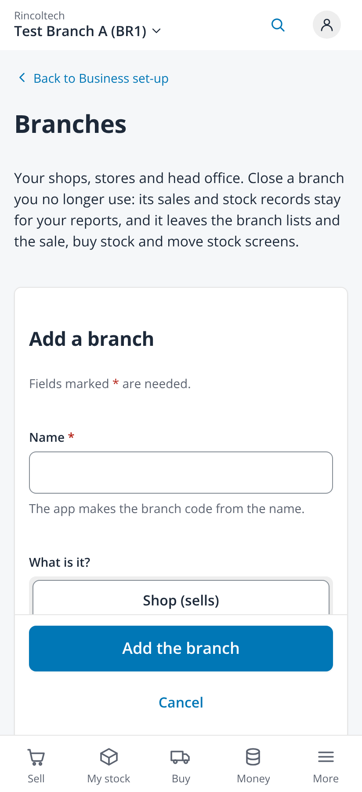
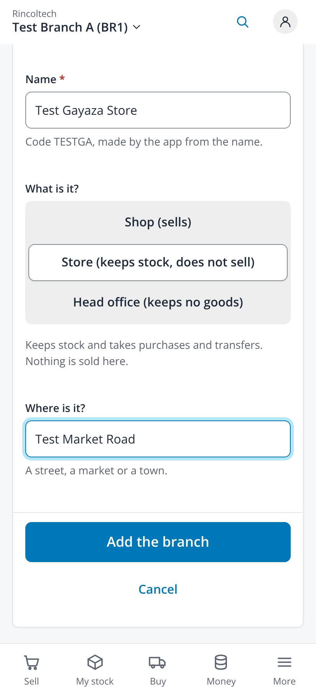
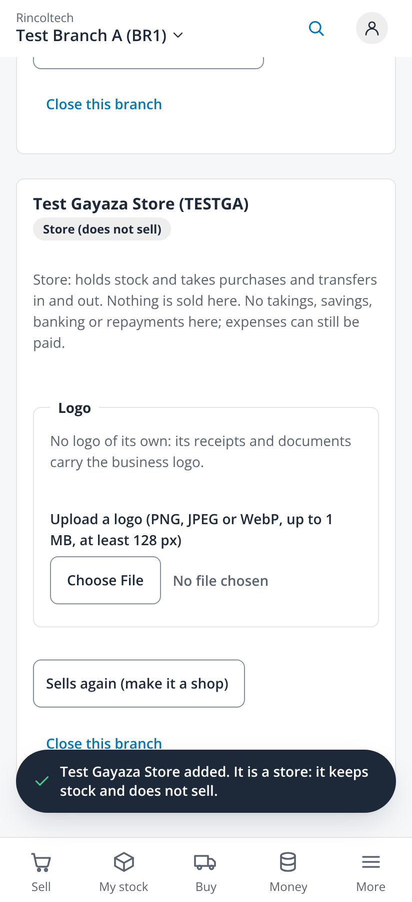
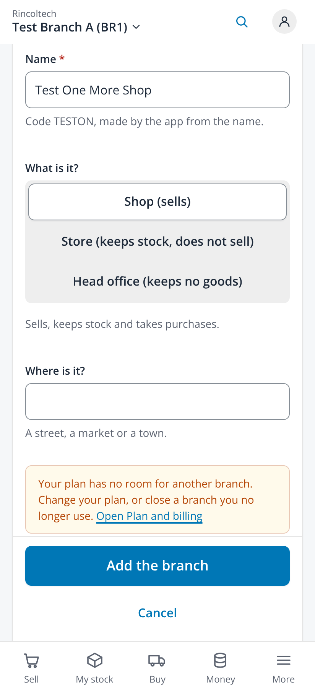

# Add a branch (issue #581)

Taken on 2026-10-25 from `npm run dev` with `VITE_DEV_TENANT=demo VITE_RETAIL_MOCK=1` (fabricated administrator session, no backend)
in headless Chromium at 412x900, 2x, with touch and reduced motion. `/api/v1/branches` was answered by the capture script with
fabricated branches, and the mock administrator was given `core.branches.read` and `core.branches.manage` for the capture only. No
page scrolled sideways (scroll width 412 on every capture).

| File | Screen |
|---|---|
| `01-branches-add-a-branch-button-412` | Branches: Add a branch at the top, for whoever holds `core.branches.manage` |
| `02-add-a-branch-form-empty-412` | The form: "Fields marked * are needed.", Name *, the code hint, What is it? |
| `03-add-a-branch-store-chosen-code-shown-412` | Store chosen on the segmented control, its hint, and the code the app makes from the name |
| `04-store-added-dark-toast-412` | The dark toast "Test Gayaza Store added. It is a store: it keeps stock and does not sell." and the new store in the list |
| `05-plan-full-link-to-plan-and-billing-412` | A full plan in plain words with Open Plan and billing, no raw refusal |

| Form | Store chosen | Added | Plan full |
|---|---|---|---|
|  |  |  |  |
