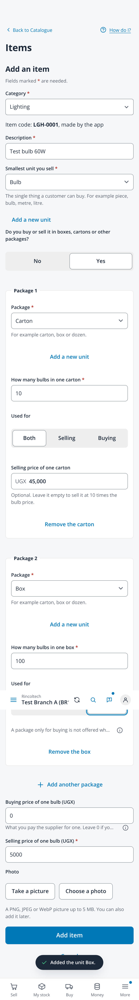
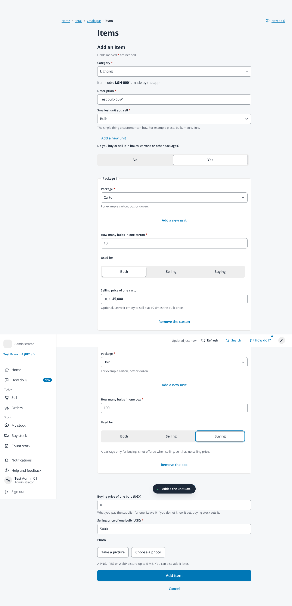

# Add an item with its packages (issue #689)

Taken on 2026-10-29 from `npm run dev` with `VITE_DEV_TENANT=demo VITE_RETAIL_MOCK=1 VITE_RETAIL_MOCK_CAPS=units` (fabricated
administrator session, no backend) in headless Chromium. Full page captures, so the fixed top bar and menu show part way down.
The item, units and prices are made up: Test bulb 60W counted in Bulb, a carton of 10 for both at UGX 45,000 and a box of 100
only for buying. Bulb, Carton and Box were added with Add a new unit, so the toast of the last one shows. No page scrolled
sideways.

| File | Screen |
|---|---|
| `add-item-packages-412` | Phone, 412px wide, 2x, with touch |
| `add-item-packages-1366` | Laptop, 1366px wide |

| Phone | Laptop |
|---|---|
|  |  |
