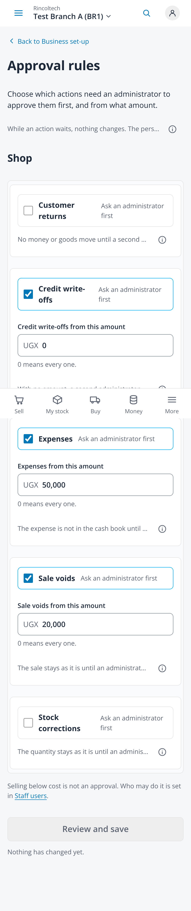
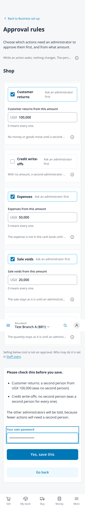
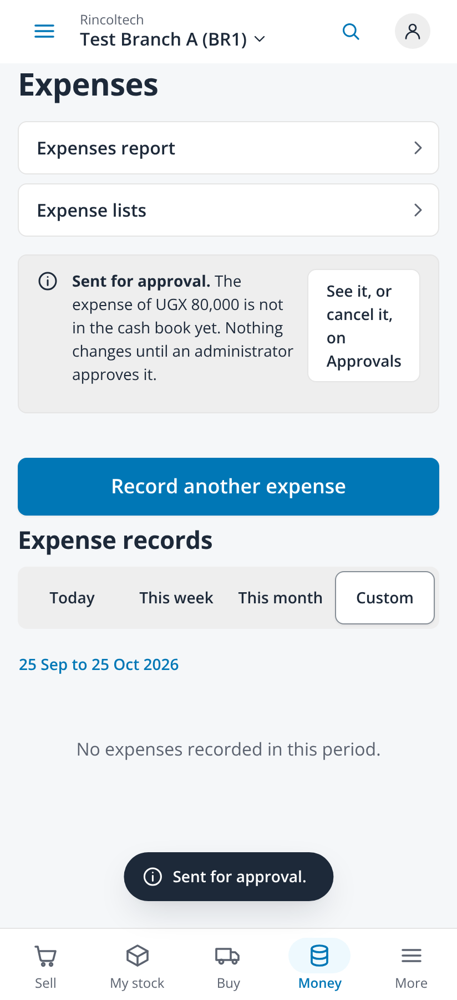

# Approval rules (issue #343, ADR-091)

Taken on 2026-10-25 from `npm run dev` with `VITE_DEV_TENANT=demo VITE_RETAIL_MOCK=1
VITE_RETAIL_MOCK_APPROVALS=retail_sale_void,retail_stock_correction,retail_expense` (fabricated administrator session, no
backend) in headless Chromium at 2x with reduced motion, the phone at 412x900 with touch. `GET` and `PUT /settings/approvals` and
the approvals list were answered by the browser script with fabricated rules in the shape of the generated schema. No page
scrolled sideways (scroll width 412 on every capture).

| File | Screen |
|---|---|
| `01-approval-rules-412` | The shop's actions: a switch each, the amount while on, one Hint line on what happens while it waits, the below-cost note |
| `02-approval-rules-review-412` | Review: each change read back, the others will be told, the administrator's own password |
| `03-approval-rules-saved-412` | Saved, and the other administrators were told |
| `04-approvals-in-words-412` | Approvals names each action in words: Void a sale, Record an expense |
| `05-expense-waits-412` | An expense worth the amount: Sent for approval, not in the cash book yet, See it, or cancel it, on Approvals |
| `06-stock-correction-waits-412` | A stock correction worth the amount: Sent for approval, the quantity unchanged |

| Rules | Review | Waiting |
|---|---|---|
|  |  |  |
