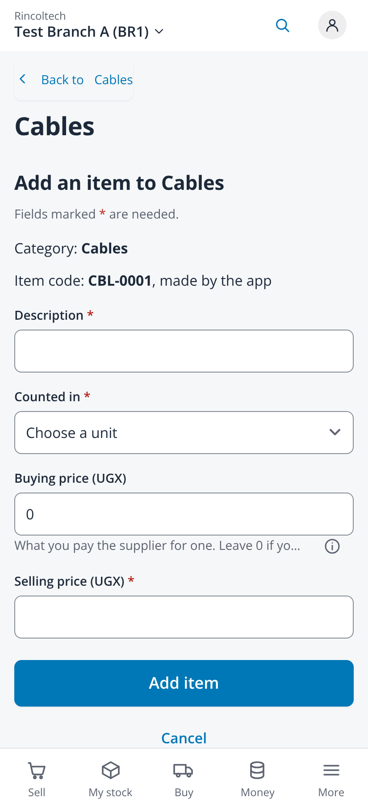
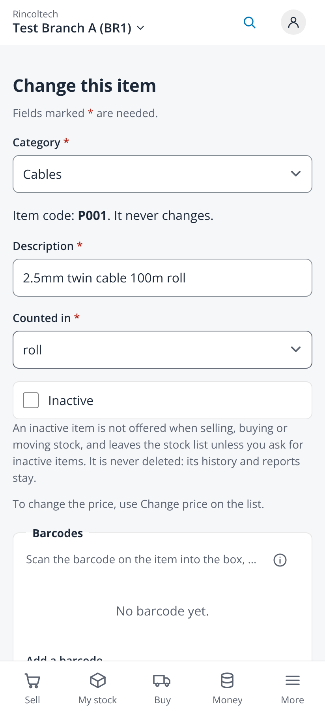
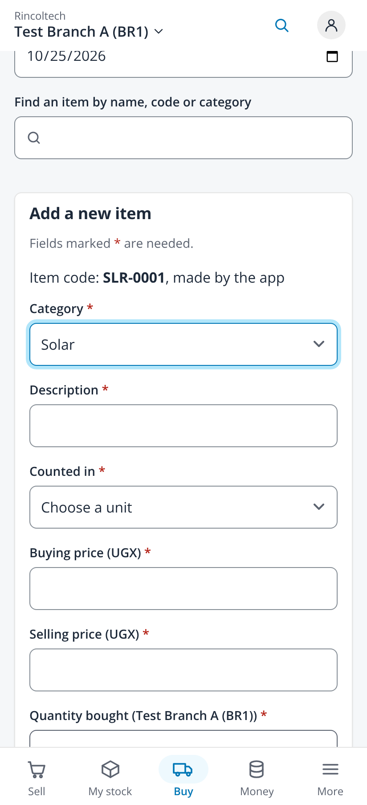
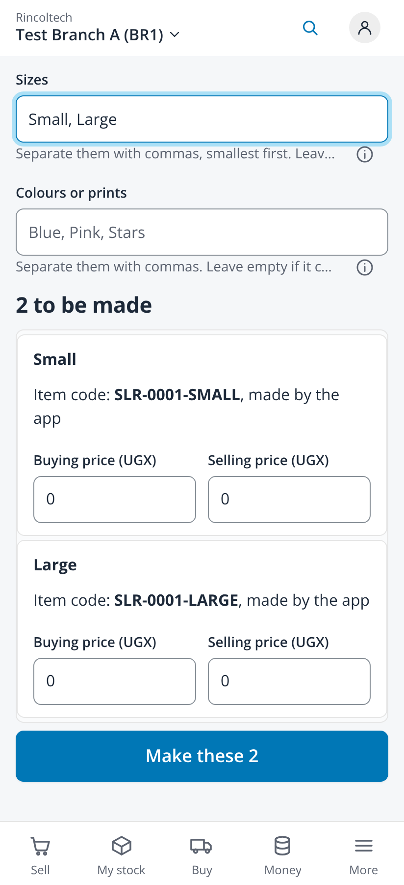

# The app always makes the item code of a new item (issue #562)

Taken on 2026-10-25 from `npm run dev` with `VITE_DEV_TENANT=demo VITE_RETAIL_MOCK=1` (fabricated administrator session, no backend)
in headless Chromium at 412x900, 2x, with touch and reduced motion. No page scrolled sideways (scroll width 412 on every capture).
Every item and code is fabricated by the mock.

| File | Screen |
|---|---|
| `01-new-category-code-start-shown-412` | Add a category: the code start the app makes from the name is shown, not asked |
| `02-category-add-item-code-made-by-app-412` | Add an item inside Cables: "Item code: CBL-0001, made by the app", no code box |
| `03-category-item-added-with-code-412` | The item saved, with the code the app gave it |
| `04-items-add-before-category-412` | Add an item on Items before a category is chosen: the code is made once you choose it |
| `05-items-add-category-chosen-412` | The category chosen: its next code is shown |
| `06-edit-item-code-never-changes-412` | Change this item: "Item code: P001. It never changes." |
| `07-buy-stock-new-item-code-412` | Buy stock, Not in the list? Add it here: the code as text above the category |
| `08-sizes-codes-made-by-app-412` | Add an item with sizes and colours: no short code box, each size's code made by the app |
| `10-import-make-codes-412` | Import items: Let the app make the codes, unticked by default, here ticked and checked |

| Add in a category | Edit | Buy stock | Sizes |
|---|---|---|---|
|  |  |  |  |

The import keeps a file's codes unless "Let the app make the codes" is ticked (owner decision D45); see `10-import-make-codes-412`.
