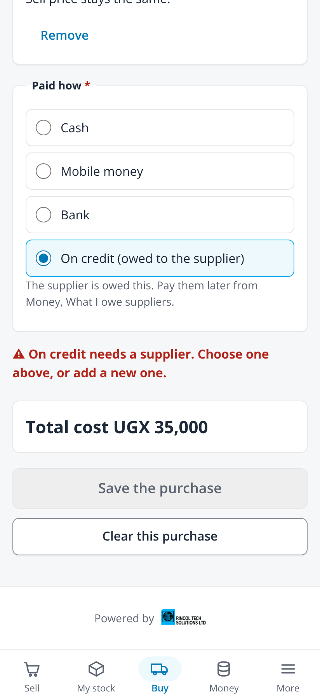
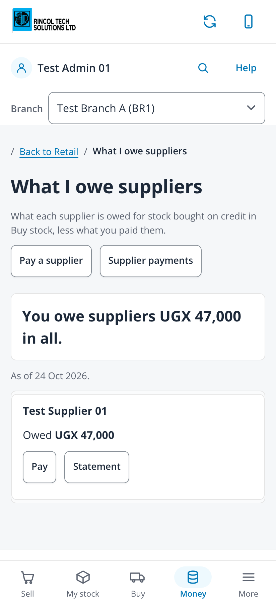
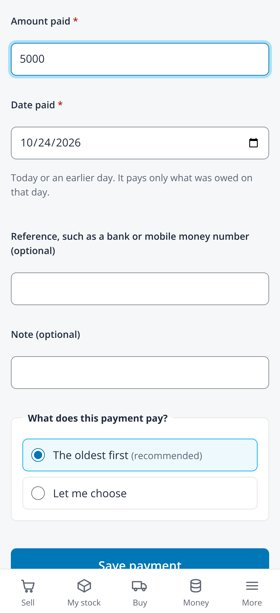
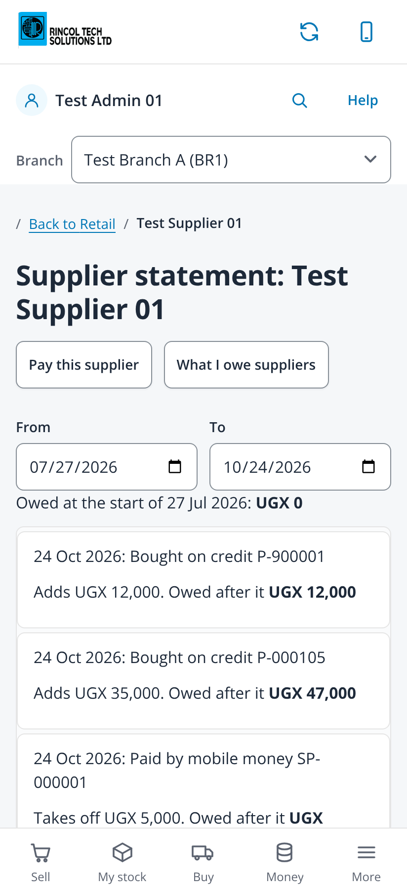

# Buy on credit, what I owe suppliers, pay a supplier, supplier statement (issue #557)

Taken on 2026-10-24 from `npm run dev` with `VITE_DEV_TENANT=demo VITE_RETAIL_MOCK=1` (fabricated administrator session, no backend)
in headless Chromium at 412x900, 2x, with touch and reduced motion. The mock session has no capabilities, so the purchasing
capability is off, which is the case this issue is for. The mock starts with one fabricated credit purchase (P-900001); the
walk-through bought 10 bulbs on credit from Test Supplier 01, paid 5,000 by mobile money and opened the statement. No page scrolled
sideways (scroll width 412 on every capture).

| File | Screen |
|---|---|
| `01-buy-stock-on-credit-needs-supplier-412` | Buy stock, Paid how (required) with On credit chosen and no supplier: the hint and "On credit needs a supplier" |
| `02-buy-stock-on-credit-ready-412` | The supplier chosen: Save the purchase is enabled |
| `03-money-tab-412` | The Money tab lists What I owe suppliers |
| `04-what-i-owe-suppliers-412` | The total first, then each supplier with what is owed, Pay and Statement |
| `05-pay-a-supplier-412` | Pay a supplier: amount and Date paid required, today at first |
| `06-payment-saved-412` | The payment saved |
| `07-what-i-owe-after-payment-412` | The balance after the payment |
| `08-supplier-statement-412` | The statement: owed at the start, each purchase and payment with the running balance |
| `09-supplier-statement-share-412` | The end of the statement and Share the statement |

| On credit, no supplier | What I owe | Pay a supplier | Statement |
|---|---|---|---|
|  |  |  |  |
