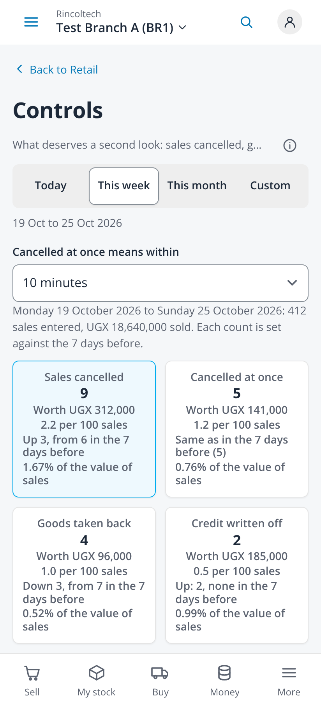
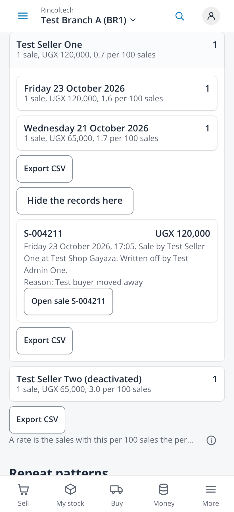
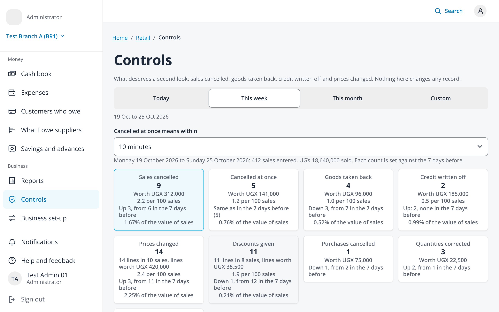

# Controls: credit written off and the menu entry (issue #357, ADR-087)

Taken on 2026-10-25 from `npm run dev` with `VITE_DEV_TENANT=demo VITE_RETAIL_MOCK=1` (fabricated administrator session, no
backend) in headless Chromium at 2x with reduced motion, the phone at 412x900 with touch and the laptop at 1280x800. The four
`/api/v1/retail/controls/*` routes were answered by the browser script with fabricated figures in the shape of the generated
schema (the retail mock has no Controls data). The session has one shop chosen, so the shop level of Group by is left out. No
page scrolled sideways (scroll width 412 and 1280 on every capture).

| File | Screen |
|---|---|
| `01-controls-cards-412` | Phone: the days, then the cards; Credit written off after Goods taken back, with its rate, trend and share |
| `02-controls-write-offs-opened-412` | Phone: Credit written off by person, a seller opened by day, and the record: "Written off by ...", the reason and Open sale |
| `01-controls-cards-1280` | Laptop: the grouped menu (#564) and the cards four across |
| `03-controls-in-business-menu-1280` | Laptop: the menu scrolled to Business: Reports, Controls (current; Reports is not), Business set-up |
| `02-controls-write-offs-opened-1280` | Laptop: the same opened groups and record |

| Phone cards | Phone record | Laptop |
|---|---|---|
|  |  |  |
