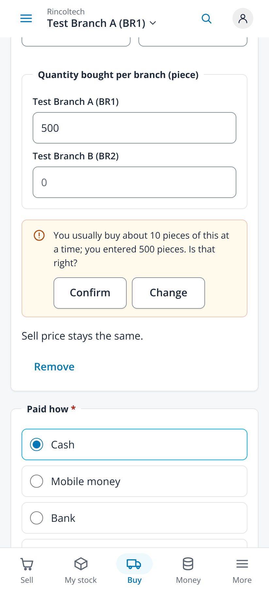
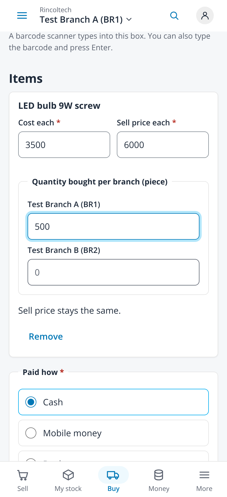
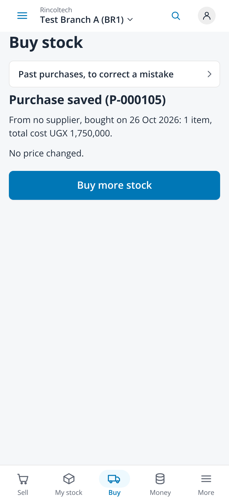
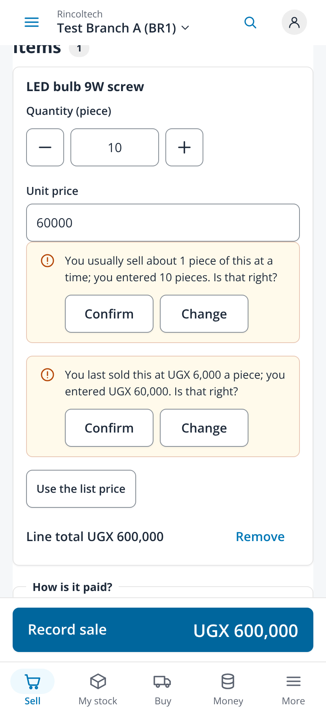
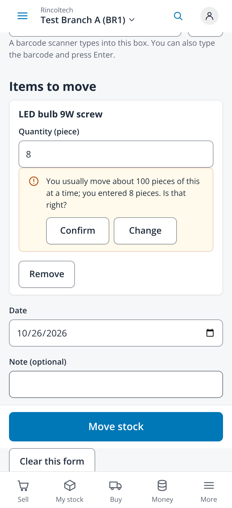
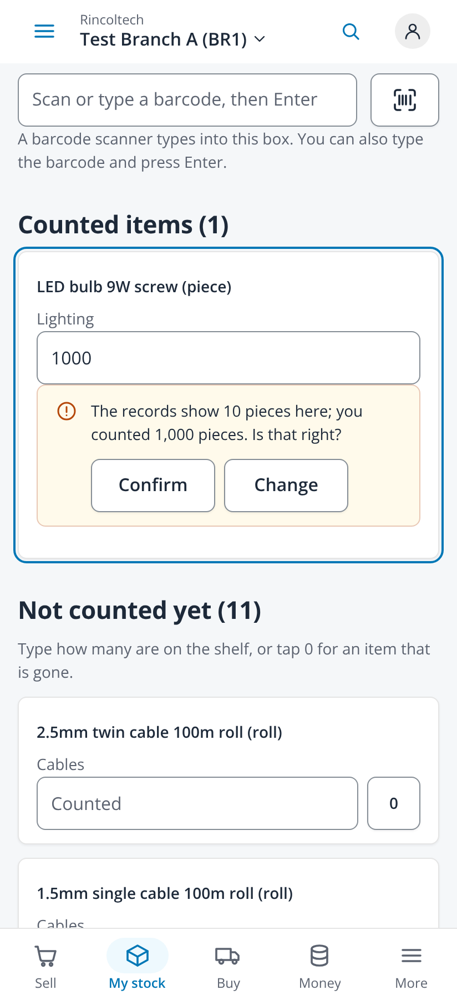
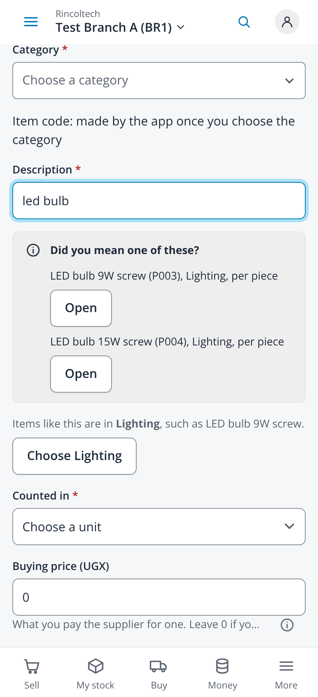
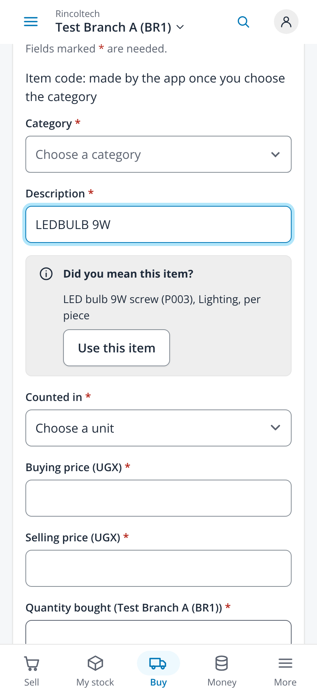

# Entry warnings and name hints (issue #353)

Taken on 2026-10-25 from `npm run dev` with `VITE_DEV_TENANT=demo VITE_RETAIL_MOCK=1` (fabricated administrator session, no backend)
in headless Chromium at 412x900, 2x, with touch and reduced motion. The mock keeps no entry history of its own, so for these captures
LED bulb 9W screw was given a fabricated one through `setMockEntryNorms` (bought about 10 at a time, sold one at a time at UGX 6,000,
moved about 100 at a time); the records hold 10 at Test Branch A. No page scrolled sideways.

| File | Screen |
|---|---|
| `01-buy-stock-quantity-412` | Buy stock, 500 typed and Save pressed: the warning next to the quantity, with Confirm and Change; Save the purchase stays usable |
| `02-buy-stock-change-keeps-the-form-412` | Change pressed: the warning goes, the cursor is in the quantity, 500 is kept and nothing is saved |
| `03-buy-stock-confirmed-and-saved-412` | Save pressed again and Confirm: the confirmation is recorded and the purchase saved |
| `04-sell-quantity-and-price-412` | Sell, 10 at a price typed as UGX 60,000: a warning on the quantity and one on the price, each with Confirm and Change |
| `05-move-stock-quantity-412` | Move stock, 8 where about 100 are moved |
| `06-count-stock-against-records-412` | Count stock, 1,000 counted where the records show 10 |
| `07-add-item-did-you-mean-and-category-412` | Add an item, "led bulb" typed: Did you mean with Open on each, and Choose Lighting, chosen only by a tap |
| `08-buy-stock-new-item-use-this-item-412` | Not in the list? Add it here on Buy stock, "LEDBULB 9W" typed: Use this item puts the existing item on the purchase |

| Buy stock | Change | Saved | Sell | Move stock | Count stock | Add an item | New item on Buy stock |
|---|---|---|---|---|---|---|---|
|  |  |  |  |  |  |  |  |
