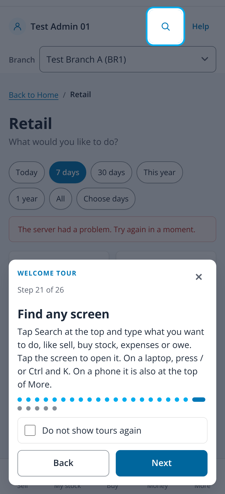
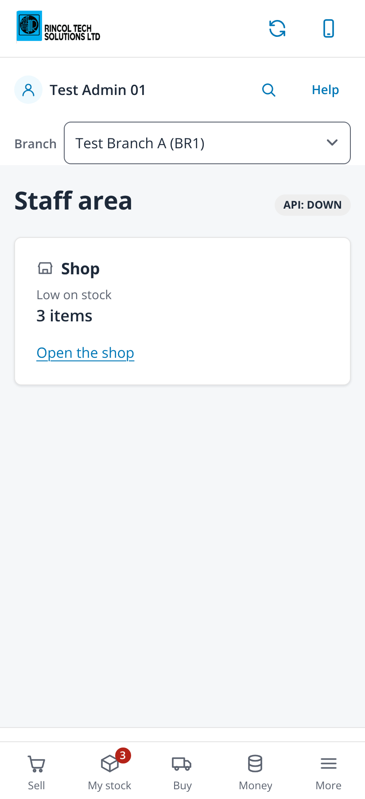
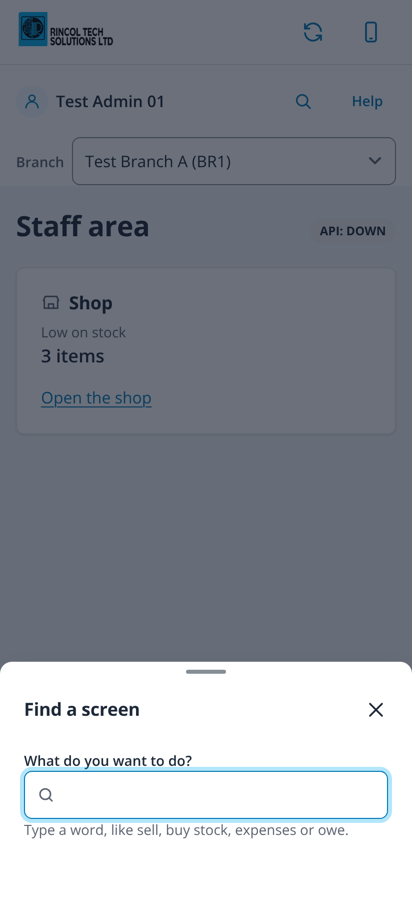
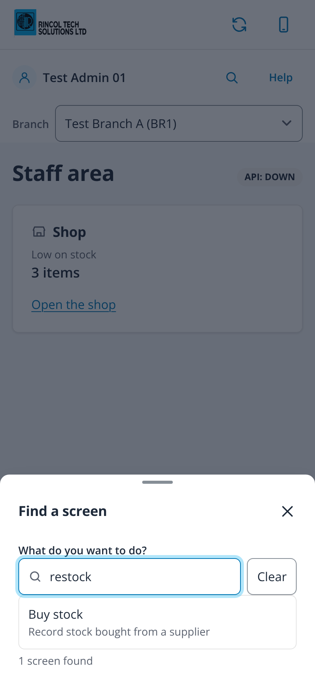
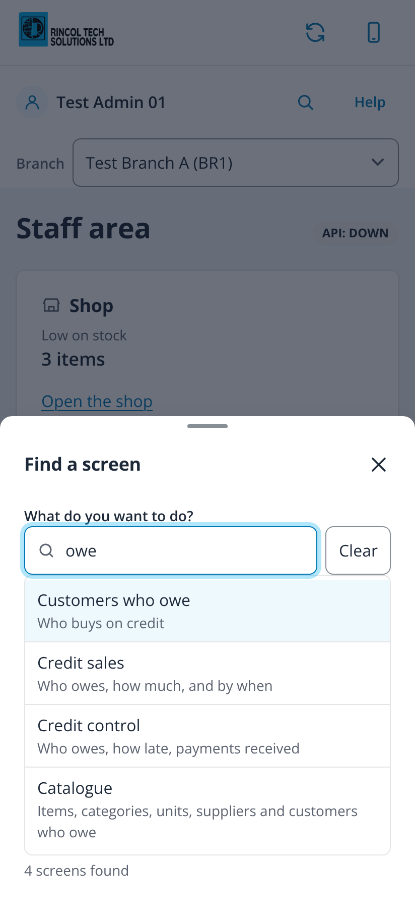
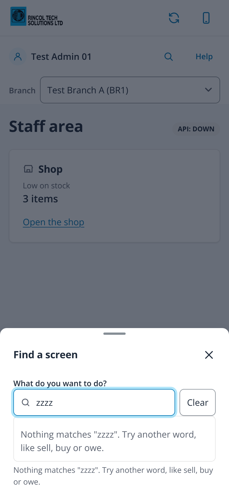
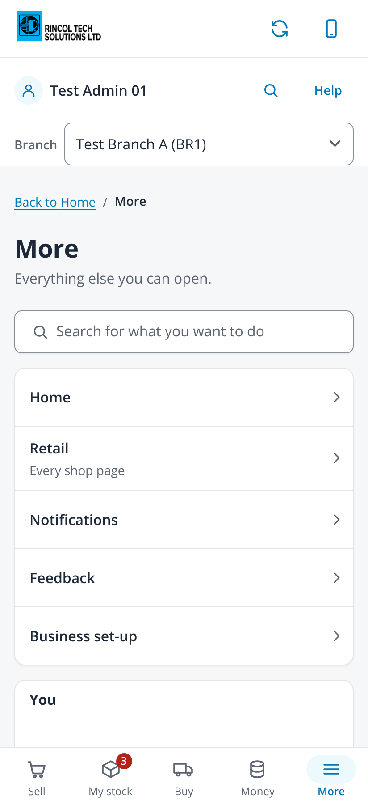
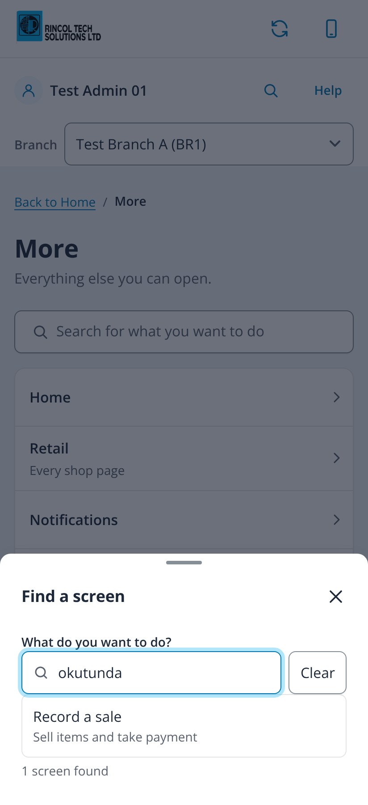

# Feature search: find any screen by typing what you want to do (issue #551)

Taken on 2026-10-24 from `npm run dev` with `VITE_DEV_TENANT=demo VITE_RETAIL_MOCK=1` (fabricated administrator session, no
backend) in headless Chromium at 412x900, 2x, with touch and reduced motion. The Home summary was answered with fabricated
figures and every other API read refused, as in the #539 captures, so Home says the API is down. No page scrolled sideways, the
Search button is 48x48px, and every option of the list is at least 48px tall.

| File | Screen |
|---|---|
| `00-tour-step-412` | The welcome tour's new Find any screen step, lighting up the Search button in the staff bar |
| `01-staff-bar-412` | The staff bar on a phone: the Search icon beside Help (named Search for a screen reader) |
| `02-sheet-empty-412` | The sheet just opened: the box has the cursor, the hint suggests words, no list until something is typed |
| `03-typing-restock-412` | "restock" typed: the match-only synonym finds Buy stock, which shows under its glossary name only |
| `04-typing-owe-412` | "owe" typed, Down pressed: the first match highlighted, the status line says how many screens |
| `05-no-match-412` | A word that matches nothing says so and suggests other words |
| `06-more-page-412` | The More page starts with the same search, full width |
| `07-more-luganda-412` | "okutunda" (to sell) typed from the More page finds Record a sale |

| Tour step | Staff bar | Sheet, empty | Typing "restock" |
|---|---|---|---|
|  |  |  |  |

| Typing "owe" | No match | More page | Luganda |
|---|---|---|---|
|  |  |  |  |
