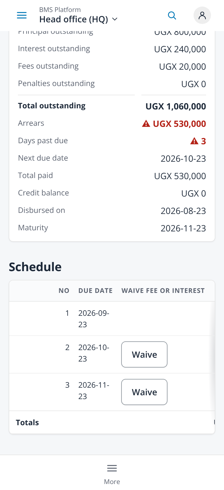
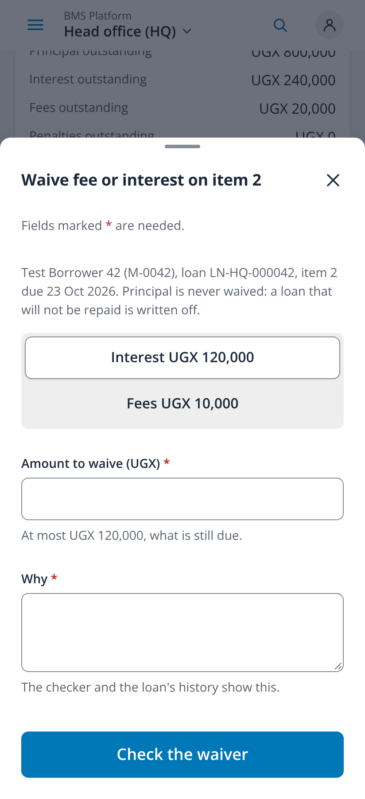
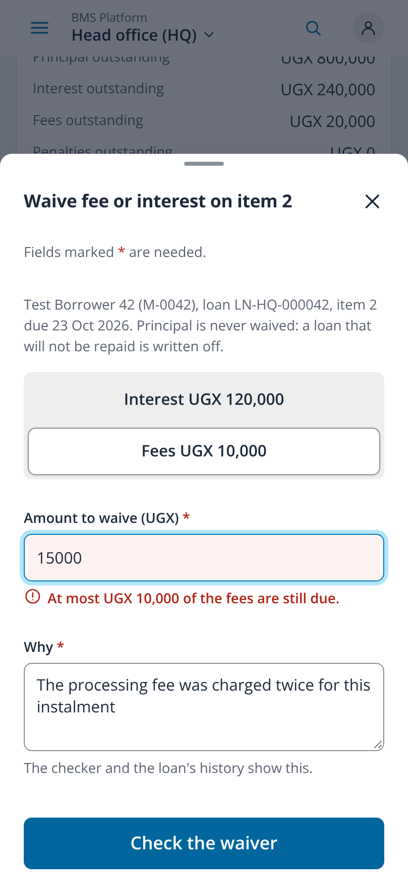
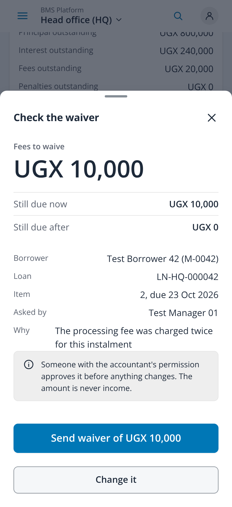
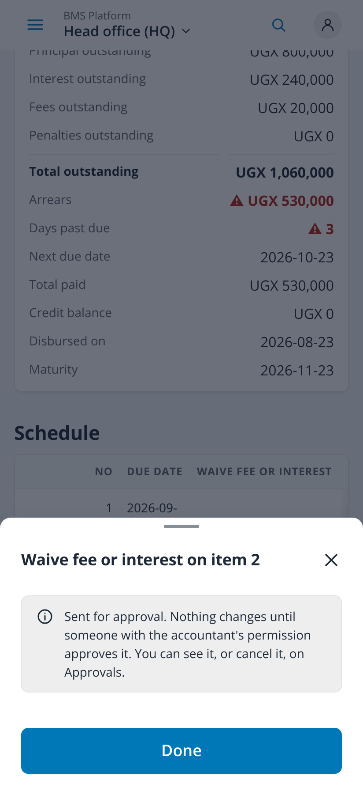
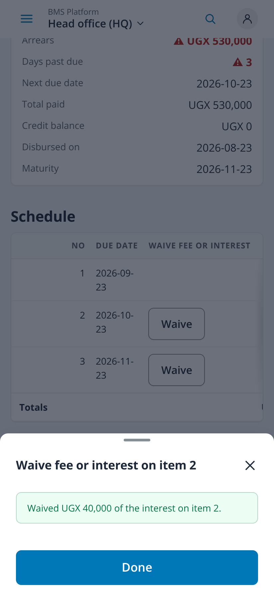

# Waive fee or interest on a schedule row (issue #265, FR-ARR-04)

Taken on 2026-10-26 from `npm run dev` with `VITE_DEV_TENANT=demo` in headless Chromium at 412x900, 2x, with touch and reduced
motion. Every `/api/v1` call was answered by the capture script with fabricated demo data (Test Borrower 42, loan LN-HQ-000042,
three monthly items of UGX 400,000 principal, UGX 120,000 interest and UGX 10,000 fees, item 1 paid); no backend and no real data.
Captures 01 to 05 are a branch manager (may ask, not the accountant: the waiver waits); 06 and 07 an accountant under the
business's approval amount (it is waived at once). No page scrolled sideways (scroll width 412 on every capture).

| File | Screen |
|---|---|
| `01-schedule-row-action-412` | The schedule: Waive on each row with fees or interest still due (item 1 is paid and has none), 48px |
| `02-waive-form-412` | The sheet: borrower, loan and item, "principal is never waived", Interest or Fees with what is still due on each, the amount and why |
| `03-amount-above-what-is-due-412` | Fees chosen and 15,000 typed: the error under the field says at most UGX 10,000 is still due; nothing is sent |
| `04-review-who-how-much-why-412` | The review before sending: the amount large, what is due now and after, the borrower, loan, item, who asks and why, and who approves |
| `05-sent-for-approval-412` | Sent: nothing changes until someone with the accountant's permission approves it, on Approvals |
| `06-accountant-review-412` | The accountant's review: below the approval amount it is waived at once |
| `07-accountant-waived-at-once-412` | Waived at once, in words |

| Row action | Form | Too much | Review | Sent | Waived |
|---|---|---|---|---|---|
|  |  |  |  |  |  |
