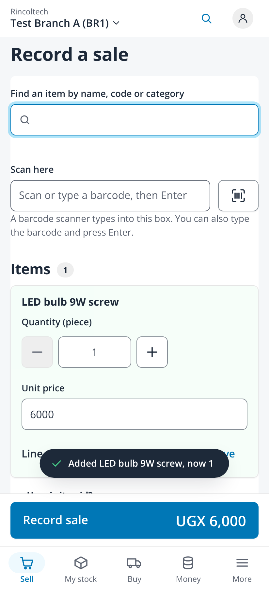
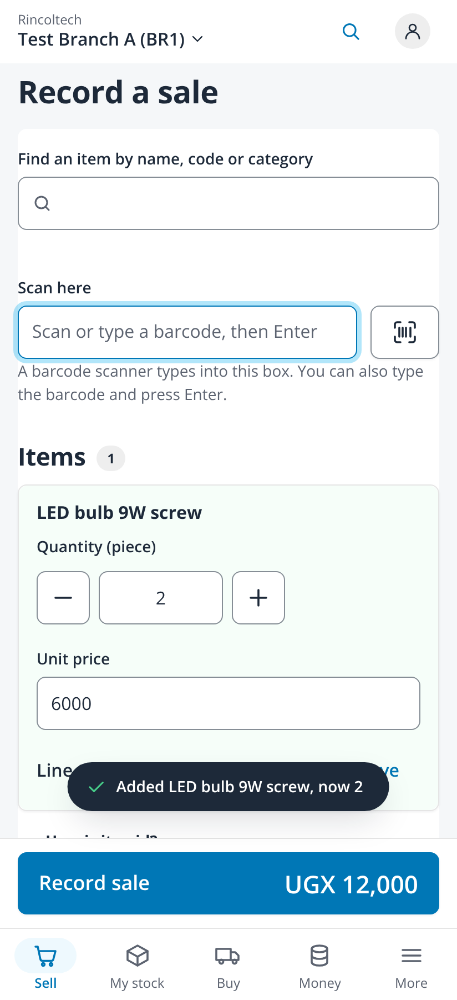
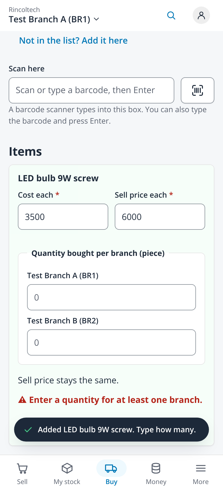
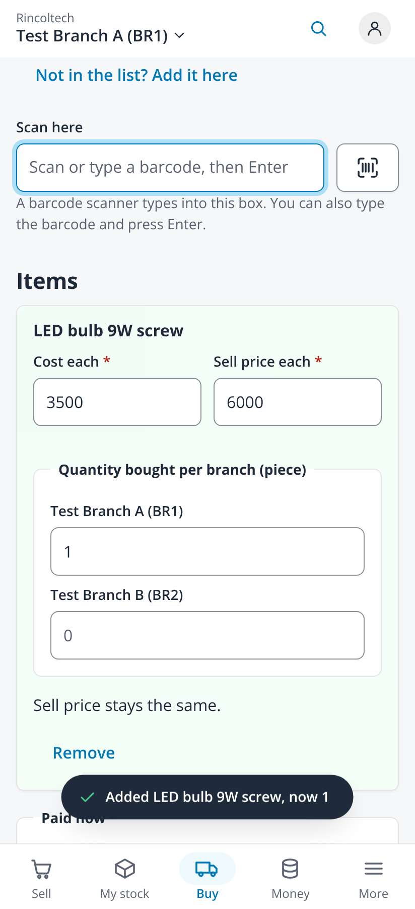
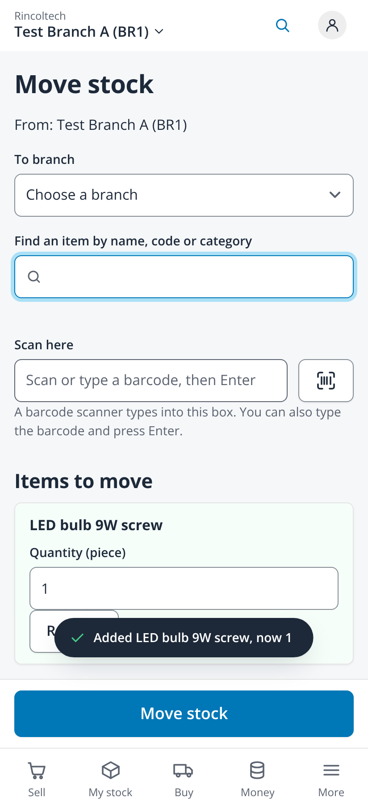
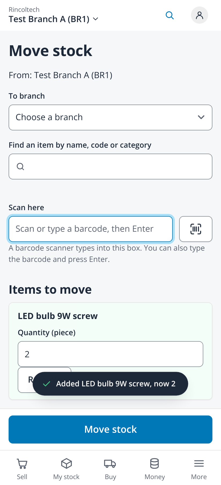
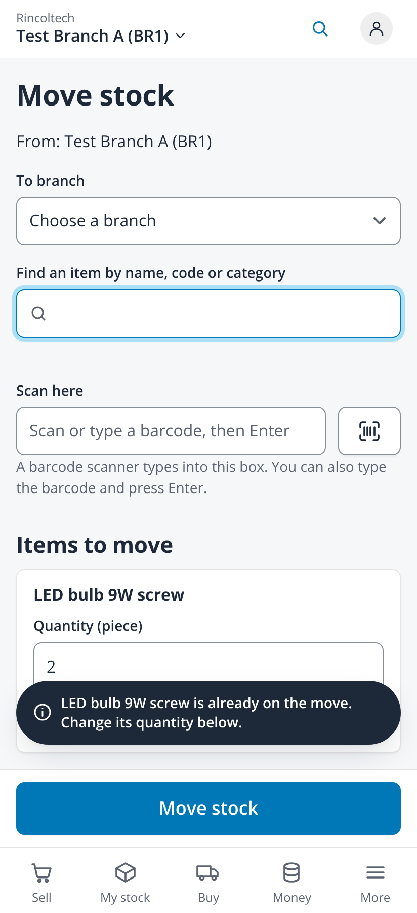
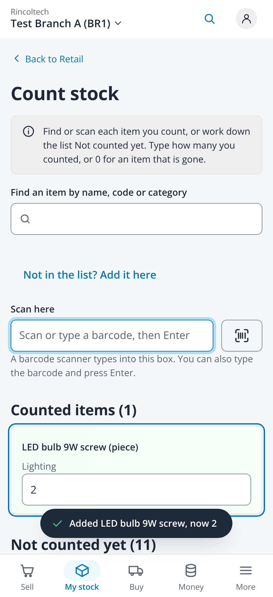

# Show that an item was added (issue #498)

Taken on 2026-10-25 from `npm run dev` with `VITE_DEV_TENANT=demo VITE_RETAIL_MOCK=1` (fabricated administrator session, no backend)
in headless Chromium at 412x900, 2x, with touch. Motion was left on, so each capture is taken about 120ms into the line's flash
(the faint green tint behind the line). LED bulb 9W screw was given a made-up barcode, which was typed into the Scan box and
Entered, the path a scanner and the camera take. No page scrolled sideways.

| File | Screen |
|---|---|
| `01-sell-picked-412` | Sell, picked from the search: "Added LED bulb 9W screw, now 1" and the new line flashing |
| `02-sell-scanned-412` | Sell, then scanned: "now 2", the line flashing again, the quantity 2 |
| `03-buy-stock-picked-412` | Buy stock, picked: no quantity yet, so "Added LED bulb 9W screw. Type how many." |
| `04-buy-stock-scanned-412` | Buy stock, then scanned: "now 1" at the branch at the top, the line flashing |
| `05-move-stock-picked-412` | Move stock, picked: "now 1" |
| `06-move-stock-scanned-412` | Move stock, then scanned: "now 2", the toast above the sticky Move stock bar |
| `07-move-stock-already-412` | Move stock, picked again: the info toast "already on the move", no check and no flash |
| `08-count-stock-scanned-412` | Count stock, scanned twice: "now 2" and the counted line flashing |

| Sell picked | Sell scanned | Buy picked | Buy scanned |
|---|---|---|---|
|  |  |  |  |

| Move picked | Move scanned | Already on the move | Count scanned |
|---|---|---|---|
|  |  |  |  |
