# Item picker on search, and Share receipt above New sale (issue #534)

Taken on 2026-10-24 from `npm run dev` with `VITE_DEV_TENANT=demo VITE_RETAIL_MOCK=1` (fabricated session and items, no
backend) in headless Chromium with reduced motion, at 412x900 and 360x800. Each file has a `-412` and a `-360` copy. No
screen scrolled sideways and no option of the list was under 48px.

| File | Screen |
|---|---|
| `01-sale-empty` | Record a sale before anything is typed: the search box and the Scan box, no list of items |
| `02-sale-typing` | "bulb" typed: the short list under the box, the typed word marked, the price and the stock here, a negative balance flagged |
| `03-sale-after-pick` | Two items picked (a tap, then Down and Enter): the box empty, the list closed, the cursor back in the box |
| `04-count-stock-typing` | Stock-take with "cable" typed: the matches of the count sheet under the box, over the list Not counted yet |
| `04b-count-stock-after-pick` | The picked item at the head of Not counted yet, marked, with the cursor in its count box; the search empty and closed |
| `04c-count-stock-counting` | The whole page during a count (owner decision on #535): Counted items, Not counted yet with a 0 on each line, and the question before finishing with lines left |
| `05-sale-complete` | The sale-complete screen, the whole page: Share receipt first as the main action, New sale below the receipt actions |

## The captures at 412 wide

| Record a sale, empty | Typing | After pick |
|---|---|---|
| 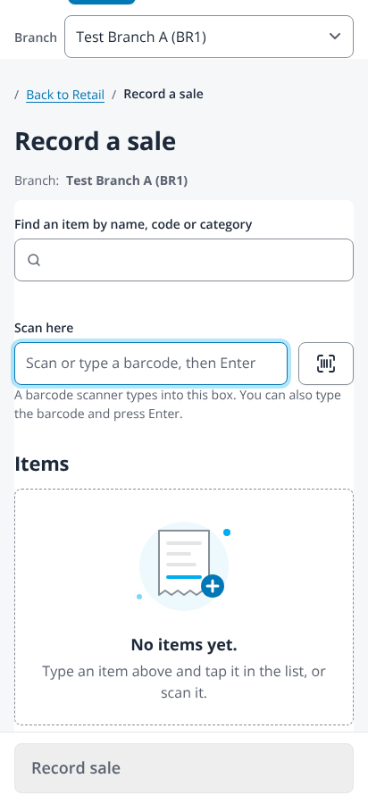 | 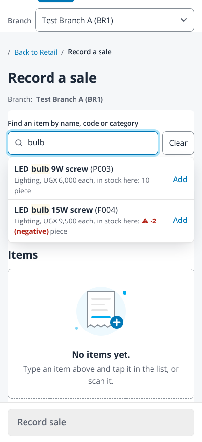 | 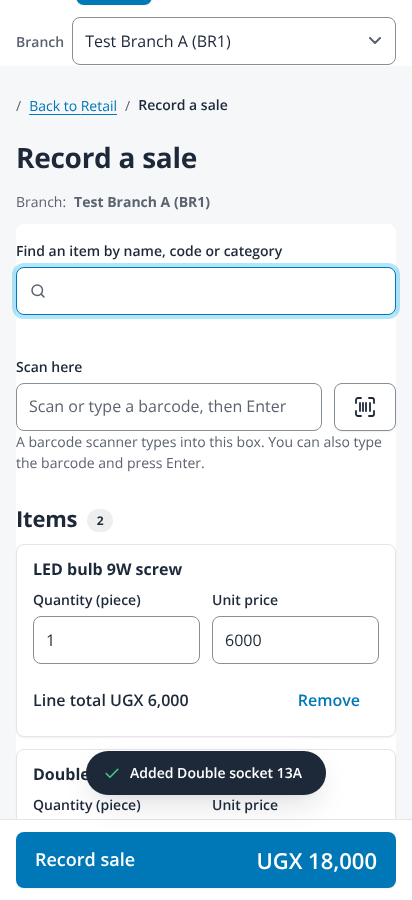 |

| Count stock, typing | Count stock, after pick | Count stock, counting | Sale complete |
|---|---|---|---|
| 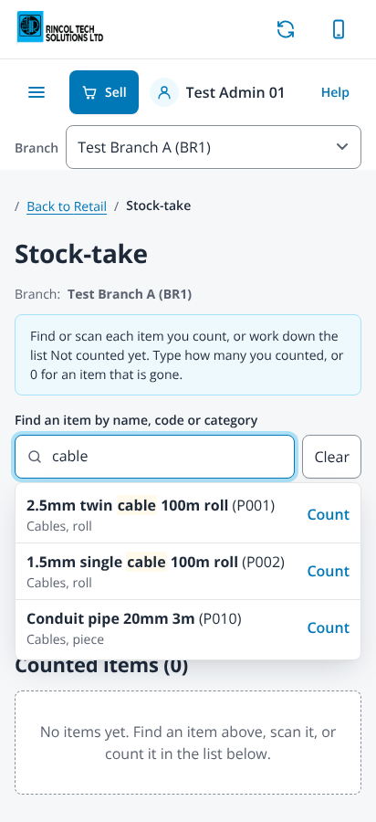 | 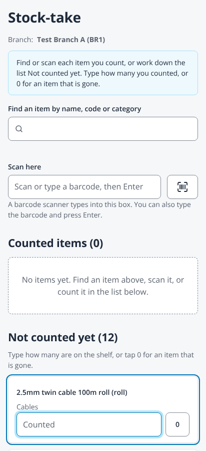 | 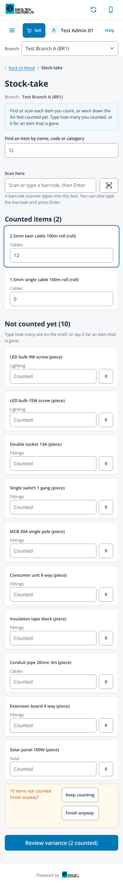 | 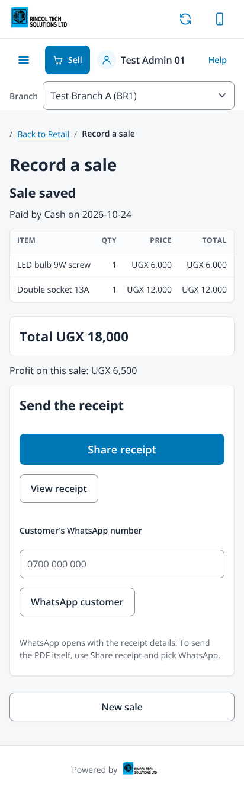 |

## The captures at 360 wide

| Record a sale, empty | Typing | After pick |
|---|---|---|
| 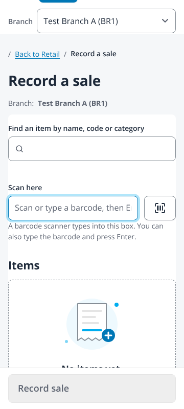 | 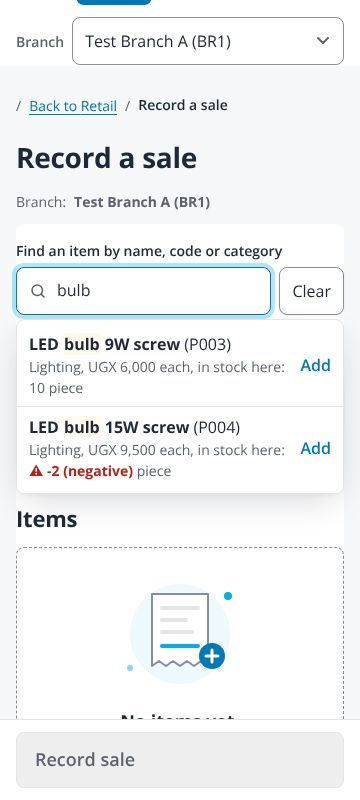 | 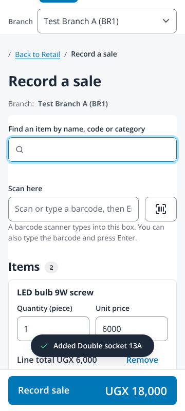 |

| Count stock, typing | Count stock, after pick | Count stock, counting | Sale complete |
|---|---|---|---|
| 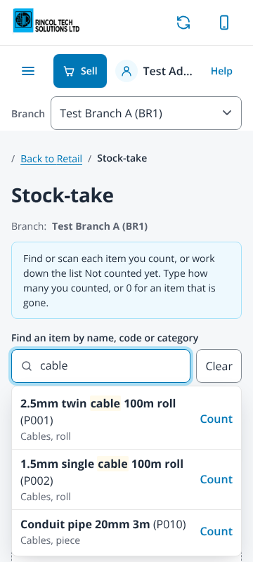 | 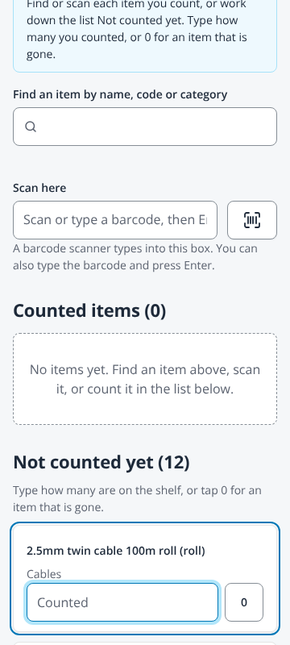 | 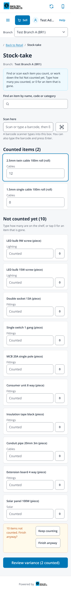 | 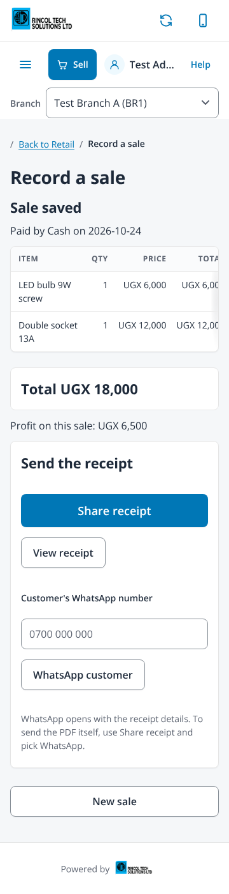 |
