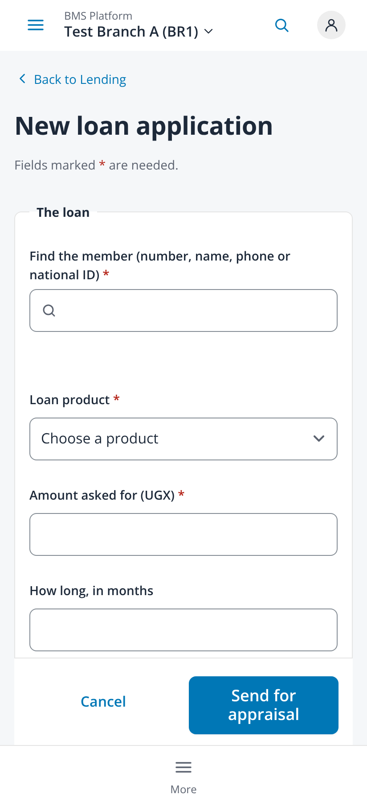
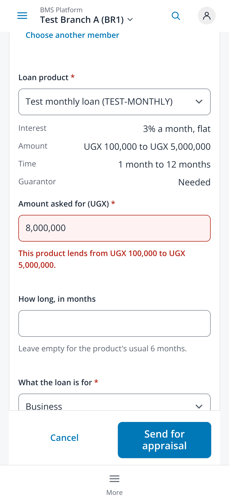
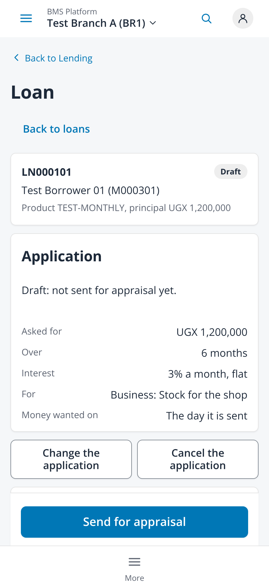
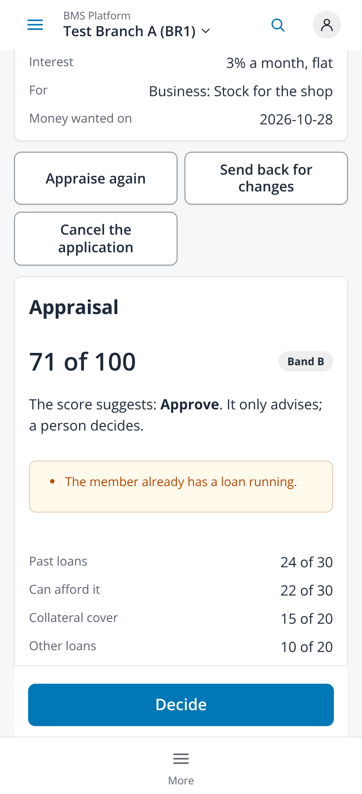
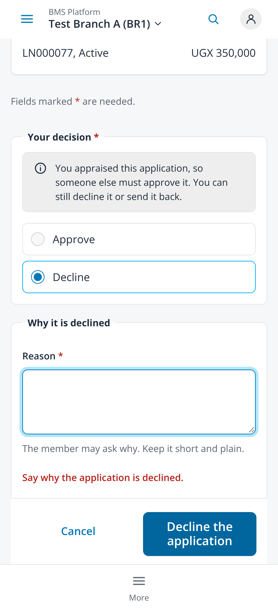

# Loan application, appraisal and decision (issue #280 slices 3 and 4, issue #289)

Taken on 2026-10-25 from `npm run dev` with `VITE_DEV_TENANT=demo` in headless Chromium at 412x900, 2x, with touch and reduced
motion. Every `/api/v1` call was answered by the capture script with fabricated data (Test Borrower 01, Test Guarantor 01, a test
product and round amounts); no backend and no real data. The session held the lending loan, member and collateral permissions
for the capture. No page scrolled sideways (scroll width 412 on every capture).

| File | Screen |
|---|---|
| `01-loans-new-loan-application-412` | Loans: New loan application at the top, for whoever may create a loan and find members |
| `02-new-application-empty-412` | The form: "Fields marked * are needed.", the member search and the product, no error before Send |
| `03-new-application-errors-under-fields-412` | Send pressed with nothing filled: the summary line and each error under its field |
| `04-product-limits-and-amount-error-412` | The product's interest, amount and time limits, and an amount above the limit said under the field on leaving it |
| `05-guarantor-and-collateral-412` | A guarantor found by searching with the amount they guarantee, and the member's plot ticked as collateral |
| `06-draft-send-for-appraisal-sticky-412` | A draft on the loan page: where it stands, its terms, and Send for appraisal in the sticky bar |
| `07-appraise-412` | Appraise: the largest payment, income (empty uses the member's), other payments, visit notes |
| `08-appraised-score-and-decide-sticky-412` | An appraised application: score, band, the warning in words, the parts of the score, Decide in the sticky bar |
| `09-decide-approve-412` | Decide: Approve chosen, a smaller amount than asked, Approve the loan |
| `10-decide-maker-checker-and-reason-412` | The appraiser cannot approve (FR-APR-03): Approve off with the reason; Decline needs a reason, said under the field |
| `11-collateral-value-in-business-currency-kes-412` | Issue #289: a business in KES types a new item's value in KES, not UGX |
| `12-approved-loan-schedule-once-full-412` | An approved loan, the whole page: Disburse at the top, the application with its approved terms, the appraisal, and the payments it would mean shown once; the Schedule section only points to them (the bar in the middle is the fixed tab bar, drawn once by the full-page capture) |

| Form | Product limits | Draft | Appraised | Maker-checker |
|---|---|---|---|---|
|  |  |  |  |  |
