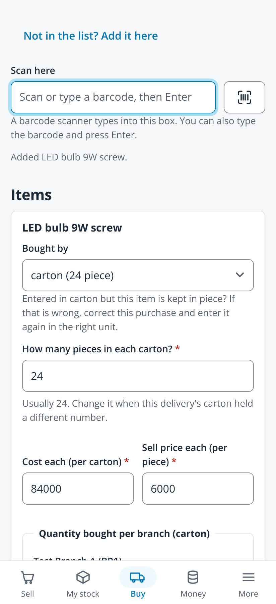
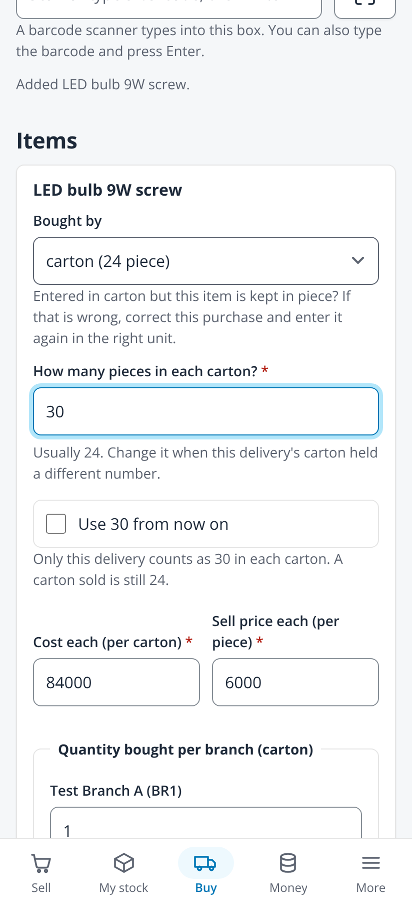
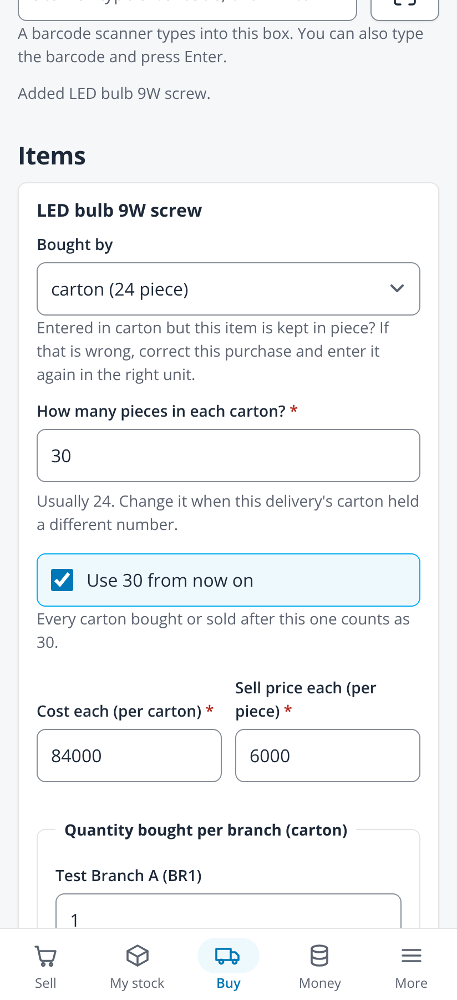
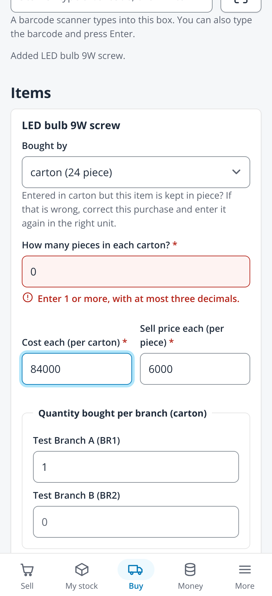
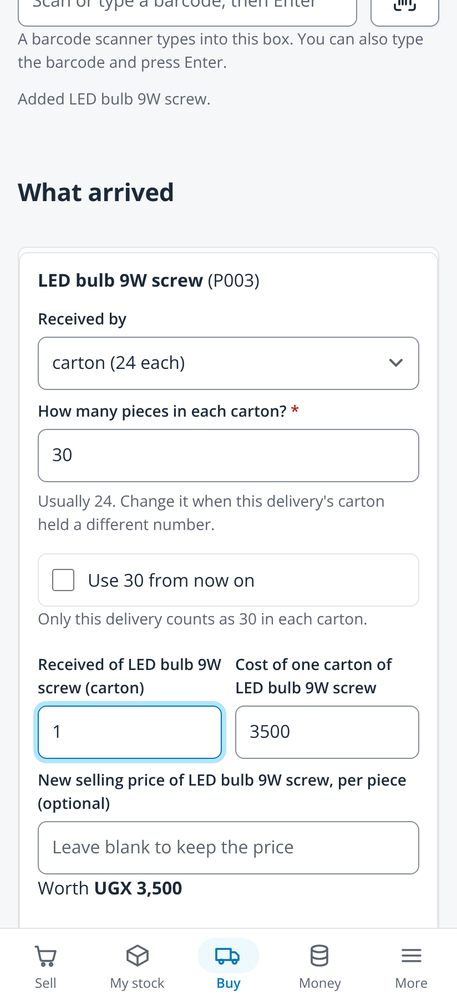

# A buying pack's size per delivery (issue #554)

Taken on 2026-10-24 from `npm run dev` with `VITE_DEV_TENANT=demo VITE_RETAIL_MOCK=1` (fabricated administrator session, no backend)
in headless Chromium at 412x900, 2x, with touch and reduced motion. The mock session does not report capabilities, so for these
captures only it was given the units and purchasing capabilities and its items carried their packs (a local change, not committed).
LED bulb 9W screw was given a carton of 24 and a carton barcode, which was scanned on each screen. No page scrolled sideways.

| File | Screen |
|---|---|
| `01-buy-stock-carton-scanned-412` | Buy stock after scanning the carton barcode: the carton chosen and How many pieces in each carton? filled with the usual 24, required |
| `02-buy-stock-thirty-412` | 30 typed: Use 30 from now on is offered, and the note says only this delivery counts as 30 while a carton sold is still 24 |
| `03-buy-stock-use-from-now-on-412` | Use 30 from now on ticked: every carton bought or sold after this one counts as 30 |
| `04-buy-stock-size-wrong-412` | 0 typed and the field left: the error under the field |
| `05-goods-received-thirty-412` | Receive goods without an order: the same question on the carton line |

| Scanned | 30 typed | Use from now on | Wrong size | Goods received |
|---|---|---|---|---|
|  |  |  |  |  |
